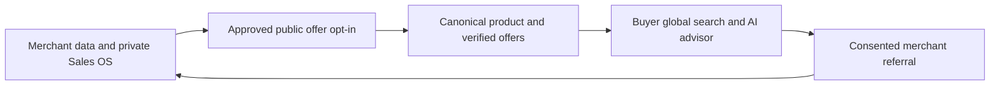

# 01 — ASOSIY BIZNES G‘OYA VA UCH BOSQICHLI YO‘L

**Versiya** v1.0 | **Sana** 2026-10-21 | **Status** Business baseline; real-life verification pending.

## Bir jumlada

**AI Commerce OS & Network** — Instagram, Telegram va veb orqali sotadigan mustaqil do‘konlarga katalog/ombor, avtomatik mini-sayt, AI sotuvchi, CRM va order management beradigan, so‘ng ularning ruxsatli mahsulot takliflarini yagona global AI qidiruvda narx, lokatsiya va kafolat bo‘yicha solishtirishga imkon beradigan platforma.

## Uch asosiy biznes obyekti

- **Merchant workspace** — mustaqil do‘kon tashkiloti, xodim, filial, privacy, buyurtmalar, stock, AI agent va o‘z domeni.
- **Canonical Product** — bir xil brend+model+variant tavsifi; sotuvchi taklifiga egalik qilmaydi; texnik parametrlar versiyalanadi.
- **Merchant Offer** — maʼlum sotuvchining SKU+filial+narx+condition+kafolat+mavjudlik taklifi; public bo‘lishi uchun explicit opt-in.

## STAGE 1 — Merchant Sales OS

- **Kimga:** avval PC/gaming PC/elektronika do‘konlari; website yo‘q/borligi to‘siq emas.
- **Asosiy muammo:** Direct/Telegramda qimmatli lead yo‘qoladi, narx va konfiguratsiya takror tushuntiriladi, stok/chat/buyurtma tarqoq.
- **Mahsulot:** 24/7 AI sales, ruxsatli kanallar, katalog-import, mini-sayt, PC compatibility/quote, CRM, stock/rezerv, order/payment proof review, delivery/pickup, status notification, dashboard, UZ/RU/EN voice report.
- **Kim pul to‘laydi:** Merchant subscription + ixtiyoriy setup/integration; buyer search/chat bepul.
- **Module range:** `M01`–`M20`.
- **MVP initial slice (baseline 2026-10-22, DEC-100):** Owner login → merchant+branch → katalog CSV → stock/price (UZS/USD) → storefront (savatcha → buyurtma so'rovi) + Telegram / Instagram / web chat → AI advisor (PC quote) → AI buyurtma qoralamasi → operator handoff → sotuvchi tasdig'i va rezerv → topshirish → notification → matnli hisobot. **To'lov va yetkazish tizimdan tashqarida** (do'kon o'zi); voice — golden set testidan keyin beta.
- **Stage 1 done:** end-to-end pilot ishlaydi; critical order/stock/tenant leak false claim=0; onboarding va recurring fee sinovga tayyor; buyer marketplace hali mavjud emas.

## STAGE 2 — Merchant Network

- **Kimga:** o‘nlab/yuzlab merchantlar; POS/ERP ishlatuvchilar va ko‘p filialli savdogarlar.
- **Mahsulot:** self-service provision, connectors, price/stock source priority, global canonical identity, public-offer opt-in, scalable tenant billing/quality, integration APIs.
- **Kim pul to‘laydi:** Merchant SaaS, yuqori tarif/integration; global qidiruvga pul to‘lab yuqori rank sotib olinmaydi.
- **Module range:** `M21`–`M30`, Stage 1 barcha mavjud funksiyalar bilan davom etadi.
- **Stage 2 done:** merchant o‘zi ulanadi, 2+ merchant bir model taklifini xavfsiz normalizatsiya qiladi, opt-out/revoke indexdan ishonchli olinadi, validation va provenance ko‘rinadi. Public network hali yopiq beta bo‘lishi mumkin.

## STAGE 3 — Global AI Shopping

- **Kimga:** O‘zbekiston xaridorlari va qidiruv orqali yangi mijoz istaydigan merchantlar.
- **Mahsulot:** global web/Telegram search, same product cross-store offers, price + delivery + warranty + condition, map/branch/pickup, public-evidence AI Advisor, privacy-safe merchant referral, saved alerts, SEO.
- **Kim pul to‘laydi:** boshlanishda merchant SaaS; keyinchalik toza belgilangan sponsored slots va ixtiyoriy verified referral monetizatsiyasi. Buyer qidirish uchun to‘lov qilmaydi.
- **Module range:** `M31`–`M39`.
- **Stage 3 done:** aksariyat ko‘riladigan mahsulotlarda 2+ dolzarb taqqoslanadigan offer; stale/wrong products nazorati, index revoke, xolis ranking, merchant attribution; real buyer foydasi maʼlumot bilan tekshiriladi.

## Hozir qila olmaymiz / keyingi ehtimoliy yo‘nalishlar

- O‘zimiz global fulfilment ombori, barcha merchant pullarining platforma orqali settlementi, buyer protection/dispute arbitraj tizimini Stage 1 da qurmaysiz.
- Agro/fermerlar, B2B ulgurji order, transchegaraviy soliqlar, white-label marketplace, AI Marketing Studio va social sentiment alohida extension backlogida qoladi. Ularning domainlari keyingi biznes qoidalarni talab qiladi.
- Har bir ijtimoiy tarmoqni noqonuniy scraping bilan avtomatlashtirish qabul qilinmaydi; adapter rasmiy integration capabilityga qarab enabled bo‘ladi.

## Mijozlarga vaʼda qiladigan foyda va tekshiruv

| Buyer/merchant | Vaʼda | Nimani o‘lchaymiz |
|---|---|---|
| Merchant | Suhbatga tez javob va operatorga tayyor lead | First response p50/p95, SLA miss, qualified leads |
| Merchant | Narx/stok bir joyda | SKU freshness, false price, stock discrepancy |
| Merchant | Websaytsiz online savdo | Site activation, quote requests, paid orders |
| Merchant | Egaga auditli hisobot | Reconciliation, voice recognition accuracy |
| Merchant network | Do‘konni tez ulash | Onboarding time, sync health, support minutes |
| Shopper | Eng qulay to‘g‘ri taklifni solishtirish | Valid comparisons, wrong-price rate, buyer referral |

## Uch bosqich orasidagi kontrakt

**Biznes qatlam qarori:** Merchant mustaqil pul to‘lay oladigan mahsulot. Global platformaga kirishi merchant checkout/CRM uchun majburiy emas.

## Biznes cheklovlar

1. Merchant birinchi qiymatni global traffic bo‘lmasa ham oladi.
2. Katalog/POS noaniq bo‘lsa AI sotmaydi, quote operatorga o‘tadi.
3. Uchala tilda AI agent arxitektura qo‘llaydi; mahalliy voice quality dalilsiz kafolatlanmaydi.
4. Xaridor shaxsiy maʼlumoti va order merchant privacy doirasida; global qidiruvga o‘tmaydi.
5. Product features to‘liq `02`, qoidalar `03`, statuslar `05`, UI `06`, maʼlumotlar `07`, testlar `10` da mavjud.
