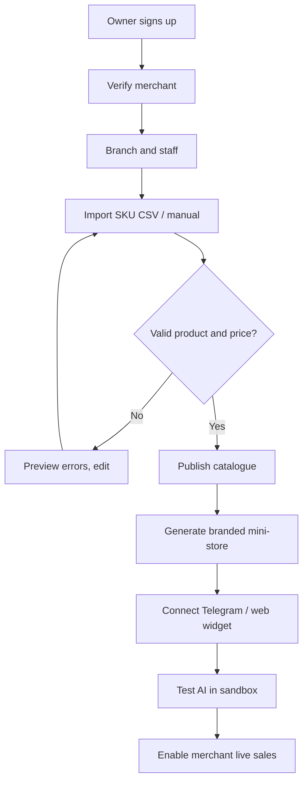
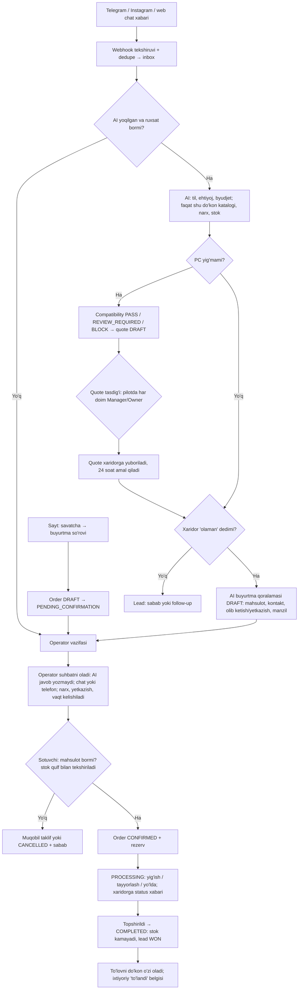
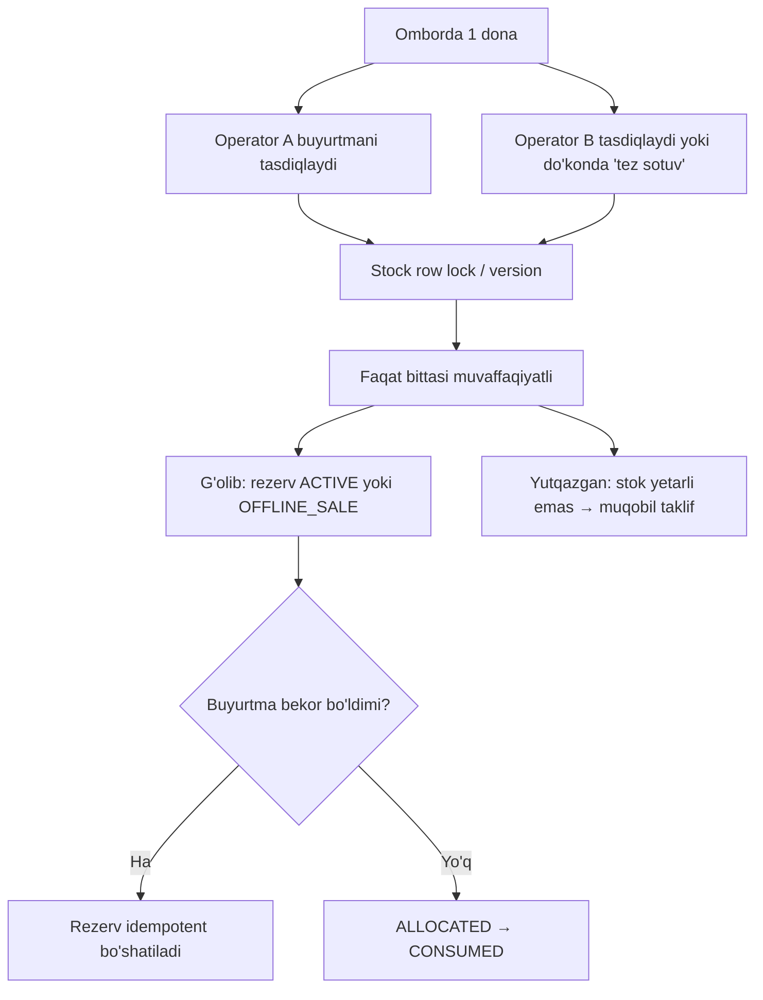
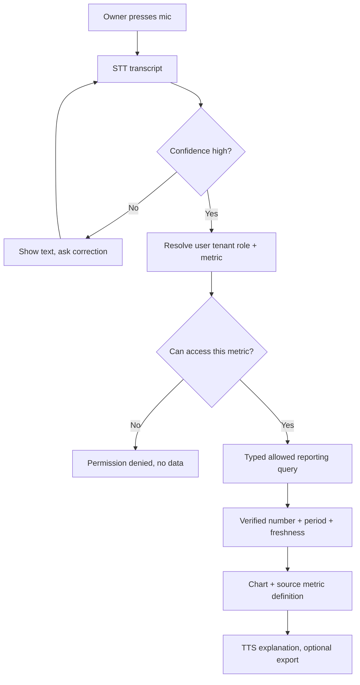
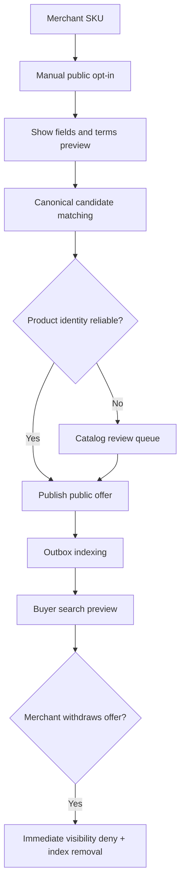
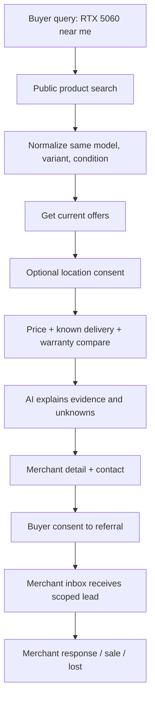

# 06 — UI SITEMAP, USER JOURNEYS, MERMAID FLOWS

**Version:** v1.0 | **Business UI specification** — pixel-perfect design later, route/actions/fallback now.

## Stage 1 merchant app routes

```text
/app/{merchant_slug}
  /overview                        -> M18: dashboard and reports
  /setup                           -> M01 + M03 + M07 + M09: onboarding wizard
  /team                            -> M02: role and branch management
  /branches                        -> M03: branch and coverage
  /catalog                         -> M04: product list and imports
  /catalog/new                     -> M04: product editor
  /prices                          -> M05: price history and approval
  /inventory                       -> M06: branch-SKU stock, ledger, reserves, "tez sotuv" (DEC-123)
  /pc-builder                      -> M08: compatible PC quote wizard
  /storefront                      -> M07: theme, domain, publish
  /channels                        -> M09: bot/widget/Meta connect status
  /inbox                           -> M10+M11: chat queue, assign, AI handoff
  /leads                           -> M12: funnel and quote
  /orders                          -> M13: order board, exceptions
  /payments                        -> M14: DEFERRED (DEC-100) — Stage 1 da yo'q
  /fulfillment                     -> M15: DEFERRED (DEC-113) — holat /orders ichida
  /support                         -> M16: warranty and returns
  /notifications                   -> M17: template, task, failure logs
  /reports                         -> M18: analytics, saved reports, exports
  /voice                           -> M18: S5 da matnli hisobot-chat; mikrofon — beta (DEC-112)
  /settings/ai                     -> M19: tool/prompt/policy and usage
  /settings/billing                -> M19: plan, payments, quotas
  /audit                           -> M20: object actions, security logs

Storefront: /s/{merchant_slug}/, /p/{merchant_slug}/{product_slug}, /cart (→ buyurtma so'rovi, to'lovsiz — DEC-115), /quote/{token} (faqat PC), /orders/{tracking_token}
```

## Stage 2 network admin and merchant routes

```text
/signup, /activate/{token}         -> M21
/app/integrations                  -> M22
/app/public-offers                 -> M24
/app/stock/transfers               -> M25
/app/knowledge                     -> M27
/app/developer                     -> M30
/platform/tenants                  -> M26
/platform/canonical-products       -> M23
/platform/index-health             -> M28
/platform/verification             -> M29
```

## Stage 3 buyer app

```text
/                                   -> Global home/search
/search?q=...                       -> M31, filters/search results
/products/{canonical_slug}         -> M32, offers & evidence
/compare?ids=...                    -> M32, side-by-side compare
/nearby                             -> M33, location permission/map
/ai-shopping                        -> M34, public evidence advisor
/shops/{merchant_slug}             -> M35, verified merchant details
/account/saved                      -> M36, watchlist
/account/alerts                     -> M36
/transparency                       -> M37, ads/ranking disclosure
/help/report-offer                  -> M32/M37, wrong-price report
```

## Screen ownership crosswalk: every module must have UI

| Module | User-visible pages/components | Primary business action | Exception and feedback |
|---|---|---|---|
| `M01` | Onboarding wizard, Merchant profile, Account status and review | Email/telefon verifikatsiyasi va egani aniqlash | takrorlangan tashkilot / error, retry, human help |
| `M02` | Team list, Invite panel, Role/scope editor, Approval queue | Invite va accept | o‘zini oxirgi ownerlikdan o‘chirish / error, retry, human help |
| `M03` | Branch list/map, Schedule editor, Service radius, Pickup rules | filial yaratish/archivlash | noto‘g‘ri geolokatsiya / error, retry, human help |
| `M04` | Products table, Product editor, Import preview, Publish validation | mahsulot+variant/SKU | dublikat SKU / error, retry, human help |
| `M05` | Pricing table, Change price dialog, History, Price approval | bazaviy narx va price-list | narx almashgan paytdagi eski quote / error, retry, human help |
| `M06` | Stock list, SKU stock ledger, Adjustment approval, Reservation monitor, "Tez sotuv" tugmasi (desktop + mobil) | filial-SKU fizik qoldiq | ikki parallel rezerv / error, retry, human help |
| `M07` | Storefront builder, Website preview, Public catalog, Product detail, Cart/request | subdomain va brand theme | subdomain conflict / error, retry, human help |
| `M08` | PC Builder, Compatibility findings, Budget alternatives, Quote action | ready PC builds | unknown BIOS / error, retry, human help |
| `M09` | Channel connect wizard, Permission status, Webhook health, Disconnect | Telegram bot / Business bog‘lash | provider ruxsat bermaydi / error, retry, human help |
| `M10` | Unified inbox, Conversation detail, Human takeover, Assignments, Escalation queue | inbound normalization/dedup | takrorlangan xabar / error, retry, human help |
| `M11` | AI agent config, Tool permissions, Test playground, Conversation explanation, Fallback | uz/ru/en niyat va tilni aniqlash | LLM hallucinated SKU / error, retry, human help |
| `M12` | Lead pipeline, Lead detail, Quote builder, Quote preview, Approval | lead dedup va source attribution | operator forgot lead / error, retry, human help |
| `M13` | Order list, Order detail (fulfillment method, manzil, kelishuv izohi, "to'landi" belgisi), Confirm/cancel dialog, Timeline, Order exceptions | AI/sayt DRAFT → operator tasdig'i → topshirish (UX-02) | parallel confirm / error, retry, human help |
| `M14` — DEFERRED | Payments list, Review receipt, Payment detail, Reconciliation, Refund approval | pay link yoki merchant rekvizitlari | screenshot forged / error, retry, human help |
| `M15` — DEFERRED | Fulfillment board, Shipment timeline, Courier view, Tracking page | pickup vs local delivery | noto‘g‘ri address / error, retry, human help |
| `M16` | Support inbox, RMA case, Warranty detail, Resolution history | warranty terms snapshot | warranty ambiguous / error, retry, human help |
| `M17` | Notification center, Template editor, Task queue, Delivery log | notification template va locale | takror notification / error, retry, human help |
| `M18` | Overview dashboard, Report builder, Voice mic/transcript, Chart/export | KPI: orders/paid turnover/margin only if COGS exists | ASR currency mistake / error, retry, human help |
| `M19` | Plan/usage, Settings, Billing, Support center, AI safe mode | AI enable/disable/policy | over-quota conversation / error, retry, human help |
| `M20` | Audit search, Object activity timeline, Security event view | who/when/why/change trace | logga PII tushishi / error, retry, human help |
| `M21` | Public signup, Provision checklist, Retry setup | public signup and anti-fraud | fraud signup / error, retry, human help |
| `M22` | Integration catalog, Mapping wizard, Sync health, Conflict resolution | connector registry and credentials | API credentials revoked / error, retry, human help |
| `M23` | Global product review, Merge diff, Provenance audit | brand/model/MPN/GTIN normalize | false merge / error, retry, human help |
| `M24` | Public listings settings, Offer publish preview, Freshness report | per-SKU public opt-in/out | merchant revokes permission / error, retry, human help |
| `M25` | Branch stock matrix, Transfer order, Transfer audit | branch stock splits | transfer and reservation collide / error, retry, human help |
| `M26` | Billing console, Tenant fleet, Usage analytics | plan self-service changes | billing webhook replay / error, retry, human help |
| `M27` | Knowledge hub, Agent sandbox, Policy release | FAQ/returns/warranty knowledge | policy contradicts merchant terms / error, retry, human help |
| `M28` | Index health, Publish queue, Quality diagnostics | incremental index from public offers | lost event / error, retry, human help |
| `M29` | Trust center, Verification queue, Appeals | merchant business verification | fake business document / error, retry, human help |
| `M30` | Developer settings, API usage, Webhook tester | API key/service account with scopes | leaked key / error, retry, human help |
| `M31` | Global home/search, Results, Filters, No results | query uz/ru/en/translit | query ambiguity / error, retry, human help |
| `M32` | Compare table, Merchant offer card, Price history, Report issue | same variant normalization | comparison variant mismatch / error, retry, human help |
| `M33` | Map + list, Nearby merchants, Pickup selector | city and neighborhood query | precise location denied / error, retry, human help |
| `M34` | AI search chat, Evidence drawer, Compare recommendation, Feedback | intent and budget clarifying | LLM recommends private SKU / error, retry, human help |
| `M35` | Merchant page, Contact CTA, Lead routing receipt | merchant profile and offers | merchant ignores referral / error, retry, human help |
| `M36` | Saved items, Alert preferences, Account privacy | guest browsing | price changed but out of stock / error, retry, human help |
| `M37` | Search placements, Sponsor disclosure, Ranking explanation | organic ranking relevance rules | seller pays to fake quality / error, retry, human help |
| `M38` | Product landing, Merchant landing, SEO preview | canonical product public pages | thin duplicate pages / error, retry, human help |
| `M39` | Global bot, Results cards, Merchant link | global query in Telegram | merchant AI leaks private data / error, retry, human help |

## 7 asosiy end-to-end UX flow (business order)

### UX-01: Merchant onboard → mini sayt


### UX-02: Stage 1 savdo oqimi — xabar yoki sayt → buyurtma → operator → tasdiq → topshirish (DEC-100)

Bu Stage 1 ning **yagona canonical savdo oqimi**. To'lov tizimdan tashqarida, do'kon o'zi oladi; yetkazishni do'kon o'zi tashkil qiladi.



| Qadam | Kim | Holat | DEC |
|---|---|---|---|
| Xabar keladi, AI maslahat beradi | AI | Conversation `AI_ACTIVE`, Lead `QUALIFIED` | — |
| PC yig'ma uchun taklif | AI → Manager/Owner | Quote `DRAFT → APPROVED → SENT` | DEC-100e, 102, 103, 109 |
| "Olaman" — buyurtma qoralamasi | AI yoki sayt | Order `DRAFT` (stok band emas) | DEC-100c, 115 |
| Operator ulanadi | Sales | Conversation `HUMAN_ACTIVE`, Order `PENDING_CONFIRMATION` | DEC-100d, 100g |
| Mahsulot borligi tasdiqlanadi | Sales (o'ziga biriktirilgan) / Manager | Order `CONFIRMED`, rezerv `ACTIVE` | DEC-105, 108 |
| Tayyorlash / yo'lda | Sales / ombor | Order `PROCESSING`, rezerv `ALLOCATED` | DEC-113 |
| Topshirildi | Sales / Manager | Order `COMPLETED`, stok kamayadi | DEC-105 |
| Bekor qilish | Manager / Owner | Order `CANCELLED`, rezerv bo'shaydi | DEC-108 |
| Kutib qolgan buyurtma | Tizim → Manager | 24 soat eslatma, 72 soat "bekor qilinsinmi?" | DEC-104 |

### UX-03: Bitta qolgan mahsulot — parallel tasdiq va offline sotuv


### UX-04: To'lov va yetkazish — `DEFERRED` (DEC-100, DEC-113)
Stage 1 da to'lov tekshiruvi va yetkazish moduli yo'q. To'lov provayderi yoki yetkazish hamkori bilan shartnoma bo'lganda bu oqim qayta yoziladi (eski variant git tarixida, commit `58809a4`).

### UX-05: Voice owner report in UZ/RU/EN


### UX-06: Merchant publishes offer to global network


### UX-07: Global buyer AI compare → local seller


## UI obligatory states checklist

| UI state | Mandatory design |
|---|---|
| Loading | Skeleton/spinner and cancel where long job |
| Empty | Actionable import/create/permission instructions |
| Validation failure | Inline field errors, backend code mapped to clear user language |
| Stale data | Last updated time and refresh/reconfirm control |
| Conflict (409) | Show new entity version, «reload / review changes», no silent overwrite |
| Offline/provider error | Retry when safe, contact operator, job status |
| Permission denied | Access request option, no sensitive data flashed |
| Duplicate submission | Same order/receipt, never second charge or reservation |
| Async processing | Job reference, progress/state, resume after page reload |
| Partial fulfilment | Item-level status, human support, explain next step |
| Mobile | Touch-first inbox, product search, owner voice/report, courier actions |

## ASCII wireframe — Merchant inbox
```text
┌──── AI Commerce Merchant OS ──────────────────────────────────────────────┐
│ Overview  Catalog  Stock  Inbox  Quotes  Orders  Payments  Reports        │
├───────────────┬─────────────────────────────┬────────────────────────────┤
│ Conversations │ Customer chat               │ Sale assistant             │
│ ● New (12)    │ UZ/RU/EN messages           │ Need: PC editing + CS2     │
│ Human (4)     │ AI state: ACTIVE / HANDOFF  │ Budget: 10m UZS            │
│ Waiting (7)   │ price and SKU evidence      │ Candidates + stock source  │
│ Failed (2)    │ [Takeover] [Reply]          │ [Draft quote] [Escalate]   │
└───────────────┴─────────────────────────────┴────────────────────────────┘
```

## ASCII wireframe — Merchant order
```text
┌──────── Order #ORD-... / tenant: merchant  ───────────────────────────────┐
│ Status: CONFIRMED   Fulfillment: PICKUP   Paid mark: — (tekshirilmagan) │
│ Items: SKU / variant / qty / quote price snapshot / fulfilment branch      │
│ Events: DRAFT → PENDING_CONFIRMATION → CONFIRMED → PROCESSING → COMPLETED │
│ Exceptions: [Price changed] [Stock conflict] [Reservation review 72h]     │
│ Actions: [Confirm] [Start processing] [Complete] [Cancel] [Mark paid]    │
└───────────────────────────────────────────────────────────────────────────┘
```

## ASCII wireframe — Global comparison
```text
┌──── Global AI Shopping ───── Search: RTX 5060 8GB ──────────────────────┐
│ Product variant exact match / city / stock freshness                      │
├────────────────┬──────────────┬─────────┬─────────────┬──────────────────┤
│ Merchant       │ Item price   │ Delivery│ Warranty    │ Last verified    │
│ Store A        │ 4.4m UZS     │ unknown │ 6 months    │ 15min ago        │
│ Store B        │ 4.6m UZS     │ free    │ 24 months   │ 2h ago           │
│ [Compare AI evidence] [Map branches] [Go to seller] [Report incorrect]    │
└───────────────────────────────────────────────────────────────────────────┘
  Illustrative values only, not live offers.
```

## UI may not claim

- «In stock» if product location lacks fresh evidence.
- «Cheapest delivered» with unknown shipping amount.
- «Payment successful» on screenshot alone.
- «Compatible PC» when a blocking property is unknown.
- «AI handled everything» if operator is still assigned.
