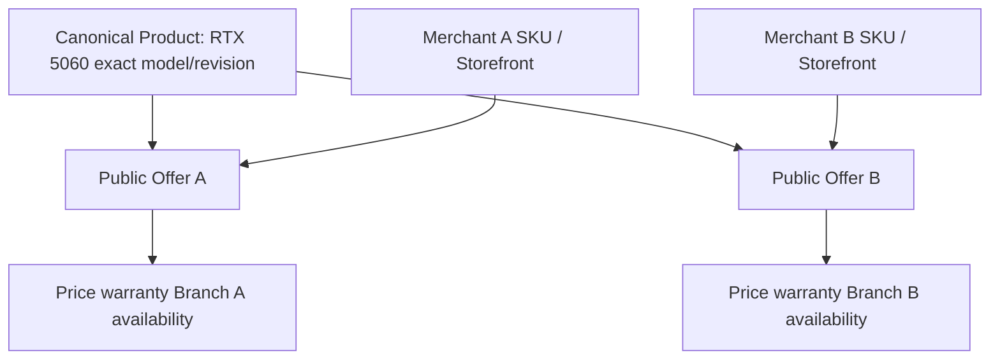

# 07 — BUSINESS ENTITIES, DATA OWNERSHIP VA PUBLIC/PRIVATE CHEGARALAR

**Version:** v1.0. Bu **logical business model**; SQL table/FK/index/partition tanlovi keyingi engineering design qarori.

## Maʼlumotlarni saqlash modeli

- Platforma multi-tenant. Tenant scope (`merchant_id`) primary authorization invariant, foydalanuvchi request bodyidagi `merchant_id` hech qachon o‘z-o‘zidan ishonchli emas.
- Stage 1 da `MerchantProduct` va `MerchantSKU` source of truth. Stage 2 da `CanonicalProduct` mustaqil registry, `PublicOffer` merchantning ruxsatli taklifi.
- Public search maxfiy inventar tabelidan emas, faqat public field whitelistdan project qiladi.
- One merchant may own multiple branches, each branch same SKU separate sellable balance. Quote immutable item snapshots, invoice/paid records historical.

| Business entity | Owner/context | Visibility | Core facts | Logical cardinality |
|---|---|---|---|---|
| Merchant | Merchant Core | Private | Tenant legal/profile, lifecycle, defaults | 1 → N Branch, Staff, Channel, Offer |
| Principal / Membership | Access | Private | Actor, role, tenant, branch permission | Principal N ↔ N Merchant (via membership) |
| Branch | Location | Private with public-approved subset | Address/geo/hours/pickup, active flag | Merchant 1 → N Branch |
| Product / Variant / SKU | Merchant Catalog | Private; published subset storefront | Merchant item, attributes, condition, lifecycle | Merchant 1 → N Products 1→N SKUs |
| Price Version | Pricing | Private; public only selected amount | Currency, amount_minor, source, effective/valid until | SKU 1 → N prices |
| Stock Balance / Ledger | Inventory | Private | Per-branch SKU on_hand/reserved/allocated; immutable movements | Branch+SKU 1→1 balance and 1→N movements |
| Reservation | Inventory | Private | Qty, origin quote/order, expiry, reason, version | Order line → reservation(s) |
| Channel Account | Channels | Private | Provider account ref, token ref, capabilities | Merchant 1 → N channel accounts |
| Conversation/Message | Conversations | Private | Channel identity, messages, AI/human mode | Channel 1 → N threads; thread 1 → N messages |
| Customer Link / Lead | CRM | Private | Per merchant minimal identity, contact consent, qualification | Merchant 1 → N leads; lead N → threads |
| Quote + Quote Lines | Quotes | Private/customer signed token | Immutable product/price/spec snapshot, expiry, approval | Lead 1 → N quote revisions; quote 1 → N lines |
| Order + Order Lines | Orders | Private/customer scoped token | Confirmed snapshot, status, merchant ref | Order 1 → N lines |
| Payment Attempt / Evidence | Payments | Private | Provider txn and receipt proof; verified ledger | Order 1 → N attempts; no unrelated merchant data |
| Shipment / POD | Fulfillment | Private/customer tracking token | Method, courier, address, proof, retry reasons | Order 1 → N shipments |
| Support/RMA Case | After-sales | Private | Warranty snapshot, return reason, resolution | Order line 1 → N support cases |
| Notification / Task | Notifications | Private | Trigger, channel, recipient, template, delivery status | Domain event 1 → N messages/tasks |
| Report Metric Definition | Reporting | Private platform policy | metric id, denominator, timezone, permission | Tenant report query scopes data |
| Voice Request / Evidence | Voice | Private; retention-limited | Language, transcript, allowed metric, answer ref | Principal 1 → N voice sessions |
| Audit Record | Audit | Private restricted | Actor, entity, action, version, correlation, safe diff | All critical mutable aggregates |
| Integration Connection / Sync Cursor | Integrations | Private | Credential ref, scope, mapping, source priority, cursor | Merchant 1 → N connectors |
| Canonical Product | Product Network | Public when published | Brand/model/variant/attributes, identity proofs | Canonical 1 → N Merchant Offers |
| Match Decision / Provenance | Product Network | Restricted reviewers | Candidate, evidence, reviewer, reversible merge | Offer SKU → canonical link history |
| Public Offer | Offer Network | Public only opt-in | Public price, freshness, condition, location, warranty | Merchant SKU/Branch → public offer; canonical 1 → N offers |
| Index Projection | Search | Derived/public | Searchable canonical and offer identifiers only | Eventual projection of public published offers |
| Merchant Verification | Trust | Public selected badge; evidence private | Proof, verifier, expiry, disputes | Merchant 1 → N verification decisions |
| Buyer Public Account / Saved Watch | Buyer | Buyer private | Consent, favorite, alert threshold, unsubscribe | Buyer 1 → N watch/alerts |
| Referral / Attribution | Discovery | Buyer/merchant scoped | Public offer click, consented handoff, response result | Search interaction → 0..N referrals |
| Subscription / Usage Ledger | Billing | Private | Plan, limits, usage counted by bill window | Merchant 1 → N subscription periods |

## Canonical vs SKU vs Offer (uchta farqli narsa)

- Bir xil model variantlari canonical darajada tekshiriladi; stock/price **hech qachon canonical product property emas**.
- Ko‘p filialli merchantning bir mahsuloti turli filialda turlicha mavjud bo‘lishi mumkin.
- Merchant public opt-out bersa canonical product qolishi mumkin, lekin offer chiqmaydi.
- Product matching «ASUS RTX 5060» bilan «MSI RTX 5060»ni bitta SKU qilmaydi; high-level family degan alohida search grouping bo‘lishi mumkin.

## Data invariants / consistency boundaries

| Business operation | Source of truth | Atomic business invariant | Eventually consistent projections |
|---|---|---|---|
| SKU price edit | Merchant Pricing | Price revision and audit persisted | Storefront cache, public offer index |
| Inventory reserve | Merchant Inventory | available never negative and one reservation per idempotent request | search inventory flag, notifications |
| Order confirmation | Merchant Orders + Inventory | validated price snapshot and consistent reservation | dashboard and analytics |
| Payment verification | Merchant Payment Ledger | provider identity, amount, currency, merchant and idempotency | paid KPI, buyer notification |
| Agent conversation reply | Conversation/Channel state | authorized speaker, no duplicate send intention | notifications and AI cost accounting |
| Public listing opt-out | Offer visibility source | public access immediately denied | search engine index deletion/replay |
| Canonical merge/split | Global Product Registry | audited reversible mapping change | reindex multiple public offer groups |

## Ownership and erasure policy

- Merchant owns commercial records by tenant; platform operates data processor/contractual arrangement as applicable and compliance review required.
- Buyer privacy: consented referral only, no global cross-store unified CRM identity by default.
- Media and voice: merchant-scoped storage, retention rules and download permissions; avoid raw PII in metrics/logs.
- GDPR/PDP-style compliance specifics are not asserted as final legal advice; before production collect local counsel requirements for Uzbekistan and any expansion geography.
- Deleting a merchant does not delete payment/dispute records subject to lawful retention; public offers removed immediately, other data purged based on retention policy.

## Business-level schema guardrails for future ERD

- Stable unique keys for `(merchant_id, sku)`, `(provider, account, external_event_id)`, `(tenant, operation, idempotency_key)`, `(consumer_id, event_id)`.
- Money in integer minor units or exact decimal; no float money; currency and price-version always explicit.
- Stock ledger append-only, corrections as additional movements, not retroactive rewrite.
- All aggregate mutations versioned; compare-and-swap or transaction lock if parallel orders possible.
- Search index cannot be primary database for purchase, stock, actual price or eligibility.
