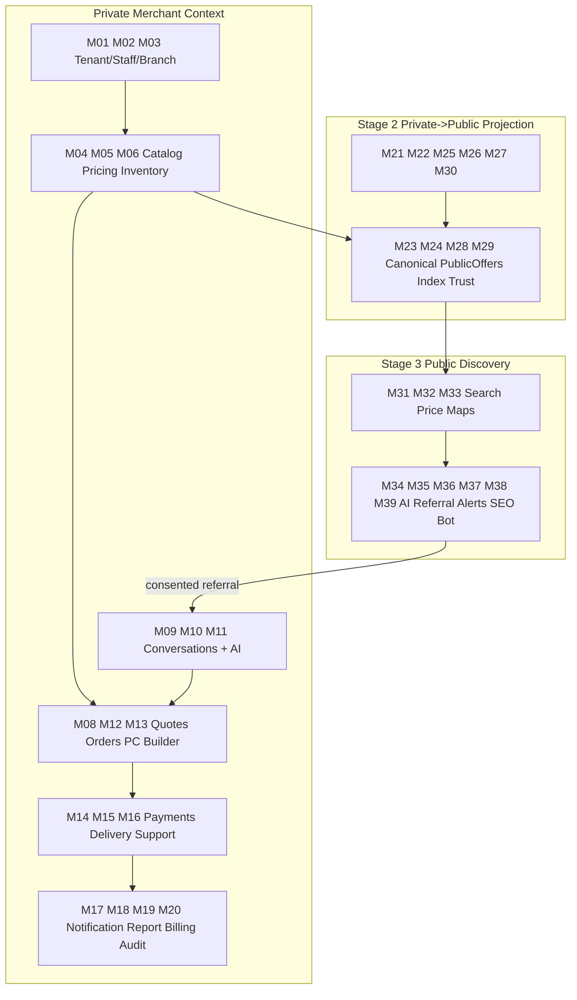

# 09 — BUSINESS MODULE RELATIONS, EVENTS, NOTIFICATIONS, FAILURE POLICY

**Version:** v1.0. Entity owner and business intent are binding; exact transport (Celery/RabbitMQ/Redis) is ADR to decide.

## Context map: logical ownership

**Boundary rule:** boshqa modulning persistent data modelini to‘g‘ridan-to‘g‘ri yozish mumkin emas. Public application service/port orqali request qilinadi; modul ownership aniq. Biznes eventlar eventual projectionsga xizmat qiladi, lekin moliya/stock transaction o‘z DB atomik commit ichida bo‘lishi kerak.

## Canonical event catalog (meaning, not transport)

| Event | Produced by | Required consumers | Business outcome | Failure / replay |
|---|---|---|---|---|
| `merchant.activated.v1` | M01 | M07,M19,M21 | Setup checklist and storefront draft | Retry provisioning, no duplicate tenant |
| `catalog.sku_published.v1` | M04 | M07,M11,M28 | Site + agent fresh product retrieval | Idempotent index upsert |
| `pricing.price_changed.v1` | M05 | M07,M11,M24,M28 | Reprice active quotes on confirmation; refresh public offer | Higher version wins, old event ignored |
| `inventory.stock_changed.v1` | M06 | M07,M11,M24,M28 | Available stock recalculated | Recompute from balance, not event arithmetic on replay |
| `conversation.message_received.v1` | M10 | M11,M12 | AI routing or human task | Provider event id dedup |
| `conversation.handoff_requested.v1` | M10/M11 | M17 | Notify assigned operator | One open task per handoff key |
| `quote.approved.v1` | M12 | M17,M13 | Send quote and allow acceptance | Snapshot/version guard |
| `order.created.v1` | M13 | M06,M14,M17 | Track reserved stock and payment needed | DB atomic order/reserve boundary per ADR |
| `order.cancelled.v1` | M13 | M06,M14,M15,M17 | Release hold, review money, stop dispatch | No duplicate release/refund |
| `payment.verified.v1` | M14 | M13,M15,M17,M18 | Eligible fulfillment and paid report | Verification independent, reconcile late payment |
| `shipment.delivered.v1` | M15 | M13,M16,M17,M18 | Close delivery, ask consented review | POD validation, replay no-op |
| `public_offer.published.v1` | M24 | M28,M31 | Buyer offer searchable | Allowlist projection only |
| `public_offer.withdrawn.v1` | M24 | M28,M31,M38 | No public exposure | Read-time deny until index cleared |
| `canonical_product.match_changed.v1` | M23 | M24,M28,M31 | Re-group offers, preserve original merchant SKUs | Reindex and reversible mapping |
| `merchant.verified.v1` | M29 | M35,M37 | Valid trust badge in public profile | Badge expiry, audit |
| `referral.created.v1` | M35 | M10,M12,M17 | Merchant accepts consented new buyer lead | Dedup visitor+offer+time policy |

## Transactional outbox principle and job classes

- State mutation + outbox intent written atomically inside source transaction; event bus delivery at-least-once assumed.
- Event consumers must be idempotent and enforce monotonic aggregate version, track `(consumer, event_id)` dedup.
- Failures must have retry count/next attempt/dead letter, human operation and event trace. Never falsely claim «exactly-once external effect» for email/Telegram/payment APIs without provider idempotency contract.
- Separate business jobs: webhook processing, AI response generation, price/stock sync, quote expiry, reservation expiry, payment reconciliation, notification send, report export, voice STT/TTS, public offer indexing, canonical matching review, data retention.

## Notification trigger matrix

| Trigger | Recipient | Channel | Business content | Dedup / quiet-hour |
|---|---|---|---|---|
| New human handoff | Assigned sales | In-app + opted merchant Telegram | Customer link, reason, age | Dedup by handoff task; high priority |
| Quote approved/sent | Buyer if channel permits | Same opted-in channel | Verified quote link + expiry | One per quote revision |
| Payment proof uploaded | Merchant finance | In-app | Awaiting settlement verification | Never auto-mark paid |
| Payment verified | Buyer, order manager | Same channel/in-app | Verified receipt/status | Once per verified tx |
| Stock low | Warehouse, owner | Dashboard/notification | SKU, branch, available | Group by SKU and cooldown |
| Reservation expiry | Order manager | In-app | Expired order/quote; next steps | One per reservation |
| Delivery dispatched | Buyer | Opted channel | Tracking and realistic ETA if known | Shipping transitions idempotent |
| Delivery failed | Buyer, manager | In-app/customer transactional | Reason, reschedule | High-priority task |
| Integration degraded | Owner/admin | Dashboard + alert | Affected price/stock trust | Rate-limited repeats |
| Public offer withdrawn | Owner / search service | Internal job + dashboard | Visibility removed | Priority and read-time deny |
| Refund failed | Finance, owner | In-app critical | Funds unresolved, retry/manual action | Escalate, no auto-resolve |

## Recovery matrix

| Failure | Order/payment/inventory invariant | Business action |
|---|---|---|
| Duplicate webhook | Never create duplicate order/stock/payment | Dedup event and return existing outcome |
| Retry after worker crash | Previous DB mutation not undone | Idempotent consumer and replay |
| Redis unavailable | DB primary remains authoritative | Pause ephemeral jobs; durable outbox backlog |
| LLM unavailable | Merchant stock/orders still work | Switch to human inbox |
| POS is stale | Do not sell false stock | Mark availability low-confidence; human approval |
| Payment provider offline | Proof/manual only if verifiable | Pending; reconcile later |
| Index behind | Public results may be stale | Display freshness and fail closed on revoked offer |
| Merchant account suspended | No new checkout/public offer | Existing orders read/resolve by authorized support |
