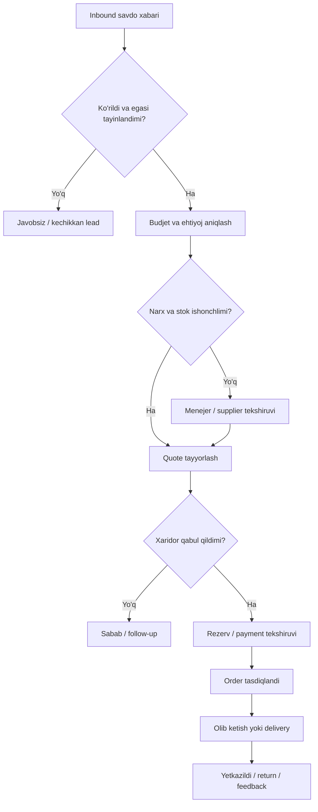
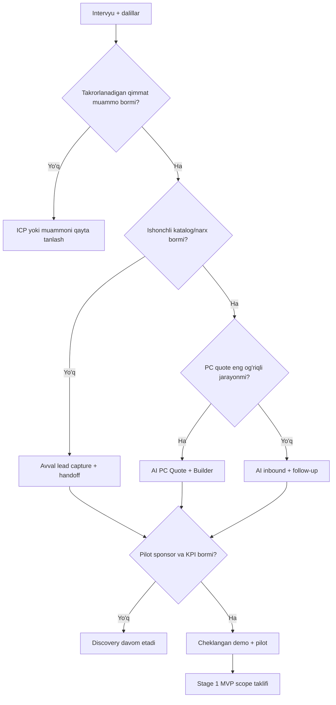

# A01 — Market Problem Discovery: PC va elektronika do‘konlari

> **Loyiha:** AI Commerce OS & Network  
> **Hujjat ID:** `A01` · **Versiya:** `v0.1` · **Sana:** 2026-10-20  
> **Status:** `DRAFT` — tadqiqot rejasi, bozor natijalari hali tasdiqlanmagan  
> **Qaror egasi:** loyiha asoschisi  
> **Oldingi hujjatlar:** `../business/00_README_AND_SCOPE.md`, `../business/01_BUSINESS_VISION_AND_3_PHASES.md`  
> **Keyingi hujjatlarga kirish:** `business/03` biznes qoidalar, `business/02` modullar, `business/10` reliz scope, `engineering/03` DDD, `engineering/15` AI agent. Hali yozilmagan: biznes model / unit economics va pilot shartnomasi (`../decisions/DECISION_REGISTER.md`).

## 0. Hujjatning vazifasi

Biz avval umumiy marketplace qurmaymiz. Dastlab **PC yig‘adigan va elektronika sotadigan do‘konlarda haqiqiy, pul talab qiladigan muammo**ni topamiz. Keyin shunday do‘kon uchun mustaqil ishlaydigan **Merchant Sales OS** yaratamiz: katalog, narx, stok, o‘z sayti, AI sotuvchi, lead, quote, buyurtma, operatorga uzatish va analitika. Kengayganda esa do‘kon ruxsati bilan ommaviy mahsulot takliflarini umumiy qidiruvga ulaymiz.

> **MUHIM:** Quyidagi muammolar, raqamlar va sotuv g‘oyalari hozircha **gipoteza**. Hali birorta merchant intervyusi bu hujjatga kiritilgani yo‘q. Taxminni fakt sifatida ishlatmaymiz.

### Javob topishimiz kerak bo‘lgan 5 savol

1. Do‘konda qaysi muammo tez-tez uchraydi va haqiqatan pul yoki ish vaqtini yo‘qotadi?
2. Boshlanish uchun kuchli taklif qaysi: `24/7 AI chat`, `PC quote/compatibility`, `katalog/ombor`, yoki ularning kichik kombinatsiyasimi?
3. Kamida 3 ta do‘kon ishonchli katalog va narx ma’lumotlarini berib, pilotda qatnashishga tayyormi?
4. Sotuvchi sinovdan keyin obuna to‘lashi uchun qanday o‘lchanadigan natija ko‘rishi kerak?
5. Rasmiy Telegram/Instagram/payment integratsiyalarining qaysilari aynan pilot do‘konlar uchun mumkin?

## 1. Ish doirasi

| Mavzu | Tekshiramiz | Birinchi pilotda va’da qilmaymiz |
|---|---|---|
| Savdogar | PC yig‘ish, GPU/CPU/RAM/SSD, elektronika; filial va xodimlari | Barcha toifalarni birdan qamrash |
| Kanallar | Telegram, Instagram, web-chat, telefon, mavjud sayt | Har qanday platformani ruxsatsiz avtomatlashtirish |
| Katalog | SKU, variant, narx, ombor, yetkazib beruvchi, import, yangilanish | Tekshirilmagan ma’lumotni “aniq” deb aytish |
| AI | Savol-javob, ehtiyojni aniqlash, PC tavsiya, quote draft, handoff | Narx/to‘lov/stockni o‘zboshimchalik bilan tasdiqlash |
| Savdo | Lead → quote → order → payment tekshirish → yetkazish holati | O‘zimizning kuryer parki, global checkout |
| Merchant UI | Katalog, inbox, buyurtma, statistikalar, avtomatik sayt | To‘liq ERP o‘rnini birinchi kundan bosish |
| Kelajakdagi network | Merchant public offer berishga tayyormi? | Global narx solishtirishni 1-bosqichda ishga tushirish |

### Uch bosqich bilan bog‘liqligi (BD-01)

- **Stage 1 — Merchant Sales OS:** birinchi daromad keltiradigan do‘konning individual tizimi.
- **Stage 2 — Merchant Network:** self-service onboarding, integratsiyalar, standartlashgan katalog, public offer opt-in.
- **Stage 3 — Global AI Shopping:** turli do‘konlarning ommaviy narx, kafolat, lokatsiya va qoldiqlarini taqqoslash.
- Kengaygan checkout/logistika, B2B va agro — **future extension**, core roadmap emas (`business/11` §D).

**A01 asosan Stage 1ni tekshiradi.** Stage 2/3 bo‘yicha faqat kelajakdagi moslashuvga ta’sir qiladigan savollarni beramiz.

## 2. Kimlar bilan gaplashamiz?

| Rol | Uning bajaradigan ishi | Tekshiriladigan muammo | Mumkin bo‘lgan qiymat |
|---|---|---|---|
| Do‘kon egasi / qaror qiluvchi | Rentabellik, xodimlar, savdo nazorati | Yo‘qotilgan mijoz, noaniq statistika, samarasiz ish | Ko‘proq tasdiqlangan buyurtma, tejalgan vaqt |
| Sotuv menejeri | Xabarlarga javob, ehtiyojni aniqlash, follow-up | Takroriy savollar, kech javob, unutilgan lead | AI yordamchi, inbox va eslatma |
| PC yig‘uvchi mutaxassis | Komponent mosligi, konfiguratsiya | Har bir PC taklifini qo‘lda yig‘ish | PC Builder + qoidalar engine |
| Ombor xodimi | Qoldiq va narxni aktual saqlash | Excel/POS/supplier nomuvofiqligi | Katalog va ombor integratsiyasi |
| Xaridor | Narx va mos konfiguratsiya topish | Instagram→Telegram→menejerga o‘tish | Tez va tekshirilgan taklif |

**Birinchi ICP — gipoteza:** ko‘p maslahat talab qiladigan PC do‘koni, faol inbound xabarlar, eksport qilinadigan katalog/narxlar, taklifni tasdiqlovchi menejer va pilot natijasini o‘lchashga tayyor rahbar.

> Obunachilar soni yoki Instagramning chiroyli yuritilishi o‘zi yetarli qualification mezoni emas.

## 3. Gipotezalar reyestri

| ID | Taxmin | Qanday dalil yig‘amiz? | Nima inkor qiladi? | Ehtimoliy yechim |
|---|---|---|---|---|
| HYP-001 | Xabarlarga kech javob sabab lead yo‘qoladi | So‘nggi 7–14 kunlik xabarlar, javob vaqti, real misollar | Hammasiga tez javob va kam hajm | AI first response + handoff |
| HYP-002 | Custom PC narxli taklifi ko‘p vaqt oladi | Real quote yasashni kuzatish, vaqtni o‘lchash | Takliflar allaqachon tez | PC quote builder |
| HYP-003 | Narx va qoldiq turli tizimlarda tarqoq | Excel/POS/supplier/chat xaritasi, mos kelmagan qiymatlar | Yaxshi ishlovchi bitta source of truth | Data ingest/sync |
| HYP-004 | Leadlar kuzatuvsiz qoladi | Javobsiz/unutib yuborilgan chatlar va jarayon | Ishlaydigan CRM/follow-up mavjud | Lead pipeline + reminders |
| HYP-005 | Ish vaqtidan tashqari talab mavjud | Tungi va dam olish kungi mazmunli so‘rovlar | Mazmunli so‘rov juda kam | 24/7 AI faqat qiymat bo‘lsa |
| HYP-006 | Saytsiz do‘konga tayyor storefront kerak | Saytning mavjudligi, ulashish/katalog muammosi | Mavjud sayt ehtiyojni qoplaydi | Generated storefront |
| HYP-007 | Voice Business Copilot uchun to‘lashadi | Egasi so‘raydigan KPIlar, foydalanish ehtimoli | Ovozni kerakli deb bilishmaydi | Premium/later, MVP blocker emas |
| HYP-008 | Do‘kon kelajakda public offer chiqaradi | Rozilik, qaysi maydonlar public, raqobatchi xavotiri | Narx taqqoslashga qarshi | Faqat opt-in publishing |
| HYP-009 | Aniqlik “aqlli” chatbotdan muhimroq | Xato narx/stok va qayta qo‘ng‘iroq holatlari | Muhim dalil yo‘q (baribir noto‘g‘ri ma’lumot bermaymiz) | Deterministic tools + approval |
| HYP-010 | Do‘kon to‘lashga tayyor | Qaror qiluvchi bilan aniq pullik davom sharti | “Zo‘r g‘oya” deyish, ammo commitment yo‘q | Tarif va scope qayta ko‘rish |

Har gipoteza statusi: `UNTESTED`, `SUPPORTED`, `MIXED`, `REFUTED`. O‘zgartirish faqat `EVD-###` dalil bilan. Qarama-qarshi misollarni ham saqlaymiz.

## 4. Tadqiqot rejasi

### 4.1. Tanlash

Boshlang‘ich **maqsad**: 15–20 do‘konga murojaat qilish, 8–12 ta mazmunli suhbat olish, shundan 3–5 ta pilot nomzod. Bular reja, erishilgan natija emas.

Turli savdogarlardan namuna olish kerak:

- PC yig‘uvchilar va faqat komponent sotuvchilar;
- Instagram-first, Telegram-first va web-first savdogarlar;
- kichik jamoa va bir nechta sotuvchisi/filiali bor do‘konlar;
- Excel bilan va POS/ERP bilan ishlaydiganlar;
- tayyor PC va buyurtma asosida yig‘ishni aralashtiradiganlar.

### 4.2. Intervyu qoidalari

1. “Bizning AI sizga kerakmi?”dan oldin mavjud ish jarayonini aniqlaymiz.
2. Oxirgi **real** holatlarni so‘raymiz, taxminiy kelajakdagi javoblarga tayanmaymiz.
3. Vaqt/hajmni imkon bo‘lsa kuzatamiz; ko‘rilmagan sonni “estimate” deb belgilaymiz.
4. Chat namunalarini faqat ruxsat bilan olamiz; telefon, manzil, F.I.Sh., karta, chek va boshqa shaxsiy ma’lumotlarni yashiramiz. Ruxsatsiz xom ma’lumotni uchinchi tomon AIga yubormaymiz.
5. Merchantga rasman tasdiqlanmagan Instagram yoki to‘lov imkoniyatlarini va’da qilmaymiz.
6. Har uchrashuv oxirida bitta amaliy keyingi qadamni olamiz: eksport namuna, demo sanasi, pilot sponsor yoki rad javobi.

### 4.3. 30 daqiqalik uchrashuv

| Vaqt | Vazifa |
|---|---|
| 0–5 min | Do‘kon formati, filial, jamoa, sotuv kanallari |
| 5–15 min | Oxirgi haqiqiy savdo va yo‘qolgan/kechikkan leadni kuzatish |
| 15–22 min | Katalog, quote, ombor, narx, payment workflow |
| 22–27 min | Ish vaqti/pulga ta’siri, mavjud vositalar, to‘lov motivi |
| 27–30 min | Demo/pilotga tayyorgarlik, ma’lumot olish shartlari |

## 5. Do‘konlarga beriladigan asosiy 22 savol

**Savdo va xabarlar**

1. Asosiy mahsulotlaringiz qaysilar? Custom PC yig‘ish ulushi qancha?
2. Bir kun/haftada nechta **haqiqiy savdo so‘rovi** keladi va qayerdan?
3. Oxirgi xaridor yozganidan buyurtma kelguncha qanday qadamlar bo‘lganini ko‘rsata olasizmi?
4. Ko‘p takrorlanadigan savollar qaysi? Javob berishning qaysi qismi eng ko‘p vaqt oladi?
5. Ish vaqtidan tashqari yozganlarga nima bo‘ladi?

**PC yig‘ish, narx, supplier**

6. Mijoz budjet aytgandan keyin taklif tayyorlash necha daqiqa oladi? Oxirgi uch misolni ko‘rsata olasizmi?
7. CPU socket, RAM, motherboard, PSU, case va BIOS mosligini kim tekshiradi?
8. Narxlar qayerda saqlanadi, qanchada o‘zgaradi, valyuta kursi bormi?
9. Sizda yo‘q komponentni supplier yoki boshqa filialdan olib kelasizmi? Haqiqiy qoldiq qayerdan ma’lum bo‘ladi?
10. Xaridorga berilgan narxli taklif qancha muddat amal qiladi va kim yakuniy tasdiqlaydi?

**CRM, ombor, buyurtma**

11. Xabarga kim javob beradi, chat boshqa menejerga qanday beriladi?
12. Oxirgi marta mijoz unutib qoldirilganda nima bo‘lgan? Muammo qanday aniqlangan?
13. Stokning asosiy manbai Excel, POS, supplier chat yoki boshqami?
14. Bitta qolgan tovarga ikki mijoz buyurtma qilsa nima qilasiz? Rezerv bormi?
15. Buyurtma, bekor qilish, qaytarish, kafolat, yetkazish holatlarini qayerda yuritasiz?
16. Mijoz to‘laganini qanday tasdiqlaysiz? Check rasmi yetarlimi yoki haqiqiy tushum tekshiriladimi?

**Qaror va iqtisodiy qiymat**

17. Qaysi dasturlarni almashtirishni istamaysiz? Ularda API yoki eksport bormi?
18. Sotuvchi bir kunda takroriy savollarga taxminan qancha vaqt sarflaydi? Buni o‘lchash mumkinmi?
19. Har kuni bilishni xohlagan 3 ta biznes metrikangiz qaysilar? Ovozni ishlatish qulaymi yoki yozma hisobotmi?
20. Agar faqat bitta jarayonni tezlashtira olsak, qaysisini tanlardingiz? Nima uchun?
21. Yangi xizmatni sotib olishga kim qaror qiladi? 30 kunlik cheklangan pilot va undan keyin to‘lovga nima sabab bo‘ladi?
22. Kelajakda mahsulotingizni boshqa do‘konlar bilan narx solishtirishda ko‘rsatishga rozimisiz? Qaysi maydonlar public bo‘lishi mumkin?

**Yordamchi savollar:** “Oxirgi marta qachon?”, “Ekranda ko‘rsata olasizmi?”, “Qancha vaqt oldi?”, “Kim tasdiqladi?”, “Nima xato ketdi?”

## 6. Kuzatiladigan haqiqiy savdo jarayoni



Har do‘konda: xabar kanali, qancha handoff, quote vaqti, qo‘lda nusxalash, narx manbai, rezerv, to‘lov tasdiqlash va yakuniy statusga e’tibor beramiz.

### Dalillarni qanday saqlaymiz?

| Maydon | Qiymat formati |
|---|---|
| `evidence_id` | `EVD-001` |
| `merchant_code` | `M-001`; roziliksiz real do‘kon nomini oshkor qilmaymiz |
| `date`, `role` | Sana/vaqt zonasi, owner/sales/stock |
| `source_type` | interview / observation / sanitized chat / allowed export |
| `finding` | Aynan nima kuzatildi, sharh emas |
| `related_hypothesis` | `HYP-001` va h.k. |
| `confidence` | Low / Medium / High + asos |
| `counter_evidence` | Qarama-qarshi misol |
| `privacy_and_consent` | Rozilik, redaction, retention |
| `next_validation` | Keyingi qanday dalil kerak |

Dalil kuchi: kuzatilgan real ish/eksport — kuchli; yaqin o‘tmishdagi batafsil misol — o‘rta; umumiy fikr — zaif.

## 7. Asosiy KPIlar va baseline

| ID | KPI | O‘lchash usuli | Muhim farq |
|---|---|---|---|
| KPI-001 | `inbound_inquiries` | Takror va spamdan tozalangan mazmunli savdo suhbatlari | Xabarlar soni emas, alohida so‘rov |
| KPI-002 | `first_response_time_p50/p90` | Birinchi mazmunli javobga qadar vaqt | Avtomatik “salom” yetarli emas |
| KPI-003 | `qualified_lead_rate` | Aniqlangan budjet/maqsad/kontaktga ega lead ulushi | Mezoni oldindan kelishiladi |
| KPI-004 | `quote_preparation_time` | Ma’lumot yetarli bo‘lgandan yuborilguncha | Tayyor PC vs custom alohida |
| KPI-005 | `quote_to_order` | Tasdiqlangan order / quote | Vaqt bo‘yicha cohort bilan |
| KPI-006 | `verified_paid_orders` | Tasdiqlangan to‘lov/real orderlar | AIga noto‘g‘ri attribution qilmaslik |
| KPI-007 | `wrong_price_stock_claims` | Noto‘g‘ri narx/qoldiq incidentlari | Zero critical target |
| KPI-008 | `staff_time_spent` | Ish vaqti namunasi | Self-report xato bo‘lishi mumkin |
| KPI-009 | `merchant_contribution` | Qo‘shimcha savdodan hissa foyda, xarajatlarni ayirib | Foyda taxminini o‘ylab topmaslik |
| KPI-010 | `ai_cost_per_conversation` | LLM + STT/TTS + infra + kanallar | Obunaga nisbatan hisoblash |
| KPI-011 | `human_handoff_rate` | Operatorga o‘tgan chatlar / AI chatlar | Juda past ham xavfli |
| KPI-012 | `catalog_data_freshness` | Tekshirilgan narx va qoldiq ulushi | Supplier stoki alohida baholanadi |

Imkon bo‘lsa pilotdan **7–14 kun oldin baseline**, pilotda esa **2–4 hafta** o‘lchov olamiz. Boshqa reklama kampaniyalari bilan farqlarni hisobga olmasdan “AI savdoni oshirdi” demaymiz.

### Merchant kuzatuv jadvali (hali to‘ldirilmagan)

| Merchant | So‘rov/kun | Quote vaqti | Katalog manbai | Qaror qiluvchi | Pilot | Dalil | Status |
|---|---|---|---|---|---|---|---|
| M-001 | TBD | TBD | TBD | TBD | TBD | TBD | Pending |
| M-002 | TBD | TBD | TBD | TBD | TBD | TBD | Pending |
| M-003 | TBD | TBD | TBD | TBD | TBD | TBD | Pending |

## 8. Pilot do‘konni saralash (100 ballik boshlang‘ich model)

| Mezoni | Ball | Qanday tekshiriladi |
|---|---:|---|
| Takrorlanadigan muhim savdo so‘rovi | 20 | Kuzatilgan yoki hujjatli hajm |
| Ishonchli katalog/narx/stock olish imkoniyati | 25 | Eksport namunasi yoki namoyish |
| Egasi/menejerning vaqt va qaror vakolati | 20 | Pilot sponsor, haftalik feedback |
| Haqiqiy qimmat muammo va KPI | 20 | Dalil, baseline |
| Rasmiy integratsiya va privacy imkoniyati | 15 | Channel eligibility, consent |
| **Jami** | **100** | |

- **80–100:** kuchli nomzod (red flag bo‘lmasa).
- **60–79:** cheklangan scope bilan sinash mumkin.
- **0–59:** discovery davom etsin; majburiy ulashga urinmaymiz.

**Stop holatlari:** ma’lumotga qonuniy kirish yo‘q; haqiqiy narx manbai yo‘q; ruxsatsiz scraping talab qiladi; chek rasmini tekshirmay payment tasdiqlashni so‘raydi; natijani umuman o‘lchashga rozi emas.

## 9. Sinov taklifi va pilot ssenariylari

### Taklif matni (gipoteza)

> “Do‘koningiz mahsulotlarini yagona katalogga ulab, Telegram/web va rasmiy ruxsatli kanallarda AI bilan savdo so‘rovlariga javob beramiz. Xaridorning budjeti va talabiga mos PC narxli taklifini tayyorlaymiz, tasdiq kerak bo‘lsa menejeringizga yuboramiz. Suhbatlar va buyurtmalar dashboardda saqlanadi; natijani raqam bilan ko‘rasiz.”

**Nimani va’da qilmaymiz:** 100% avtomatik sotuv, xatosiz AI, har qanday Instagram akkauntiga darhol ulanish yoki kafolatlangan daromad.

### Pilot chegaralari

- Maqsad — 3–5 ta real do‘kon; cheksiz bepul xizmat emas.
- 30 kunlik cheklangan pilot **taklif**; haqiqiy narx va majburiyatlar biznes model va pilot shartnomasi hujjatlarida belgilanadi (hali yozilmagan).
- 1–2 kanal va ishonchli katalog subseti bilan boshlash mumkin.
- AI quote **draft** tayyorlaydi; tekshirilmagan narx/stock/moslikni tasdiqlamaydi.
- Inson istalgan payt suhbatni olishi mumkin; AI send funksiyasida kill switch bo‘ladi.
- Merchant shaxsiy ma’lumotlari o‘zining biznes doirasida qoladi; global public offer uchun alohida opt-in.
- Muvaffaqiyat: javob vaqti, quote vaqti, qualified lead, operator vaqti, haqiqiy order, AI xarajati, accuracy.

### Beshta demo-scenario

1. **Katalog:** Excel/CSV import → validatsiya → tasdiq → merchant saytida mahsulot sahifasi.
2. **AI PC maslahat:** “10 mln so‘mgacha Premiere + CS2” → ehtiyoj → bazadagi SKU → compatibility → quote draft → manager approval.
3. **Lead:** esdan chiqayotgan chat → assigned operator → follow-up → yakuniy natija.
4. **Buyurtma:** tasdiqlash → vaqtinchalik stock rezerv → payment verification → notification; duplicate callback ikki marta qoldiq kamaytirmaydi.
5. **Voice preview:** egasi o‘zbek/rus/ingliz tilida bir KPI so‘raydi → ruxsatli agregat → sana va source bilan javob; yozish amali yo‘q.

Demo raqamlar **mock** yoki merchant ruxsat bergan real ma’lumotlar deb alohida ko‘rsatiladi.

## 10. Erta aniqlanishi kerak bo‘lgan xavflar

| ID | Savol / xavf | Boshlang‘ich himoya yo‘li | Batafsil hujjat |
|---|---|---|---|
| RISK-001 | Rasmiy Instagram messaging ulanishi mumkinmi? | Telegram/web fallback, capability matrix | engineering/13 |
| RISK-002 | Narx juda tez o‘zgaradimi? | Freshness, quote snapshot, approval | business/03, engineering/06–07 |
| RISK-003 | Oxirgi dona 2 kanalda sotilib ketadimi? | DB atomic rezerv, idempotency | engineering/07, engineering/09 |
| RISK-004 | AI GPU/CPU yoki narxni o‘ylab topadimi? | Typed tools, rule engine, human review | business/08, engineering/15–17 |
| RISK-005 | Merchant maxfiy ma’lumoti globalda chiqib ketadimi? | Tenant isolation, explicit public offer | engineering/10, engineering/14, engineering/23 |
| RISK-006 | Fake screenshot bilan payment tasdiqlanadimi? | Bankdagi haqiqiy tushum / provider callback | business/03, engineering/13 |
| RISK-007 | Chat/audio/shaxsiy data huquqiy qayta ishlanadimi? | Notice/consent, minimization, retention | engineering/10, engineering/17 |
| RISK-008 | Job crash / duplicate webhook nima qiladi? | Outbox, retry, DLQ, reconciliation | engineering/09, engineering/19 |
| RISK-009 | Merchant katalogni yangilamasa nima bo‘ladi? | Data freshness, assisted onboarding | business/02, engineering/06 |
| RISK-010 | Voice orqali moliyaviy maxfiy ma’lumot chiqadimi? | Role-scoped report, no silent write | business/08, engineering/16 |

Bu hujjat xavfni qayd etadi, barcha implementatsiya qarorini **ADR** hujjatlarida hal qilamiz.

## 11. Qaror daraxti



**GO (taklif):** kamida 3 merchant muammoga dalil beradi, ruxsatli katalog namunasi mavjud, pilotni tasdiqlovchi shaxs va KPI baseline aniq, integratsiya xavfsiz bo‘lishi mumkin.

**REVISE:** muammo bor, ammo narx/qoldiq ma’lumoti ishonchsiz — AI checkout emas, lead capture va manager handoffdan boshlash.

**NO-GO (feature):** noqonuniy scraping, shubhali to‘lovni avtomatik tasdiqlash, tenantlararo ma’lumot uzatilishi yoki asoslanmagan aniq narx va’da qilish talab etilsa.

## 12. Har bir uchrashuvdan keyingi qayd shabloni

```yaml
merchant_code: M-001
interview_date: null
respondent_role: null
segment: null
branches_count: null
channels: []
observed_recent_workflow: null
main_pains: []
quantitative_baseline: {}
price_stock_source: null
channel_readiness: null
public_offer_opt_in_interest: null
pilot_decision_maker: null
pilot_next_step: null
evidence_ids: []
privacy_consent: null
hypothesis_updates: []
open_questions: []
```

Maxfiy mijoz ma’lumotlari, credentials yoki asl chek rasmlarini bu faylga qo‘ymaymiz.

## 13. `DRAFT`dan `APPROVED`ga o‘tish shartlari

- [ ] Yetarli son va turdagi haqiqiy do‘kon intervyulari o‘tkazilgan.
- [ ] Har muhim xulosaga `EVD-###` dalil biriktirilgan.
- [ ] Qarama-qarshi misollar ham ko‘rsatilgan.
- [ ] Eng kuchli 3 muammo chastota × qiymat × to‘lashga tayyorlik bo‘yicha saralangan.
- [ ] Kamida 3 do‘kon uchun KPI baseline o‘lchash usuli aniqlangan.
- [ ] Katalog, narx, kanal va pilot vakolati tekshirilgan.
- [ ] Stage 1 hero feature va “birinchi kundan qilmaymiz” ro‘yxati taklif qilingan.
- [ ] Pilotga huquqiy/texnik bloklovchi xavf qolmagan yoki aniq cheklangan.
- [ ] Asoschi A01ga `APPROVED` qarorini bergan.

### Keyingi hujjatlarga uzatiladigan ma’lumot

| Hujjat | A01dan kerak bo‘lgan natija |
|---|---|
| Biznes model / unit economics (yozilmagan) | Muammo iqtisodiy qiymati, xabar hajmi, narxga sezgirlik, AI xarajat taxmini |
| `business/10` — Release slices | G‘olib wedge, P0/P1, chiqarib tashlanadigan imkoniyatlar |
| Pilot shartnomasi (yozilmagan) | Merchant majburiyatlari, data access, KPI baseline |
| `business/03` — Business rules | Real narx, rezerv, quote, payment va delivery qoidalari |
| `business/02` — All business modules | Tasdiqlangan user job va acceptance talablari |
| `engineering/15–17` — AI, voice, dataset | Real savol namunalari, operatorga uzatish holatlari, AI eval ma’lumotlari |

## 14. Hozircha ochiq qoladigan qarorlar

1. “Hero feature” — AI chatmi, PC quote’mi, lead trackingmi yoki kombinatsiyami?
2. Qaysi rasmiy platforma kanallarini pilotda amalda ulaymiz?
3. Do‘kon katalogi qanchalik toza va price/stock yangilanishi qanday?
4. Quote narxi necha daqiqa/soat amal qiladi?
5. To‘lovchi merchantning hissa foydasi SaaS + AI xarajatini oqlaydimi?
6. Kelajakdagi public price comparisonga savdogar qanday qaraydi?
7. Voice Copilot alohida pullik funksiya bo‘ladimi yoki keyinroq qo‘shiladimi?

**Keyingi amaliy qadam:** dastlab 5 do‘kon bilan suhbat, dalil to‘plash, HYP statuslarini yangilash. Shundan keyin A01ni tasdiqlab, biznes model / unit economics va pilot shartnomasi hujjatlarini dalil asosida yozamiz. **Hozir production kod yozilmaydi.**
