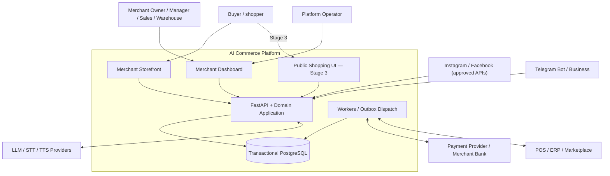
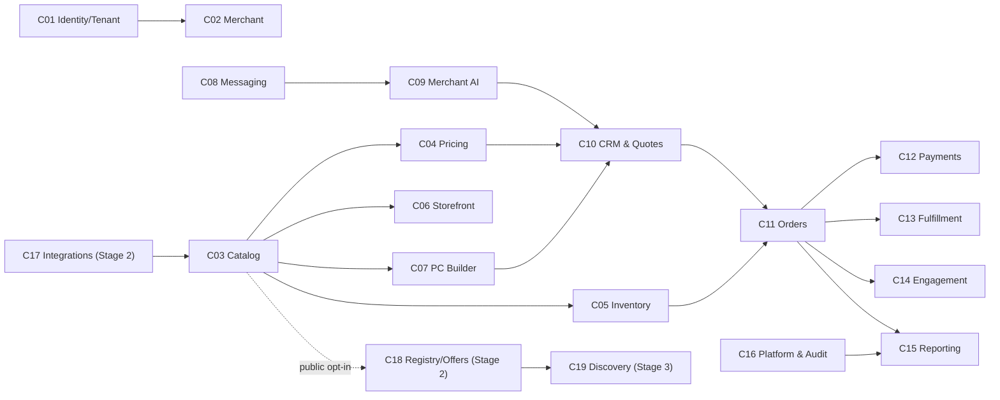
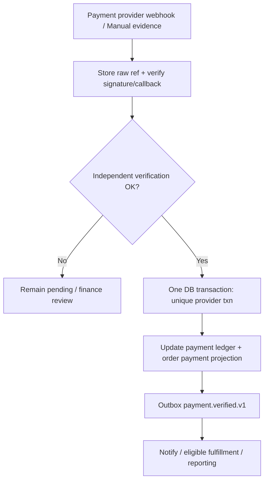
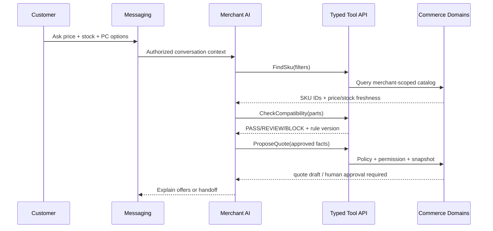
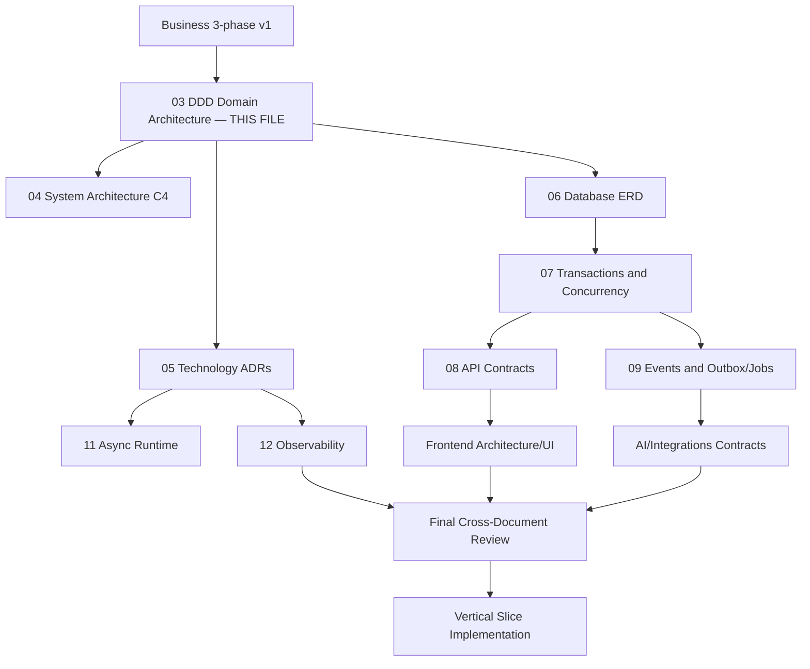

# AI COMMERCE OS & NETWORK — DDD DOMAIN ARCHITECTURE

> **Doc ID:** TECH-03 / `03_DDD_DOMAIN_ARCHITECTURE.md`  
> **Version:** v0.9 — architecture proposal for founder review  
> **Date:** 2026-10-21  
> **Scope:** Stage 1 Merchant Sales OS (implementation-oriented); Stage 2 Merchant Network; Stage 3 Global AI Shopping (extension boundaries)  
> **Depends on:** `00_README_AND_SCOPE.md`, `01_BUSINESS_VISION_AND_3_PHASES.md`, `02_ALL_BUSINESS_MODULES.md` (`M01–M39`), `03_BUSINESS_RULES_108.md` (`BL-001…BL-111`), `04_ROLES_PERMISSIONS_AND_APPROVALS.md`, `05_STATE_MACHINES_AND_EXCEPTIONS.md`, `07_BUSINESS_ENTITIES_AND_DATA_BOUNDARIES.md`, `09_MODULE_INTERACTIONS_AND_NOTIFICATIONS.md`, `11_BUSINESS_DECISIONS_ASSUMPTIONS_AND_RISKS.md`.  
> **Status:** This is NOT implemented code, finalized ERD, validated API/SLAs or approved technical ADR. It is the DDD foundation and the input to subsequent design documents.  
> **Owner:** Founder. **Review:** Product, security, engineering (AI-assisted draft, founder approves).

---

## 0. Executive decision (read this first)

**Implementation candidate:** Python/FastAPI + PostgreSQL-based **Modular Monolith**, using **bounded contexts**, **application services**, **domain model**, and **ports/adapters**. API, scheduled jobs, Telegram webhook handlers and AI orchestrator are *different entry points to the same application use cases*. Stage 1 does not create microservices, Kafka or one database per module. The **frontend is a separate repo**; `infra/` lives in the backend repo until operating requirements justify separation.

**Core principle:** 39 *business modules* are capabilities, **NOT 39 backend services or 39 databases**. These modules are grouped into bounded contexts according to ownership, language and invariants. The stage 2/3 contexts are defined now, but their persistence/API/workers are NOT built during stage 1 without a validated use case.

**Definition of good architecture:** `Merchant A` data cannot leak to Merchant B; price, stock and payments cannot be invented by AI; a retried webhook does not duplicate an order; two simultaneous buyers cannot both reserve the same final SKU; old events cannot resurrect withdrawn offers; operators can take over an AI conversation without double replies. All of these require tests, not merely descriptions.

### 0.1 Decision confidence

| Decision | Status (2026-10-22) | Reference |
|---|---|---|
| DDD-style modular monolith | APPROVED baseline | ADR-001 |
| Shared PostgreSQL, tenant-scoped records; RLS spike S0 | APPROVED baseline | ADR-002, ADR-026, TECH-23 |
| Unified transaction boundary for order confirm + reserve | APPROVED, REQUIRED INVARIANT | ADR-021, TECH-07 |
| Separate AI execution process / worker | APPROVED baseline | ADR-011, TECH-11 |
| Outbox durable, at-least-once; PG leased jobs | APPROVED | ADR-005, DEC-003 |
| Global canonical product separate from merchant SKU | BUSINESS BASELINE (Stage 2); Stage 1 — reference spec library | ADR-028 |
| Two repos (`backend`, `frontend`), frontend — 2 Next.js app | APPROVED | ADR-009, ADR-010 |
| Payment | Stage 1 da tizimdan tashqarida | DEC-100 |

Barcha qarorlar va variantlar: `../decisions/DECISION_REGISTER.md`.

## 1. Three commercial stages and non-goals

| Stage | System we actually ship | New core bounded contexts | Explicitly do NOT build yet |
|---|---|---|---|
| **1** | Merchant-specific selling: website, catalog/stock/price, messaging+AI, quotes/orders, payment state, delivery, dashboard/voice read-only | Merchant Identity, Merchant, Catalog, Pricing, Inventory, Storefront, Messaging, AI Sales, CRM+Quotes, Orders, Payments, Fulfillment, Notifications, Reporting, Platform Governance | Global price comparison, ad ranking, multimerchant checkout, full custom-trained LLM |
| **2** | Self-serve merchant scale, partner integrations, canonical catalog, merchant opt-in public offers | Provisioning enhancements, Integration Hub, Canonical Catalog, Public Listings, Publication pipeline, Merchant Trust | Public mass-market promise before data-quality gates pass |
| **3** | Public global product/merchant search, multi-offer price comparisons, geosearch, consumer AI advisor and referrals | Discovery, Shopper Identity/Alerts (conditional), Referral Attribution, Ads & Transparency (conditional) | Payment custody, universal buyer protection/returns, agro and full B2B wholesale |

**Extensions beyond Stage 3:** farmers/agro, international payments, social-media AI marketing studio and platform-wide logistics are separate future product annexes; they do not silently extend stage 1 entities or deadlines.

## 2. Ubiquitous language: never mix these terms

| Term | Definition | Ownership / key constraint |
|---|---|---|
| `Merchant` | A legally/business-distinct shop tenant | Merchant context; isolated by `merchant_id` |
| `Principal` | An authenticated human/service actor | Access context; no tenant inferred solely from submitted body |
| `Membership` | Principal's relationship to merchant, role/scope | Access context, server-validated |
| `Branch` | A physical shop/fulfillment location | Merchant context, branch ownership always checked |
| `MerchantProduct` | Merchant-specific product representation | Merchant Catalog; NOT a canonical market product |
| `MerchantSKU` | Variant + condition and merchant identifier | Merchant Catalog; unique within merchant |
| `CanonicalProduct` | Verified model/variant identity used for comparing products | Network Registry; stage 2; has no stock or sell price |
| `MerchantOffer` / `PublicOffer` | Merchant-authorized, publishable description of selling a SKU | Public Listings; must support immediate takedown/read-time deny |
| `PriceVersion` | Versioned source of a particular merchant SKU selling price | Pricing; historical quotes preserve snapshot |
| `StockBalance` | Physical/reserved/allocated quantities for merchant-branch-SKU | Inventory; authoritative commerce quantity |
| `Reservation` | Temporary claim on stock with TTL, state and origin | Inventory; one request cannot reserve twice |
| `Lead` | Per-merchant opportunity, with consented requirements | CRM; never globalized by matching phone number silently |
| `Quote` | Versioned immutable offered terms once approved/sent | CRM+Quotes; snapshot of SKU specs, price, currency, delivery and expiry |
| `Order` | The merchant's committed purchase intent and its line snapshots | Orders; not the same as verified paid or delivered state |
| `PaymentAttempt` | External or manual attempt to settle an order | Payments; proof upload != verified funds |
| `Shipment` | Dispatch/pickup process and evidence | Fulfillment; not equivalent to Order |
| `Conversation` | Merchant-scoped session for a channel account and counterpart | Messaging; human/AI speaking authority explicitly tracked |
| `BusinessEvent` | State-transition fact, e.g. `order.created.v1` | Emitted by domain owner in same transaction as state mutation |
| `OutboxMessage` | Durable intent to transmit a committed event/task | Shared infrastructure; at-least-once delivery |
| `ReadModel` | Rebuildable read-optimized projection for dashboard/search | Not authoritative for checkout, money or stock |

**Strict anti-corruption rule:** marketing language like “sale,” “income,” “stock” must be mapped to exact domain definitions (`paid_gross`, `net_paid_sales`, `refunded`, `reserved`, `sellable`). AI reports may only name approved metrics, not freehand SQL-derived guesses.

---

## 3. System context diagram



**Roles:** merchant buyer, merchant staff and public shopping user have different data visibility. Platform admins have purpose-limited support access and audit; no unconditional access to every merchant's private chats.

## 4. Bounded context inventory (code-facing organization)

The table is **the authoritative proposed mapping for all M01–M39**. Stage 1 logical code packages are intentionally fewer than business capabilities. The precise boundaries will be recorded as ADRs and revisited only against measurable coupling problems.

| Context / package | Business coverage | Domain ownership and responsibilities | Stage |
|---|---|---|---|
| **C01 Access & Tenant** `identity` | M01, M02, M21 (provisioning access), M26 (tenant lifecycle) | Principal/Membership, effective permissions, current tenant, invite, merchant lifecycle authorization | 1→2 |
| **C02 Merchant Profile** `merchants` | M01, M03, M21 | Merchant identity/profile, branches, hours, locations, service zones and storefront defaults | 1→2 |
| **C03 Merchant Catalog** `catalog` | M04 | MerchantProduct/SKU/variant/attributes/media/publishing, file import contracts | 1 |
| **C04 Pricing** `pricing` | M05 | PriceVersion, currency, discounts, limits, price snapshots and effective-time checks | 1 |
| **C05 Inventory** `inventory` | M06, M25 | Branch stock balances/ledger, reservations, allocation, release, receipts, branch transfer | 1→2 |
| **C06 Storefront** `storefronts` | M07, M38 (public SEO content via adapter) | Site branding/routing/renderable catalog projection, merchant domain/subdomain, publication visibility | 1→3 |
| **C07 PC Advisor** `pc_builder` | M08 | Component rule set, compatibility decisions, versioned assembly proposal; not monetary authority | 1 |
| **C08 Channels & Inbox** `messaging` | M09, M10, M39 (global channel adapter later) | Provider accounts, webhook identities, conversations/messages, AI/human handoff and outbound send authority | 1→3 |
| **C09 Merchant AI** `merchant_ai` | M11, M27 | Agent session, merchant-scoped knowledge/policy, tool orchestration and escalation | 1→2 |
| **C10 CRM & Quotes** `sales` | M12 | Leads, customer linkage/consent, Quote revisions, approvals, immutable offer snapshot | 1 |
| **C11 Orders** `orders` | M13 | Order, lines, confirmation, cancellation/exception, independent order status | 1 |
| **C12 Payments** `payments` | M14 | PaymentAttempt, settlement verification ledger, refund case, provider transaction mapping | 1 |
| **C13 Fulfillment & After-sales** `fulfillment` | M15, M16 | Shipment/pickup, courier proof, warranty/RMA and delivery exceptions | 1 |
| **C14 Engagement** `engagement` | M17 | Task, notification templates, consent/recipient, outbound delivery and SLA escalations | 1 |
| **C15 Reporting & Voice** `reporting` | M18 | Metrics definitions/read-models, scoped reporting queries, voice read-only command routing | 1 |
| **C16 Platform Ops & Audit** `platform` | M19, M20, M26 | Subscription usage/billing policy, merchant AI quotas, system ops and append-only business audit | 1→2 |
| **C17 Integration Hub** `integrations` | M22, M30 | External provider connections, API keys, sync jobs, per-field source priority, reconciliation | 2 |
| **C18 Product Registry & Listings** `market_catalog` | M23, M24, M28, M29 | Canonical product ID, reversible matching, merchant publication consent, public offer, trust and search publication | 2 |
| **C19 Public Discovery** `discovery` | M31, M32, M33, M34, M35, M36, M37, M38, M39 | Search/compare/geo, public shopping AI, referrals, saved alerts, transparency, SEO, global bot | 3 |

**Important:** contexts C01–C19 represent **domain boundaries**, not independently deployed systems or necessarily 19 top-level folders on day one. For MVP, `platform`, `merchants`, `identity` and `fulfillment` may start with limited subpackages, while business rules remain owned. **M01 spans C01 + C02**: Access controls the identity/access lifecycle; Merchants owns profile. `M19/M26` also span tenant/platform subscriptions; multiple-context coverage is intentional *capability composition*, never dual ownership of one database table.

### 4.1 Ownership rule

1. Exactly **one context owns each mutable aggregate/table**.
2. Other contexts cannot directly write another context's ORM model or table.
3. Read via explicit application query ports or context-owned published read models; no importing foreign `repositories/` or `models/`.
4. Mutable multi-context synchronous workflows go through a **named orchestration use case** and a **shared DB transaction/UoW**, not ad hoc event chains with weak atomicity.
5. Asynchronous events are for committed facts, notifications and read projections; a queued stock decrement cannot be the *only* enforcement of no-oversell.
6. Third-party integration data is **not domain truth until normalized, authenticated, validated and committed**.
7. Search and AI are **read/decision consumers**, not owners of merchant price, quantity, payment or identity.

### 4.2 Map all business modules explicitly (coverage audit)

| M-ID | Source business module | Owning/use-case context | Note |
|---|---|---|---|
| M01 | Merchant organization/onboarding | C01 + C02 | Membership/access vs profile split |
| M02 | Staff/roles/branch permissions | C01 | C02 owns branch facts |
| M03 | Branch/service region | C02 | Publication subset separately controlled |
| M04 | Catalog/variants/SKU | C03 | Stage 2 mapping out, not in this context |
| M05 | Price/currency/discount | C04 | Immutable price versions |
| M06 | Inventory/receipts/reservation | C05 | Atomic stock guard |
| M07 | Merchant branded web | C06 | Source is C03/C04/C05 publicized view |
| M08 | PC configurator | C07 | Deterministic compatibility checks |
| M09 | Channel connections | C08 | Provider credentials via secret-store refs |
| M10 | Inbox/conversation/handoff | C08 | Exactly one effective speaker at a time |
| M11 | Merchant AI sales | C09 | Tool calls subject to permission |
| M12 | CRM/lead/quotes | C10 | Quote snapshots |
| M13 | Orders | C11 | Checkout orchestrates sync reserve |
| M14 | Payment/proof | C12 | Verified settlement only |
| M15 | Delivery/pickup | C13 | Shipment own FSM |
| M16 | Returns/warranty | C13 | Separate case aggregate |
| M17 | Notifications/tasks | C14 | At-least-once with idempotent intentions |
| M18 | Analytics/voice | C15 | Approved metric registry |
| M19 | AI controls/merchant billing/platform ops | C16 + C09 | Limits/plan owned C16; agent policy C09 |
| M20 | Activity/audit | C16 | Append-only audit writes from use cases |
| M21 | Self-service merchant | C01 + C02 | Workflow composed by provisioning app |
| M22 | POS/ERP/marketplace integration | C17 | Anti-corruption adapters |
| M23 | Canonical product | C18 | Versioned identity + split/merge |
| M24 | Merchant public offer/opt-in | C18 | Private by default |
| M25 | Multi-branch stock/fulfillment | C05 + C13 | Separate stock vs shipment ownership |
| M26 | Scale tenancy/subscriptions | C01 + C16 | Lifecycle/usage separation |
| M27 | AI knowledge center | C09 | Policy is merchant-scoped |
| M28 | Search publishing/data quality | C18 | Events + index projection |
| M29 | Verification/trust | C18 | Public verified badges with expiry |
| M30 | Partner API/dev access | C17 | Scoped API keys |
| M31 | Global search/filter | C19 | Public read only |
| M32 | Price comparison | C19 | Read pricing from public offers, not private prices |
| M33 | Geosearch/maps | C19 | Public approved locations |
| M34 | Global shopper AI | C19 | Separate trust and prompts from C09 |
| M35 | Referral tracking | C19 + C10 | Consent-gated merchant lead handover |
| M36 | Buyer profile/saved/alerts | C19 | Optional and separate global buyer account |
| M37 | Organic/sponsored rank | C19 | Explicit ad labeling |
| M38 | Content/SEO | C06 + C19 | Merchant vs global web properties |
| M39 | Global Telegram/discovery API | C19 + C08 adapter | Public bot cannot use merchant private tools |

**Coverage:** 39/39 business capabilities assigned; some span two owners only where workflows integrate separately owned aggregates.

---

## 5. Strategic design: context relationship diagram



**Read arrows as business collaboration, NOT dependency/import direction.** Avoid cycles: the *implementation dependency* uses `protocols/contracts` exposed by owner contexts. Modules don't import one another's internals. The `orders` application orchestrator can call `inventory` and `pricing` public ports; the inventory domain does not import `orders` models.

### 5.1 Context-to-context integration mode

| From | To | Mode | Contract | Why |
|---|---|---|---|---|
| Messaging → Merchant AI | async after inbound event | `ProcessInboundMessage(conversation_ref,event_ref)` | LLM not inside webhook ACK |
| Merchant AI → Catalog/Pricing/Inventory | synchronous **read ports** | `FindSku`, `GetActivePrice`, `GetAvailability` | No facts invented; freshness |
| Merchant AI → CRM | authenticated command | `QualifyLead`, `ProposeQuote` | Controlled writes, tenant actor |
| PC Builder → Catalog | read structured spec snapshot | `GetComponentSpecs` | Deterministic compatibility evidence |
| CRM+Quotes → Pricing | sync read + snapshot | `ValidateQuotePrice` | Immutable proposed terms |
| Orders → CRM+Quotes/Pricing/Inventory | **synchronous app orchestration / one UoW** | `ConfirmOrder` coordinated by application workflow | No oversell, snapshot atomicity |
| Payments → Orders | sync state coordination at verified payment commit | `ApplyVerifiedPayment` | Duplicates/out-of-order handled |
| Orders → Fulfillment | event once eligible | `order.fulfillment_eligible.v1` (PROPOSED) | Not all orders are ready on creation |
| Orders/Payments → Engagement | event | `order.created.v1`, `payment.verified.v1` | Notification not coupled to checkout latency |
| Transactions → Audit/Outbox | same DB transaction | `AuditEntry`, `OutboxEvent` | Reliable changes and trace |
| Catalog/Pricing/Inventory → Registry (Stage 2) | event to projection | `sku.published`, `price.changed`, `stock.changed` | eventual consistency + freshness |
| Registry → Discovery (Stage 3) | index/public read port | `FindOffers` | Global buyer must never query merchant private tables |
| Public Discovery → CRM merchant (Stage 3) | consented referral command | `RegisterPublicReferral` | No global auto-merge of customers |

### 5.2 Prohibit internal HTTP for synchronous modules

No HTTP calls between in-process modules; no microservice-for-every-module; no inter-module Kafka as default. Functions/interfaces in the same process are suitable for synchronous business workflows. Workers may run as another **process** using the same application packages and DB; that does not make them separate bounded contexts.

---

## 6. Layered tactical architecture of a domain module

```text
backend/
  src/
    commerce_os/
      bootstrap/
        app_factory.py               # FastAPI init, lifespan, DI wiring
        dependencies.py              # request-scope actor/UoW
        worker_factory.py            # worker wiring, no implicit API startup
      shared/
        kernel/{ids,money,clock,result,events}.py
        security/{actor,authorization,tenant_context}.py
        infra/{db,uow,outbox,logger,tracing,storage}.py
        contracts/{errors,pagination}.py
      modules/
        identity/
          domain/{entities,value_objects,policies,errors}.py
          application/{commands,queries,services,ports}.py
          infrastructure/{sql_models,repositories,adapters}.py
          presentation/{http,schemas}.py
          public.py                  # exported application/query facade only
        merchants/                   # same pattern
        catalog/
        pricing/
        inventory/
        storefronts/
        pc_builder/
        messaging/
        merchant_ai/
        sales/
        orders/
        payments/                    # DEFERRED (DEC-100) — Stage 1 da yaratilmaydi
        fulfillment/
        engagement/
        reporting/
        platform/
        # Stage 2 (not implemented in initial repo by default):
        # integrations/ market_catalog/
        # Stage 3: discovery/
      workflows/
        order_confirmation.py        # ADR-021: order CONFIRMED + inventory reserve (bitta UoW)
        order_completion.py          # COMPLETED + stock consume
        # payment_settlement.py — DEFERRED (DEC-100)
        merchant_provisioning.py     # onboarding cross-context use case
      workers/
        outbox_dispatcher.py
        inbound_messages.py
        notifications.py
        expire_reservations.py
        reconcile_payments.py
      transport/
        telegram_webhook.py
        meta_webhook.py
        web_chat.py
        websockets.py
      api/
        v1/router.py
        middlewares/{trace,auth,rate_limit}.py
      tests/
        unit/
        integration/
        contract/
        concurrency/
        security/
        e2e/
  alembic/
  docs/
    business/
    architecture/
    adr/
  infra/                          # docker, deploy, monitoring config
  pyproject.toml
```

**This is a logical target skeleton**, not a request to create every empty folder before the first coding slice. `shared/kernel` may contain stable primitives only; never a `shared/models.py` containing all business entities. Avoid unnecessary generic repository abstractions and service wrappers with no actual boundary.

### 6.1 Dependency rule (enforced by import tests)

```text
presentation/transport --> application --> domain
infrastructure ---------> application ports + domain
bootstrap --------------> implementations (composition root)

DOMAIN MUST NOT IMPORT:
  fastapi / starlette / pydantic HTTP schemas
  sqlalchemy / redis / celery / httpx / bot SDK
  other_context.infrastructure / other_context.sql_models

APPLICATION MAY USE:
  explicit transaction/UoW ports, time/id generator, authorization interface,
  owner-context public facades/typed ports (NOT foreign ORM models)
```

In Python, avoid relying on directories to enforce boundaries. A CI import-rule test checks forbidden imports and circular dependencies. Compose implementations in `bootstrap`. Design for a *usable* MVP, not dogmatic interface proliferation.

### 6.2 Domain vs application vs infrastructure example

**Inventory domain:** `StockBalance.reserve(qty)` validates non-negative available qty, `Reservation.expire()` decides legal state; no SQL.  
**Application:** `ReserveSku(command, actor, uow)` checks scope and idempotency, obtains lock, loads balance, invokes domain, stores rows, records outbox/audit, commits.  
**Infrastructure:** SQLAlchemy repository uses `SELECT ... FOR UPDATE` / conditional `UPDATE` and unique constraints; failures mapped to typed errors.  
**Presentation:** FastAPI route validates input, obtains trusted `actor` and invokes use case; no business logic in route.

### 6.3 Five rules for `public.py` facades

1. Expose `commands`, `queries`, `DTOs`, `domain events` only.
2. Never expose SQLAlchemy mapped classes.
3. Requests include validated `ActorContext(merchant_id, principal_id, role_scopes, trace_id)` (K-01).
4. Return stable domain/result errors (`NotFound`, `Conflict`, `Forbidden`, `StaleVersion`, `UnknownPrice`).
5. A facade requiring shared atomicity accepts a `UnitOfWork`/transaction handle, it **must not commit itself**. This must be explicit in the contract.

---

## 7. Aggregate ownership and invariants

| Context | Aggregate root | Critical invariant | Transactions / notes |
|---|---|---|---|
| Identity | Membership | Membership must refer to valid merchant; no removal of last active owner | Lock/update on owner change, enforce via transactional guard |
| Merchant | Merchant | Domain/subdomain uniqueness and legal account status; suspension blocks new sale | Ensure active existing obligations remain accessible |
| Merchant | Branch | A branch belongs to exactly one merchant; active order branch cannot be archived blindly | Closing may need escalation |
| Catalog | MerchantProduct/SKU | `(merchant_id,sku_code)` unique; publish requirements; archived SKU historic snapshot stays | Product and variant models have immutable IDs |
| Pricing | PriceVersion / PriceBook | Numeric price and currency, valid effective period, no silent overwrite of old revision | `version` for CAS |
| Inventory | StockBalance + Reservation | `on_hand >= 0`, `reserved + allocated <= on_hand` in supported policy, no duplicate reserve/release/consume | Database lock/atomic update, immutable ledger entry |
| Messaging | Conversation | Exactly one active sending authority at a point in time; provider message dedup | AI vs human ownership fenced by `conversation_version`/lease token |
| CRM | Lead | Tenant-scoped identity/consent; no cross-merchant merge | Minimal retained personal data |
| Sales | Quote | Approved/sent quote revision immutable; TTL and versioned price/spec snapshots | New revision rather than edit sent quote |
| Orders | Order | Legal status transitions, 1 confirmation idempotency, order lines snapshot | Confirm orchestrator sync with inventory |
| Payments | PaymentAttempt / SettlementRecord | Verified once per provider transaction + merchant/order amount/currency | Manual proof alone not verified |
| Fulfillment | Shipment | Delivered only with valid status/evidence; lost/return exception explicit | May be eventual from paid order |
| Engagement | NotificationIntent / MerchantTask | Dedup per business cause/recipient/template and attempt | External delivery at-least-once best effort |
| Reporting | MetricDefinition / ReportRequest | Allowed metric/filter set, tenant scoping, data-as-of disclosed | Read model rebuildable |
| Platform | Subscription / UsageRecord / AuditEntry | Usage based on verifiable events; audit append-only and tenant-scoped | Quota decisions do not mutate merchant money |
| Registry (2) | CanonicalProduct | Exact variant/spec identity; merge/split reversible and auditable | NO stock/prices inside product |
| Listings (2) | PublicOffer | Explicit merchant opt-in + field allowlist + active status + version | Immediate deny on withdraw, index follows |
| Discovery (3) | Referral / BuyerSavedItem | Tracking only with consent/policy; buyer identity independent from merchant CRM | Buyer may be anonymous |

### 7.1 Inventory modeling warning: stage-specific accounting

Physical `on_hand`, temporarily `reserved`, `allocated`, and `sold/shipped` are different states. Stage 1 must select and document **when physical stock decreases** (on dispatch, handover, confirmed POS sale) based on business policy. The ledger must guarantee no duplicate consumption and prevent over-reservation **under the chosen policy**. Do not independently decrement `on_hand` on payment + shipment event retries.

### 7.2 Order/Payment/Shipment statuses must remain separate

Example: `Order.confirmed`, `Payment.awaiting_confirmation`, `Shipment.pending` can exist simultaneously. Do not collapse into single giant enum with misleading `paid=delivered` implications. The business FSM currently contains `FSM-08` Order, `FSM-09` Payment and `FSM-10` Shipment; the technical schema must preserve their independent histories.

### 7.3 Cross-domain invariant boundary

Payment verified does not automatically mean stock consumed. Shipment delivered does not automatically imply refund impossible. A merchant suspension stops *new* checkout or public publication, but legitimate existing orders remain resolvable. Cross-context actions may be synchronous commands (if invariant demands atomicity) or events (if delayed outcome is safe); specify which explicitly.

---

## 8. Transaction and concurrency model — architecture commitments

### 8.1 Order confirm (synchronous, atomic)

Preconditions: authenticated merchant/buyer-safe token, merchant active, quote valid, exact currency, line SKU published, compatibility rule set accepted, price version and available stock fresh. Actor permission and idempotency verified.

```mermaid
sequenceDiagram
  participant API as API/Channel adapter
  participant WF as Checkout Workflow
  participant PR as Pricing/Quote ports
  participant PG as PostgreSQL (same UoW)
  participant INV as Inventory port
  participant ORD as Orders port
  API->>WF: ConfirmOrder(cmd, actor, idempotency_key)
  WF->>PG: BEGIN; claim unique idempotency key
  WF->>PR: Verify quote + prices (tx-consistent)
  WF->>INV: Lock SKU balances in deterministic order
  INV->>PG: SELECT FOR UPDATE / atomic CAS
  INV-->>WF: Reserved quantities or conflict
  WF->>ORD: Create order and immutable lines
  ORD->>PG: INSERT order, reservation, outbox, audit
  WF->>PG: COMMIT
  WF-->>API: order_id + version + CONFIRMED
```

**Never** hold a database transaction open while waiting for LLM, payment gateway, OCR, network or human approval. User can receive `409 INSUFFICIENT_AVAILABLE_STOCK`, `409 PRICE_CHANGED`, `409 QUOTE_EXPIRED`, `409 VERSION_CONFLICT` (K-07).

**Algorithm requirements:** locks acquired by `(merchant_id, branch_id, sku_id)` ascending order; branch row access re-checked; no float money; fixed idempotency scope `(merchant_id, operation, key)`; retry on PostgreSQL serialization/deadlock with bounded attempts and jitter *outside* failing transaction; request timeout must be bounded and correlated.

**Deferred to ERD/ADR:** precise isolation level, `StockBalance` counter strategy (`reserved` vs `allocated`), deterministic retry semantics and stock decrement point. These are NOT implemented by prose; ERD and concurrency tests must finalize them.

### 8.2 Payment verification (separate external trust boundary) — `DEFERRED` (DEC-100)



Manual screenshot or card transfer proof alone must **not** mark a payment verified. Late provider callback after cancellation enters reconciliation/manual resolution if order state conflicts. A retry must return the old result and must not double-apply ledger effects. Payment verification requires merchant-account reference, amount, currency and order correlation.

### 8.3 AI vs operator simultaneous reply (fencing)

Before AI sends outbound message, worker re-reads conversation `speaker=AI` + `conversation_version`/authority epoch; when operator clicks takeover, atomically increments epoch and revokes AI. Agent output created under old epoch is discarded (or queued for human review) and not sent. Provider send may succeed but ACK fail: outbound intention uses unique `message_intent_id`, provider native idempotency if available, otherwise reconciliation/best-effort duplicate suppression with honest at-least-once limitations.

### 8.4 Public offer opt-out (hard privacy gate)

In stage 2, on withdrawal the listing owner's DB state becomes denied in same transaction, with an outbox event. **Public reads enforce current listing consent/visibility** (read-time authority guard), not just a lagged search index. Stale results must be filtered before returning or routed to verification; search engine deletion and cache purge occur asynchronously. Propagation SLA must be measured. Merchant confidential pricing/cost and buyers are never projected.

---

## 9. Ports, adapters and why each is needed

| Port / interface | Domain consumer | Adapter | Why it's isolated |
|---|---|---|---|
| `ProductSearchPort` | Merchant AI, quote builder | PostgreSQL FTS/trigram now; optional semantic later | Swap search strategy without touching agent logic |
| `PricingReadPort` | AI, quotes, checkout | Active price version query | Prevent AI-generated price |
| `InventoryAvailabilityPort` | AI, quotes, checkout | Inventory aggregate query/locks | Inventory remains source of truth |
| `PCCompatibilityPort` | AI, quote build | Deterministic versioned rules engine | LLM must not approve unsafe configuration |
| `LLMPort` | Merchant AI, public advisor | Hosted provider adapter | Fallback, eval, cost controls |
| `SpeechToTextPort` / `TextToSpeechPort` | Reporting voice | Multilingual provider/local option | Voice quality/language portability |
| `ChannelPort` | Messaging/Engagement | Telegram, official Meta, web chat | Provider rules, rate limits and failures isolated |
| `PaymentProviderPort` | Payments | Merchant gateway/manual reconciliation | Settlement verification and signature trust |
| `POSSyncPort` | Integration Hub (2) | BILLZ/ERP/marketplace approved APIs | Per-field source priority, no double accounting |
| `GeocodingPort` / `MapPort` | Merchant/Discovery | Licensed mapping adapter | Geolocation and data retention constraints |
| `MediaStoragePort` | Catalog/AI/receipts | S3-compatible storage | Access control, TTL/retention, secret keys |
| `ReportQueryPort` | Voice Copilot | Predefined metric registry/read model | No arbitrary SQL from LLM |
| `EventPublisherPort` | Outbox worker | Durable queue / direct sender | At-least-once, replay, observability |

**Note:** a 'port' is an explicit testable contract. Do not create an interface for every one-line helper. Choose boundary-specific ports where provider instability, permission or consistency actually matter.

## 10. Domain events and ordering contract

### 10.1 Standard event envelope — K-08

Yagona format `09_EVENTS_OUTBOX_AND_JOBS.md` da (`merchant_id`, `traceparent`, `correlation_id`, `causation_id`, `aggregate_version`, `schema_version`, `producer`, `actor`, `payload`). Bu yerdagi eski taklif (`tenant_id`, `trace_id`) K-01/K-08 bilan almashtirildi.

### 10.2 Event owner / consumer map

| Event | Owner | Eventual consumers | Invariant / replay guard |
|---|---|---|---|
| `merchant.activated.v1` | Merchant | storefront, plan provisioning | No duplicate merchant setup |
| `catalog.sku_published.v1` | Catalog | storefront, AI retrieval, public index later | Upsert by SKU+version |
| `pricing.price_changed.v1` | Pricing | site/search/listings | Higher version wins; quote old snapshot untouched |
| `inventory.stock_changed.v1` | Inventory | site/search, low-stock notification | Re-read balance, don't add delta twice |
| `conversation.message_received.v1` | Messaging | AI, CRM task | Channel event ID dedup |
| `conversation.handoff_requested.v1` | Messaging | Engagement | One open handoff per thread + epoch |
| `quote.approved.v1` | Sales | Notifications/order eligibility | Approved revision immutable |
| `order.created.v1` | Orders | Payment request, notifications | Order+reservation already atomically committed |
| `order.cancelled.v1` | Orders | Stock release/payment review | Idempotent compensation |
| `payment.verified.v1` | Payments | Orders/Fulfillment/Reporting | One verified provider ref |
| `shipment.delivered.v1` | Fulfillment | Notifications/Reporting/Support | Proof and monotonic version |
| `public_offer.withdrawn.v1` | Market Catalog (2) | Search/SEO cache invalidation | Read-time deny; index lag doesn't re-expose |
| `canonical_product.match_changed.v1` | Market Catalog (2) | Matching/search index | Reversible reindex, no SKU rekey |

### 10.3 Durable event processing (design requirements)

- The source DB transaction commits **entity changes + audit + outbox row together**.
- Publisher retries indefinitely or according to explicit quarantine policy, never silently drops unprocessed event.
- Consumers record `(consumer_name,event_id)` unique inbox dedup and aggregate version where ordering matters.
- Event deliveries are **at-least-once**; an external integration's side effects may not be exactly once if provider offers no idempotency. Document compensation and reconciliation.
- Dead-letter queue is actionable: reason, payload reference (redacted), next retry, owner, replay with permission check.
- Internal synchronous invariant must not rely only on eventual consumer: `order.confirm`/reservation, manual payment verification and access checks are examples.
- Event payloads carry **minimal facts and IDs**, not raw chat text, full customer PII, provider tokens, full invoices or speech recordings.

---

## 11. AI boundaries (not a separate merchant transaction authority)



- Merchant AI tools are **capabilities** issued from `ActorContext` with merchant scope; no arbitrary ORM queries or SQL-generation mutation.
- Agent cannot directly set payment `verified`, create price revisions, consume stock or publish merchants' private offers.
- PC recommendation must use compatibility `PASS` from deterministically checked spec; `REVIEW` requires human, `BLOCK` not sold as compatible.
- Knowledge/prompts versioned per merchant. Uploaded PDFs/docs are **untrusted content** and cannot override system role/tool permissions (prompt injection guard).
- Model routing: provider inference before fine-tuning; local model only after evaluation shows quality/cost advantage. Agent escalates on missing catalog fact, stale price, no permission, provider outage.
- Voice Copilot (`uz/ru/en`) initially **read-only**. Speech input -> transcript preview -> intent -> allowlisted metric query -> provenance/timeframe -> localized answer + optional TTS. Numeric ambiguity prompts confirmation; no voice-triggered money/stock write in Stage 1.
- **Two identities:** Merchant Sales AI has merchant private read scope; Global Shopper AI in Stage 3 reads **public** data only and has separate agent tools, prompt contract, policy and cost budget.

## 12. Multi-tenancy, permissions and domain security

- `ActorContext` assembled from validated authentication/session; never from client-submitted `merchant_id`, `role`, `is_admin` or `branch_id` without server-side membership check.
- Private rows have merchant tenancy; cross-tenant FK safety must be considered (`(merchant_id, foreign_id)` composite constraints where useful). Database-level RLS is an option requiring dedicated ADR/testing. **Do not assume RLS by adding a field name only.**
- Branch permission: a merchant manager may have all branches, cashier may have only one; scope checked both in queries and in state changes.
- Public merchant storefront must expose only published content fields, not confidential costs, contact history, internal notes, exact available quantities where merchant policy hides them.
- Global buyer only sees the Public Listings projection; no shared lookup through merchant private price/inventory repositories.
- Platform support actions: break-glass access needs elevated approval, reason, audit and expiration; default support without private buyer chat access.
- PII: per-country retention/legal review; avoid sensitive data in `trace_id` baggage, logs, prompts, analytics, exception pages and outbox payloads.
- External integrations: validate signature/request freshness/merchant binding; protected secrets vault reference; webhook dedup by `(provider,channel_account_id,event_id)`.

## 13. Cross-cutting trace, async and observability requirements

These are **domain-level commitments**, not the full design of middleware instrumentation. The full engineering contract belongs to `OBSERVABILITY_AND_TRACING.md` and `ASYNC_RUNTIME_ARCHITECTURE.md`.

1. Incoming HTTP/WebSocket/webhook gets server `request_id`, W3C trace context if valid, and stable tenant-safe actor context.
2. Across HTTP -> domain workflow -> DB transaction -> outbox -> worker -> channel send, propagate trace/correlation/causation. Worker creates a new span/link when message async continuation requires it.
3. Structured logs include `trace_id`, `request_id`, `tenant_reference` (pseudonymized where needed), `module`, `operation`, `outcome`, `duration_ms`, `error_code`; redact PII, card info, full messages and voice bytes.
4. Spans/metrics for orders, reserve conflicts, price-stale, AI tool calls, model tokens/cost, inbound webhook dedup, outbox age, retry count, DLQ size, payment reconciliation failures, voice tool latency, tenant deny count.
5. Do not run long LLM calls, OCR, STT, CSV bulk import, report exports or outbound channels in request DB transaction; durable worker queue and explicit timeout/backpressure policies.
6. `async def` only for non-blocking I/O paths with async-compatible dependencies. Blocking SDKs / CPU-heavy work go to worker process or threads according to profiling; avoid invisible event loop stalls.
7. A request timing out does not prove operation was rolled back; idempotency/read-after-write status query required for retries.
8. Read model lag is exposed as `data_as_of` or `index_version`; reports distinguish paid, created, cancelled, refunded and shipped metrics.

## 14. Release slices: a solo-founder implementation order

Every slice is **end-to-end**: migrations + backend + frontend + test + audit/telemetry. Avoid completing all backend modules before frontend. No assumption that 3 stages must be fully architected to implementation detail before Stage 1 goes live.

Slice tarkibi va gate'lari — `20_TESTING_AND_RELEASE_PLAN.md` §4 va `../business/10` (DEC-005). Qisqacha:

| Slice | Business modules | Functional chain |
|---|---|---|
| **S0 Poydevor** | M01,M02,M19,M20 | bootstrap, auth (ADR-023), membership/rollar, tenant context + RLS spike, audit, tracing/logs, outbox/jobs, CI |
| **S1 Katalog & sayt** | M03,M04,M05,M06,M07 | branch → SKU → narx (UZS/USD) va stok → reference spec bog'lash → sayt, savatcha → buyurtma so'rovi; "tez sotuv" |
| **S2 Inbox** | M09,M10,M17 | Telegram / Instagram / web → durable inbound → inbox → operator; handoff |
| **S3 AI + PC** | M08,M11,M12 | AI (bake-off'dan keyin) → katalog → compatibility → quote (Manager) → AI buyurtma qoralamasi |
| **S4 Buyurtma (to'lovsiz)** | M06,M13 | operator confirm + rezerv → processing → complete; cancel; paid-mark |
| **S5 Operatsiya** | M16,M18,M19 | matnli hisobot, kafolat murojaati, AI limitlari, backup; voice beta |
| **N1 / G1** | M21–M30 / M31–M39 | Stage 2 / Stage 3 |

M14 (to'lov) va M15 (yetkazish) — `DEFERRED` (DEC-100, DEC-113). S0 security/observability and S2 durable messaging are non-negotiable for any real merchant data.

## 15. Technical design document dependency tree



**Parallel design is allowed:** after context owners are agreed, ERD, UI and OpenAPI can be refined in parallel with crosswalk reviews. The diagram shows required consistency dependencies, not a ban on concurrent drafting.

## 16. ADR ro'yxati — `SUPERSEDED`

Bu bo'limdagi dastlabki ADR ro'yxati boshqa raqamlashda edi va `05_ARCHITECTURE_DECISIONS_ADR.md` bilan to'qnashardi. 2026-10-22 dan ADR'lar faqat `05` da (ADR-001…030). Eski ro'yxat git tarixida (commit `58809a4`).

## 17. Open decisions — `MOVED`

DDD-O01…O12 `../decisions/DECISION_REGISTER.md` ga ko'chirildi va baseline sifatida hal qilindi (xarita — registr §4): O01 → DEC-122, O02 → DEC-104/105, O03 → DEC-103/110/121, O04 → DEC-107, O05 → DEC-100 (deferred), O06 → DEC-113/114, O07 → DEC-116, O08 → DEC-010/112, O09 → DEC-013/016/117, O10/O11/O12 → Stage 2/3 (deferred).

---

## 18. Mandatory design review checklist (signoff gate)

### Domain boundaries and ownership
- [ ] Every M01–M39 maps to context (done in draft); every **mutable aggregate** has one owner.
- [ ] No ORM model imported from a different context; domain import lint runs.
- [ ] Stage 1 implementation does not build stage 2/3 logic unnecessarily.
- [ ] Tenant/public data boundary is explicit; no `merchant_id` trust from input.

### Transactions, async and events
- [ ] Last-one-in-stock double reservation cannot happen under 50–100 simulated parallel checkout attempts.
- [ ] Duplicate idempotency keys and webhook callbacks return existing result without duplicate side effects.
- [ ] Event outbox and state change share a DB transaction; consumer dedup/replay safe.
- [ ] Payment proof does not set paid; late callback has reconciliation policy.
- [ ] AI/human handoff fencing prevents stale AI replies.
- [ ] No LLM/network inside critical DB transaction.

### Product accuracy and operational trust
- [ ] Quote is versioned and immutable; compatibility uncertainty escalates.
- [ ] Voice/read-only reports only use approved metrics with timeframe/data-as-of.
- [ ] Privacy-revoked public offer never served to shopper even if index lags.
- [ ] Open `O-` decisions are tracked against slice gates; none silently defaulted.

### Cross-document compatibility
- [ ] Every data owner becomes explicit FK/constraint in ERD, and API operation maps to owner.
- [ ] Every mutation has defined allowed FSM transition, role, expected version and error contract.
- [ ] Every async action has event owner, durable retry, DLQ, reconciliation and correlation ID.
- [ ] Every P0 user flow has UI states, API mapping and an executable acceptance test.

## 19. Next actual deliverable

**`04_SYSTEM_ARCHITECTURE_C4.md`**: Container diagram for FastAPI, worker, PostgreSQL, Redis/queue, object storage, Next.js storefront/admin, integrations and AI provider boundaries; trust zones, deployment and sync/async arrows. **Then** `05_ARCHITECTURE_DECISIONS_ADR.md` freezes selected technology alternatives and DB transactional ADRs before detailed ERD. The next file must reuse this context map and M01–M39 IDs; no unrelated new modules.

---

**Reference business docs:** `../business/02_ALL_BUSINESS_MODULES.md`, `03_BUSINESS_RULES_108.md`, `04_ROLES_PERMISSIONS_AND_APPROVALS.md`, `05_STATE_MACHINES_AND_EXCEPTIONS.md`, `07_BUSINESS_ENTITIES_AND_DATA_BOUNDARIES.md`, `09_MODULE_INTERACTIONS_AND_NOTIFICATIONS.md`, `11_BUSINESS_DECISIONS_ASSUMPTIONS_AND_RISKS.md`.
