# AI COMMERCE OS & NETWORK — SYSTEM ARCHITECTURE (C4)

> **Doc ID:** TECH-04 / `04_SYSTEM_ARCHITECTURE_C4.md`  
> **Version:** `v0.9 — engineering review draft`  
> **Date:** 2026-10-21  
> **Product:** AI Commerce OS & Network, **3 commercial stages**  
> **Authority:** baseline architecture (2026-10-22, ADR-001…030 — `05`); NOT deployed, audited or benchmarked  
> **Source:** `03_DDD_DOMAIN_ARCHITECTURE.md` (C01–C19), business v1.0 (`M01–M39`, `BL-001…BL-111`), `../decisions/DECISION_REGISTER.md`  
> **Owner/approval:** founder; key alternatives are decided by `05_ARCHITECTURE_DECISIONS_ADR.md`  
> **Next dependency:** `05_ARCHITECTURE_DECISIONS_ADR.md` → ERD, transaction/concurrency, API, events, AI and UI contracts.

---

## 0. Scope, intended readers and architectural status

Ushbu hujjat **tizim qayerda ishlaydi, qaysi jarayon qaysi komponent bilan qanday aloqa qiladi, qaysi ma'lumot qayerda authoritative ekanini** ko'rsatadi. Bu hujjat ERD, endpointlarning to'liq ro'yxati, database migration, LLM model benchmarki yoki production-ready Terraform emas. Ular tegishli keyingi hujjatlarda yopiladi.

**Yagona biznes yo'l:**
- **Stage 1 — Merchant Sales OS:** PC/elektronika do'koni uchun o'z veb-sayti, inventar/katalog/narx, AI-chat, CRM/quote, order, to'lov tasdig'i, delivery, reporting va uch tilli voice copilot.
- **Stage 2 — Merchant Network:** self-service onboarding, POS/ERP sync, canonical-product matching, public offer opt-in va publish pipeline.
- **Stage 3 — Global AI Shopping:** xaridor bir xil mahsulotni ulangan do'konlarning narx, lokatsiya, mavjudlik va kafolati bo'yicha solishtiradi; xolis AI advisor.

**Out of scope:** agro/B2B uchun maxsus domenlar, cross-merchant payment settlement, universal platform-owned delivery fleet, barcha social networkni tasdiqsiz avtomatlashtirish, LLMni noldan o'qitish.

### 0.1 Majburiy invariantlar (G-01…G-15)

| ID | Architecture-wide invariant | Isbot/qayerda tekshiriladi |
|---|---|---|
| G-01 | Merchant A boshqa merchant B'ning private data/AI tools'ini o'qiy olmaydi | Security integration/negative tests |
| G-02 | Narx, ombor, to'lovning truth manbai LLM/search/cache emas — domain owner + PostgreSQL | Business/AI contract tests |
| G-03 | Order confirmation va inventory reservation bitta DB UoW ichida | Parallel checkout tests |
| G-04 | Xabar kelgani haqidagi webhook 2xx bo'lishidan oldin inbox event durable saqlanadi | Crash/retry tests |
| G-05 | State update + outbox same transaction; consumer at-least-once, idempotent | Failure injection |
| G-06 | Payment proof/check rasmi `PAID` degani emas; merchant/provider tasdiqlashi talab | Payment E2E |
| G-07 | AI/outbound kanal orqali javob faqat hozirgi speaker lease/version bilan chiqadi | Handoff race test |
| G-08 | `traceparent`, `request_id`, `event_id` va `job_id` orqali async chainni kuzata olamiz | Distributed trace smoke test |
| G-09 | Public search private merchant table'dan to'g'ridan-to'g'ri ma'lumot bermaydi | Public projection contract tests |
| G-10 | Merchant public listing'ni bekor qilsa, qidiruv indeksi kechiksa ham public API qaytarmaydi | Opt-out freshness test |
| G-11 | AI tool'lari tenant/role/branch va merchant policy guard'dan o'tadi | Tool authorization tests |
| G-12 | Queue xabari yo'qolishi yoki takrorlanishi biznes invariantni buzmaydi | Retries + DLQ/replay tests |
| G-13 | Provider token/PII/audio raw log/trace ichiga yozilmaydi | Security/log redaction tests |
| G-14 | Stage 1 MVPda 19 ta microservice yoki bitta DB per context yaratilmaydi | Architecture/deployment review |
| G-15 | Har bir P0 use case UI + API + DB + worker + tracing + rollback/acceptance bilan reliz qilinadi | Release checklist |

**Atamalar:** C4 uchun `System Context (C1)`, `Containers (C2)`, `Components (C3)`, `Deployment (C4)` ko'rinishini ishlatamiz. Pastdagi Mermaid diagrammalar C4 mantig'ini ifodalovchi `flowchart/sequenceDiagram`; ular maxsus C4 plugin talab qilmaydi. `Container` — Docker container degani emas, mustaqil ishga tushadigan dastur yoki data store.

---

## 1. C1 — System Context: kimlar va qanday tizimlar mavjud?

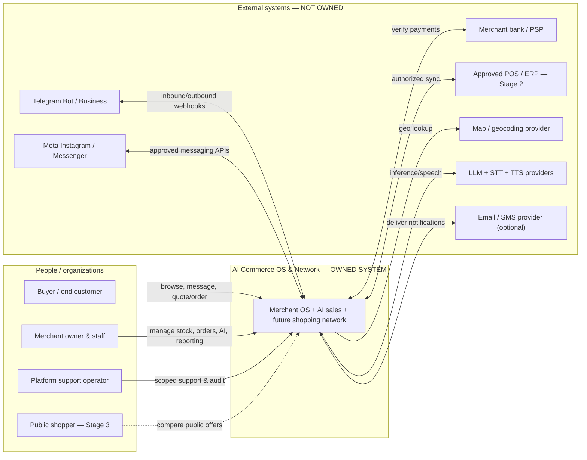

### 1.1 Ishonch chegaralari

| Actor/partner | Nima ko'radi yoki yuboradi | Nima qilolmaydi |
|---|---|---|
| Merchant owner/staff | O'z tenantiga ruxsat etilgan katalog/order/chat/report | Boshqa merchant data; role'dan yuqori action |
| Buyer (merchant web) | Published store catalog + o'z quote/order limited token orqali | Private cost/margin, boshqa xaridor buyurtmalari |
| Stage 3 public shopper | Faqat merchant opt-in qilgan public offers | Private stock ledger, customer data, private price books |
| Meta/Telegram | Shu kanalga tegishli xabarlar, cheklangan outbound | To'g'ridan-to'g'ri DB/LLM tools va order status authority |
| Payment provider | Rasmiy transaction callbacks | Raw proof bilan avtomatik `PAID` yaratib bera olmaydi |
| AI provider | Minimizatsiya qilingan inference payload | Bazaga erkin SQL yozish, merchant secrets yoki hisobot data dump |
| Platform support | Auditlanadigan, purpose-limited support view | Odatiy holatda hamma private chatlarga admin bypass |

**No direct database connectivity from external providers.** Provider ishlay olmasa, savdo core qismlari degraded/manual rejimda davom etishi kerak.

---

## 2. C2 — Stage 1 containers: ishlab chiqarishda ishlaydigan jarayonlar

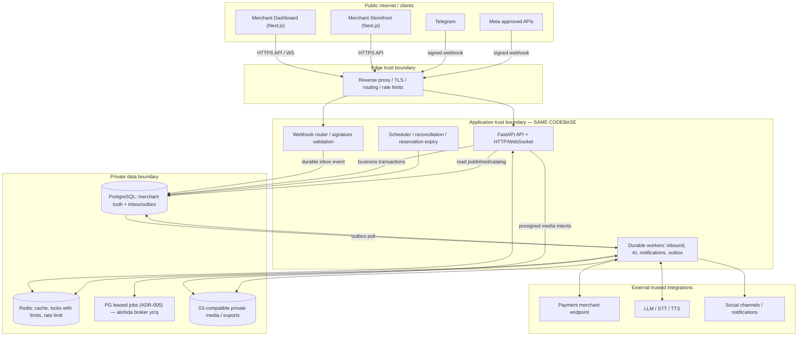

**C2 izohlari:**
1. `FastAPI API` va `workers` — alohida **OS process/deployable**, ammo **bitta codebase/domain application**. HTTP ichida AI modelini yoki batch importni kutmaymiz.
2. `Webhook router` FastAPI process ichidagi route bo'lishi mumkin; diagrammada xavfsizlik/reliability mas'uliyati uchun alohida ko'rsatilgan. Uni alohida server qilish shart emas.
3. PostgreSQL — merchant record, stock/price, transactional inbox, outbox va durable scheduler state **single source of truth**. Redis **yagona durable source emas**.
4. `QUEUE` — PostgreSQL outbox + PG leased jobs (`FOR UPDATE SKIP LOCKED`), alohida broker yo'q (DEC-003, ADR-005). RabbitMQ/Celery faqat o'lchangan queue lag SLO buzilsa.
5. Stage 1 uchun `OpenSearch`, Kafka, Kubernetes va mustaqil vector database **majburiy emas**. Postgres FTS/`pg_trgm` bilan boshlash mumkin; `pgvector` relevans testidan keyingina.
6. Dashboard va Storefront bir frontend repo ichida **ikki Next.js app** bo'lishi mumkin, lekin har ikkalasining sahifa/routing va cookie/trust chegaralari alohida ko'riladi. Aniq Next.js/Vite qarori ADR/UI hujjatida tasdiqlanadi.
7. Ovoz: client mic → authenticated upload/stream → STT → allowlisted report tool → structured answer → TTS; birinchi reliz **read-only**.

### 2.1 Container responsibility contracts

| Container | Allowed responsibilities | Not allowed | Scale boundary |
|---|---|---|---|
| Merchant Dashboard | staff UI, typed API client, view state, report/voice UI | business calculations of money, private provider keys | Independent frontend deploy |
| Merchant Storefront | public catalog/quote UI, SEO, session checkout UX | direct DB/PSP admin credentials | Independent frontend deploy |
| Reverse Proxy | TLS termination, routing, body limits, baseline rate controls | business authorization decisions | Edge replication later |
| FastAPI API | token/tenant validation, queries, domain use cases, transactions | blocking LLM, email, video or giant export inline | Horizontal replicas if needed |
| Webhook handler | signature, account mapping, dedupe, durable persist, fast ACK | running long AI logic before 2xx | API autoscale or separate ingress later |
| Worker pool | AI orchestration, retries, sends, exports, webhook processing, projections | blindly trusting unsigned queue payloads | Separate concurrency by workload |
| Scheduler | durable due-job scan/lease, cron, reconciliation | relying on in-memory timers only | Single logical ownership with locks |
| PostgreSQL | authoritative state, locks, unique constraints, event/inbox/outbox | AI prompt history raw forever | HA/replicas later by measurement |
| Redis | cache, scoped rate limits, short-lived signals | authoritative payments/inventory | Optional HA later |
| Object storage | encrypted media/audio artifacts with TTL policy, audit refs | permanent public PII/audio bucket | External/MinIO with backups |
| External AI APIs | language inference/speech | price/stock/payment authority | Multi-provider fallback by policy |

### 2.2 Repo and process placement

```text
ai-commerce-backend/                    # Repo 1
  src/commerce_os/
    bootstrap/                         # API / worker composition roots
    shared/{kernel,contracts,security,infra}/
    modules/                           # Domain C01–C16 (Stage 1 only)
    workflows/                         # Order+reserve, settlement, provisioning
    transport/                         # Telegram/Meta/webhook and WebSocket adapters
    workers/{inbound,ai,outbox,notification,expiry,reconciliation}/
    api/v1/
  alembic/
  tests/{unit,integration,contract,concurrency,e2e,security,performance}/
  infra/{compose,proxy,observability,backup,scripts}/
  docs/{architecture,adr,contracts}/

ai-commerce-frontend/                   # Repo 2
  apps/{merchant-dashboard,merchant-storefront}/
  packages/{ui,api-client,types,config}/
  tests/
```

**Infra repo nega yo'q?** Bir asoschi + AI yordamchilar uchun production secrets, compose, observability va deploy kodini `backend/infra`da yuritish deploymentga yetarli. Ayrimlari mustaqil jamoa/provisioner bo'lganda ajratiladi. Frontend alohida repo; kontraktni OpenAPI spec versiyasi va generated TS client bilan boshqaramiz.

---

## 3. C3 — FastAPI application component diagram (domain code ≠ independent services)

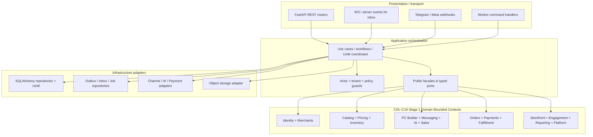

**Component import dependency direction (normative):**

```text
presentation/transport  -> application -> domain
infrastructure          -> application ports + domain
bootstrap               -> all concrete adapters for dependency injection

Forbidden:
  domain -> FastAPI / SQLAlchemy / Redis / Celery / HTTP clients
  modules.A -> modules.B.infrastructure / modules.B.sql_models
  business -> arbitrary shared mutable ORM models
  endpoint -> foreign context SQL UPDATE
```

**C01–C19 ownership (TECH-03 bilan bir xil):**

| Contexts | Source business capabilities | Stage 1 process |
|---|---|---|
| C01 Access & Tenant; C02 Merchant Profile | M01–M03, M21/M26 extensions | API + background provisioning |
| C03 Catalog; C04 Pricing; C05 Inventory | M04–M06, M25 extension | API transaction + import worker |
| C06 Storefront; C07 PC Advisor | M07–M08; M38 SEO extension | API read + merchant web; AI/PC worker |
| C08 Channels & Inbox; C09 Merchant AI | M09–M11, M27/M39 extension | webhook ingest + inbox + AI worker |
| C10 CRM & Quotes; C11 Orders | M12–M13 | REST commands + atomic orchestration |
| C12 Payments; C13 Fulfillment | M14–M16 | verified callback + fulfillment worker |
| C14 Engagement; C15 Reporting & Voice | M17–M18 | outbox notifications + read models + voice worker |
| C16 Platform Ops & Audit | M19–M20, M26 | API, subscription/usage and append-only audit |
| C17 Integration Hub | M22, M30 | **Stage 2**; no full module in Stage 1 |
| C18 Product Registry & Public Listings | M23–M24, M28–M29 | **Stage 2**; separately owned public projection |
| C19 Public Discovery | M31–M39 (and M38 public SEO) | **Stage 3**; shopper-facing read path |

**Implementation rule:** `C01–C16` are logical boundaries; only features needed in S0–S5 become actual code. `C17–C19` are extension boundaries until stages 2–3.

### 3.1 Workflows that must coordinate context owners

| Application orchestration | Participating owners | Atomicity | Side effects outside transaction |
|---|---|---|---|
| `ProvisionMerchant` | Identity, Merchant, Platform | same PG UoW where related rows required | send invite via outbox |
| `PublishMerchantProduct` | Catalog, Pricing, Storefront | catalog state and owner-authorized visibility check | invalidate public storefront cache via event |
| `GeneratePcQuote` | Catalog, Pricing, Inventory (read), PC Builder, Sales | quote proposal with source version snapshot | PDF/render AI explanation after commit |
| `ConfirmOrderAndReserve` | Sales, Pricing, Inventory, Orders | **one PG UoW + row locks/CAS** | notifications via outbox |
| `ApplyVerifiedPayment` | Payments, Orders | verified provider event dedup and matching status coordination within UoW | fulfillment eligibility event |
| `ReconcileExternalStock` | Inventory, Integrations (stage 2) | owner policy and version; no global overwrite | conflict escalation task |
| `UnpublishPublicOffer` | Catalog, Market Catalog (stage 2) | merchant consent revoke enforced at query time | async index delete is secondary |

**Do not** perform external HTTP, LLM inference or channel sends while holding `SELECT FOR UPDATE` transaction locks.

---

## 4. Critical sequence diagrams: from message to paid order

### 4.1 Inbound messaging — ACK after durable write, AI later

```mermaid
sequenceDiagram
  autonumber
  participant CH as Telegram / Meta
  participant WH as Webhook endpoint
  participant DB as PostgreSQL
  participant WR as Inbound Worker
  participant AI as Agent / approved tools
  participant OUT as Outbound Worker
  CH->>WH: POST webhook + signature/id
  WH->>WH: Verify signature, channel account, size & replay
  WH->>DB: BEGIN; INSERT inbound event UNIQUE(provider,account,event_id); COMMIT
  alt Duplicate provider event
    WH-->>CH: 2xx already accepted
  else Persisted
    WH-->>CH: 2xx accepted
    WR->>DB: Lease pending inbox event
    WR->>DB: Load tenant + conversation speaker version
    WR->>AI: Read authorized catalog/price/stock; generate candidate
    AI-->>WR: Typed response + validated tool results
    WR->>DB: Commit response intent + current speaker fencing + outbox
    OUT->>DB: Lease and load send intention
    OUT->>CH: Send approved reply (channel policy)
    CH-->>OUT: Provider message ID / error
    OUT->>DB: Record sent/ambiguous/retry outcome
  end
```

**Return code policy:** invalid signature → reject as specified by provider; confirmed duplicate → success ACK without side effects; durable insert failure → non-success so provider retry can recover. If upstream retries use non-unique IDs, adapter must define stable dedup identity. It is NOT sufficient to push to Redis and ACK. An outbox row, durable inbox row or transactionally polled work source must exist before ACK.

**Hard problem: external send ambiguity.** Telegram/Meta outbound API calls may time out *after provider processed message*. Exactly-once delivery is not universally guaranteed. Use provider idempotency if supported; otherwise mark outcome `UNKNOWN`, reconcile/review or bound retries under a defined policy. Never promise strict exactly-once outbound if provider cannot guarantee it.

### 4.2 AI/human handoff — no double speaker

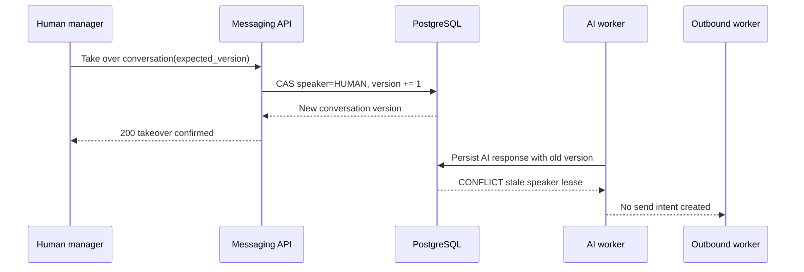

**Send-time fencing:** outbound worker checks speaker/version/policy again immediately before send; if takeover occurs during external HTTP send, no absolute atomicity with third-party provider. Record and surface rare in-flight ambiguous send; suppress further stale messages.

### 4.3 Quote → order + inventory reserve (one transaction)

```mermaid
sequenceDiagram
  autonumber
  participant U as Buyer / sales staff
  participant A as FastAPI use case
  participant PG as PostgreSQL
  participant W as Outbox worker
  U->>A: Confirm quote + idempotency key
  A->>PG: BEGIN UoW
  A->>PG: Lookup idempotency & quote/price versions
  A->>PG: Lock stock rows in deterministic SKU order
  PG-->>A: Current sellable availability
  alt Validation fails / stale / out of stock
    A->>PG: ROLLBACK
    A-->>U: 409 conflict or new quote required
  else Valid
    A->>PG: Create order + lines snapshot
    A->>PG: Reserve SKU & ledger; create expiry
    A->>PG: Add audit and outbox events
    A->>PG: Store idempotent response reference; COMMIT
    A-->>U: Confirmed order with payment pending
    W->>PG: Read committed outbox
    W-->>U: Seller/customer notifications separately
  end
```

**Guard:** reservation update is conditional/row locked and protected by DB constraints; Redis lock alone is insufficient. `on_hand` vs `reserved` vs `allocated` policy is defined in ERD and business final decisions. `order_confirm` must not wait for payment API or LLM under lock. Two independent orders for final stock must yield at most one successful reservation.

### 4.4 Payment and fulfillment boundary — `DEFERRED` (DEC-100, DEC-113; Stage 1 da to'lov va yetkazish tizimdan tashqarida)

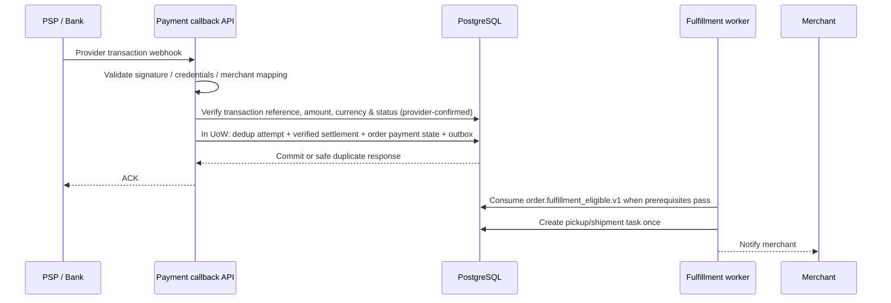

Provider may require an external status query; perform external calls **outside** DB critical transaction and ensure race-safe revalidation inside commit. Manual receipt upload goes to `PENDING_REVIEW` and finance checks real settlement before marking paid. Payment status is not delivery status; refund/return has separate FSM.

### 4.5 Reporting and Voice — UZ / RU / EN

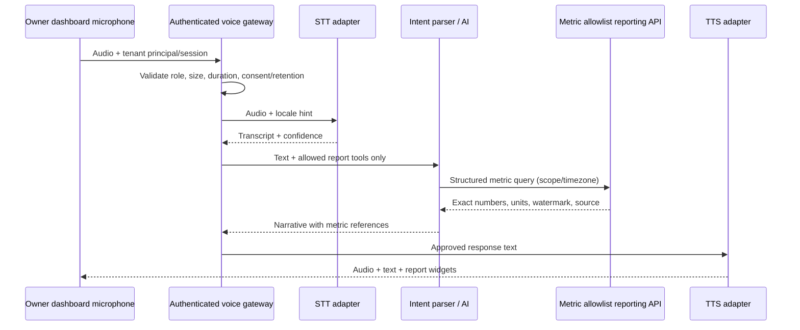

Read-only first. Voice transcription can contain model names, quantities and amount code-switch (`RTX 5060`, `ming`, `тысяч`, `dollars`). Low confidence prompts user confirmation; amount/currency never accepted as unverified write command. Report figures are computed by reporting query layer, **not fabricated by LLM**.

---

## 5. Sync vs async boundaries and queue topology

### 5.1 Workload matrix

| Workload | Entry | Sync/async | Latency/retry/failure rule |
|---|---|---|---|
| Auth + tenant + simple catalog | HTTPS FastAPI | Async I/O on SQLAlchemy async pool | Bounded query/DB timeout; no infinite retry |
| Order confirm + reserve | HTTPS application workflow | **Synchronous short DB transaction** | Version/stock conflict → 409, read latest, caller decides |
| Webhook ingestion | HTTPS FastAPI | Sync durable write (async DB driver allowed) | ACK only after committed durable inbox |
| Chat AI response | Durable inbound event | **Async worker** with LLM network calls | Time budget, quota, fallback to human |
| Outbound Telegram/Meta | Outbox job | **Async worker** | Provider-specific limits/retry/ambiguity management |
| Payment verification | Authenticated callback + reconciliation | Durable processing + short DB transaction | Idempotency + authoritative verification |
| Stock reservation expiry | Persistent due job | Scheduler/worker | CAS reservation state and version; recover after restart |
| File CSV/XLSX import | Upload + import job | Worker/chunked parser | Preview first, errors row-scoped, idempotent final import |
| PDF/large report/export | POST returns job ID | Background worker | Export TTL and signed URL; progress/status endpoint |
| Voice STT/TTS | Audio API/worker | Bounded external calls | transcript preview/fallback text, delete by retention |
| Stage 2 POS sync | Scheduled/webhook job | Queue worker | Per-field source authority; conflict review |
| Stage 3 search | HTTP read | Query against public index + read policy | Cursor/page limit; stale metadata; opt-out fail-closed |

**FastAPI `async def` is not magic:** blocking SDK/CPU-bound document/media transforms cannot run inside the API event loop. Use a worker process or tested threadpool. A cancelled client request may leave committed DB state; use idempotency key and `GET job/order status` rather than assume rollback.

### 5.2 Durable scheduler, outbox and inbox (logical topology)

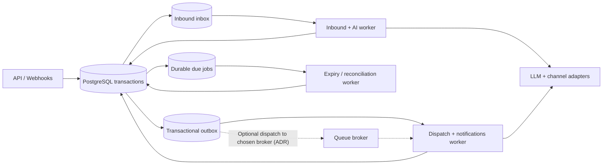

**Messaging semantics**:
- Same DB commit: business state mutation + outbox row + idempotency/audit where applicable.
- Poller uses bounded batch and lease (`FOR UPDATE SKIP LOCKED` style), retry backoff + jitter; lease expires on crash.
- Consumer processed receipt unique by `(consumer_name,event_id)` to protect at-least-once.
- Event envelope: `event_id`, `event_type`, `schema_version`, `merchant_id`, `aggregate_id`, `aggregate_version`, `occurred_at`, `traceparent/trace_id`, `request_id`, `idempotency_key`, payload reference.
- Events from different aggregates may arrive out-of-order; state projection uses `aggregate_version` or latest-source reconciling.
- Dead-letter/quarantine after bounded retry, manual replay with audit; do not auto-repeat financial/non-idempotent external side effects blindly.
- In-memory `BackgroundTasks` is allowed for best-effort noncritical niceties only, not durable payment/stock/notification requirements.
- Jobs for expiration survive deployment restarts. Prefer DB `due_at` as scheduling authority; periodic scanner enqueues eligible work. Redis cache loss must not erase reservations.

### 5.3 Delivery classes

| Class | Example | Delivery guarantee target | Failure behavior |
|---|---|---|---|
| `CRITICAL_DB` | order + stock reserve | Atomic commit or rollback | Caller retries with same key |
| `DURABLE_EVENT` | payment verified, order created | At-least-once, consumer idempotent | DLQ/replay and reconciliation |
| `PROVIDER_SIDE_EFFECT` | messenger notification | At-least-once attempt, provider-dependent duplicates | Ambiguity tracking and channel-specific policy |
| `BEST_EFFORT` | typing indicator, dashboard transient indicator | No durability guarantee | UI polling/fallback |
| `READ_PROJECTION` | search index, reporting aggregate | Eventual consistency | Expose freshness; rebuild safely |

---

## 6. Trust, identity, public/private data and API surfaces

### 6.1 API surfaces

| Surface | Authentication | Visibility & restriction |
|---|---|---|
| `/api/v1/merchant/*` | Staff session/JWT + membership + branch scopes | Merchant-private, row tenant scoping |
| `/api/v1/storefront/*` | Public or short-lived buyer session/token | Published merchant catalog only; no cost/margin |
| `/api/v1/webhooks/*` | Provider signature/known channel secrets | No user token; provider/account mapped to merchant server-side |
| `/api/v1/voice/*` | Merchant staff + report permission + limits | Read-only Stage1; intent and output scoped |
| `/api/v1/platform/*` | Staff support privilege, audited reason + MFA where needed | No blanket cross-tenant bypass |
| `/api/v1/public-search/*` | Public/rate-limited, optional shopper identity | **Stage 3** public offers only |
| `/ws/v1/inbox` | Expiring WS token + merchant+conversation scope | No token in log/URL where possible; reconnect/poll fallback |

**Cross-domain site routing:** merchant subdomain and optional custom domain must be mapped to verified merchant identity server-side. Do not trust arbitrary `Host`, `X-Forwarded-Host` or user-provided `merchant_id` without trusted proxy host allowlist. Public storefront hostname can be untrusted input; domain verification protects shop impersonation.

### 6.2 Multi-tenancy and RBAC

- API resolves `ActorContext(principal_id, merchant_id, memberships, branch_permissions, trace_id)` from server-validated auth / webhook account mapping. Never take `merchant_id` from arbitrary request body as authority.
- DB queries require merchant/branch predicates; design tests for 0 cross-tenant leaks. PostgreSQL RLS — defense-in-depth: S0 spike, o'tsa sezgir jadvallarga (ADR-026, TECH-23 §6); hali sozlanmagan.
- Context owners decide permission policy for each command. Service tokens are short-scoped, rotated, per environment.
- User-facing site and future public global network access **explicitly separated** from staff auth.
- Support staff impersonation (if offered) needs merchant opt-in/explicit time-limited grant, ticket reason, independent audit.
- For AI tools, authorization is enforced on every tool call, not just at conversation start. Budget limits per merchant+channel/session.

### 6.3 Data classification and retention

| Data class | Storage | Exposure | Additional control |
|---|---|---|---|
| Merchant private products, costs, margins | PG tenant-owned | Staff with role/branch scope | No public listing from cost/COGS |
| Published product info & approved public offers | PG projected/public read | Storefront / later network | Merchant consent/opt-in + revocation |
| Buyer personal data/chats | PG + encrypted object for media | Need-to-know only | Data retention, deletion, purpose limits |
| Audio samples/transcripts | Time-limited secure object + controlled references | Voice workflow only | Explicit consent, minimal upload, no default training reuse |
| PSP credentials / tokens | Secret manager / encrypted reference | Backend adapter only | Rotation, least scope; no logs |
| Trace/log context | OTel + structured log sink | Operations only | No raw message/audio/tokens; redaction |
| Events/outbox | PG | Backend internal only | Small payload/pointer; scrub personal data |

**Compliance gate:** actual Uzbekistan data residency/privacy and cross-border AI transfer decision must be reviewed before storing real buyer audio/messages with foreign providers. This is an unresolved requirement, not a law-compliance claim.

### 6.4 Security zones and data flow

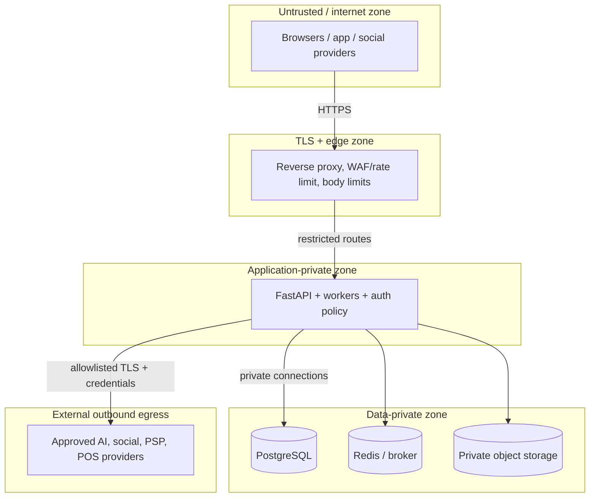

- Do not expose PostgreSQL, Redis, broker, or admin telemetry dashboards to public internet.
- Reverse proxy forwarded IP/host headers trusted only from explicit proxy IPs. Enforce HTTPS, HSTS when safe, safe CORS allowlist, CSRF protection for cookie-auth sessions, input/schema/file checks.
- Restrict uploads: max size/MIME signature validation, scanner policy for public files, temporary quarantine before publication, presigned URLs with short expiration.
- Idempotency key scoped `(merchant, actor/use_case, key)` with request hash; same key different request is conflict, not arbitrary reuse.

---

## 7. Stage 2 network extension — merchant scaling, not premature microservices

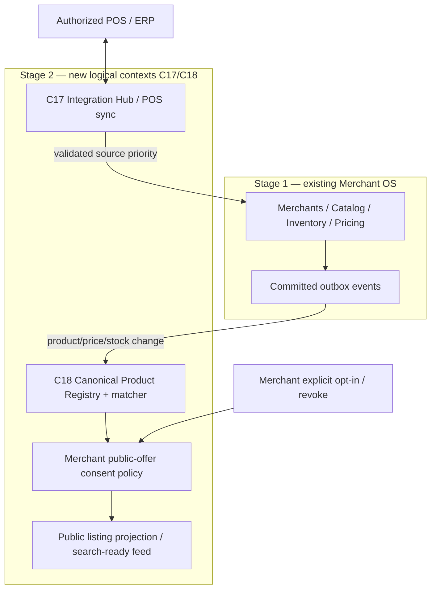

### 7.1 Stage 2 data rules

- MerchantProduct and MerchantSKU (C03) remain merchant-owned. `CanonicalProduct` (C18) models *identity*, NOT stock, selling price or individual contract.
- Same model offers can compare only after variant/condition/storage/warranty constraints; false match safety is more important than high match rate. `UNKNOWN` → manual review.
- `PublicOffer` stores approved public fields + references, `consent_version`, publish status, `last_verified_at`. Private price books, margins, raw buyer chat and internal inventory ledger must not leak.
- Public revoke must be **immediate read-time deny** even if async index update lags. Use authoritative consent/status check, versioned deny-cache/invalidation or equivalent fail-closed policy.
- If external POS and manual merchant dashboard both modify stock/price, one source-of-truth policy **per field/merchant/branch** chooses winner; conflicts get tasks, not silent overwrite.
- Merchant self-service onboarding can be released without exposing global public search until listing and trust checks pass.

**Likely infrastructure change:** stage 2 may require incremental search indexing worker and optional specialized search engine **based on measured scale only**, not by architectural fashion.

---

## 8. Stage 3 network extension — global shopping with clear trust boundary

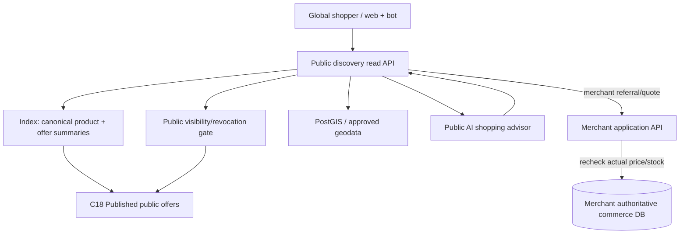

### 8.1 Global discovery guarantees

1. Search runs against public-approved projection only; **no free SQL on private merchant tables**.
2. A product page may have 2–N offers; compare precise variant/model, total price (product + known delivery), condition, warranty, pickup, distance, freshness and seller trust signals.
3. Public ranking and AI explain recommendation factors. Sponsored results are visibly labeled and separated from organic algorithm rules.
4. `data_as_of` and `last_verified_at` displayed; a stale/withdrawn offer can be hidden even if search index still contains it.
5. Merchant referral order is not auto-settled by platform; when buyer moves to merchant flow, fresh price and stock checked again using merchant authoritative context.
6. Location: merchant-provided verified branch data first; mapping/geocoding provider terms and privacy enforced. Public user's exact location is optional and minimal.
7. Stage 3 public shopper identity and alerts opt-in; do not silently merge cross-merchant customer identities.
8. Public assistant tools have **different scopes and credentials** from private merchant AI tools.

---

## 9. Deployment topology & environment separation (C4-style)

### 9.1 Pilot / first paid merchants (target proposal)

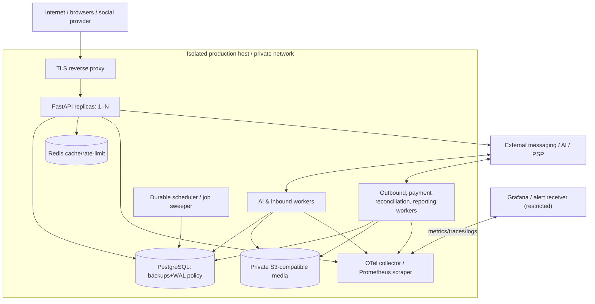

This diagram shows a **logical pilot deployment**: private storage may be hosted S3 rather than on the same machine. Database, observability and backup placement are selected after provider/data residency review. Never use this picture to assume single-VPS uptime is 99.9%; a single host/region is a single point of failure.

### 9.2 Environment matrix

| Env | Data policy | External APIs | Migrations | Deploy/rollback |
|---|---|---|---|---|
| `local` | Synthetic/fake shop and buyer data | Mock/sandbox only | Developer Alembic | Docker compose optional |
| `CI` | Disposable fixtures and fake provider payloads | No real external keys | Fresh schema + migration test | Automated test run |
| `staging` | Sanitized or consent-approved QA data | Provider sandbox/test channel | Production-like Alembic | Release candidate + full E2E |
| `production` | Legitimately processed merchant/buyer data | Approved production keys | Reviewed forward-only + backup | Versioned deploy + rollback plan |

**Production release pattern:** image digest pinned; migration compatibility (expand → deploy → backfill → contract); readiness gate checks DB access and critical configuration; rollout health, rollback application without assuming DB migration reversible; never run concurrent incompatible schema writes.

### 9.3 Fault domains and scaling rules

| Resource | Scale trigger | What to do | Do not do |
|---|---|---|---|
| FastAPI | Latency/CPU/DB pool saturated | Add API replicas **after** query/pool tuning | scale API only while DB overloaded |
| AI workers | Inference queue age, tokens budget, rate limits | Bound concurrency per tenant/provider, add workers | uncontrolled parallel LLM calls |
| Outbound workers | Queue backlog/provider rate limit | per-provider throttle, retries/backoff | flood retries causing blocks |
| PostgreSQL | slow queries, lock waits, connection limits | indexes, query plans, pool budgets, backups/HA | split microservices immediately |
| Redis | cache failures | stale protection, cache-only graceful fallback | treat Redis as payment/stock truth |
| Search | Stage 3 qps/data/relevance | measured index + pg_trgm/FTS; add engine if justified | select OpenSearch without benchmarks |
| Object storage | file growth/PII retention | lifecycle TTL/ACLs/quota | public bucket for proof/audio files |

---

## 10. Observability and cross-process trace propagation

### 10.1 Trace graph

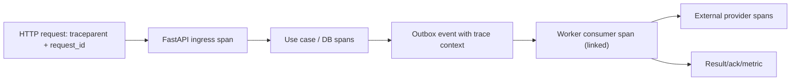

**Conventions:**
- `trace_id` from W3C `traceparent` in trusted/validated form; generate if absent; `X-Request-ID` separate request correlation value. Do not equate random user-supplied request-ID with a trusted identity.
- Put `traceparent` (or trusted trace context fields) + `event_id`, `job_id`, `merchant_id` anonymized/hash as needed into event metadata. Worker creates child or linked span after dequeue (links preferable if asynchronous time gap), not a fabricated continuous HTTP span.
- Redact tokens, full buyer phone, messages, audio and prompt payload. Prefer scalar metadata: model id, tokens, latency, safe error class, provider name, cost estimate.
- Structured JSON logs per container to central sink; Prometheus/Grafana for metrics, distributed traces via OTel collector to chosen backend, Sentry optional errors; exact vendor decisions in ADR.

### 10.2 Minimum metrics and alerts (targets, not proven SLOs)

| Area | Metric name/meaning | Alert prototype |
|---|---|---|
| API | request_rate, p50/p95 latency, `5xx` rate, auth deny ratio | sustained 5xx / high p95 |
| DB | transaction latency, deadlocks, lock wait, pool occupancy | deadlock spikes, pool exhaustion |
| Webhook | ingress dedup rate, invalid signatures, acceptance latency | signature anomaly or persist failures |
| Inbox/outbox | oldest unprocessed age, lease expirations, retry count, DLQ | backlog age above configured SLA |
| AI | first response p95, tool error, model failure, spend/tenant, escalation rate | spend abnormal / wrong-price incident |
| Inventory | negative sellable anomalies, rejected reserve, ledger mismatch | **any confirmed negative/mismatch** |
| Payment | verified callback mismatch, pending reconciliation age, refund exception | any suspicious amount/status mismatch |
| Voice | STT accuracy evaluation, fallback rate, read-report correctness, p95 | unauthorized mutation attempt |
| Stage 3 public | stale offer ratio, opt-out leakage, false product merge | **any opt-out data leak** |

**Candidate targets** (to validate with staging baselines; not contractual): API read p95 `<500 ms` at pilot load; webhook successful durable ACK p95 `<1 s` when provider constraints permit; AI text first response p95 `<12 s` measured from inbound; platform availability trial target 99.5%, not an achieved SLA. Up/down and data residency must be measured/assessed, not assumed.

### 10.3 Incidents and drill plan

- Database unavailable while webhook arrives → error (not false ACK), provider retry → inbox dedup.
- Worker crash during AI → lease reclaims, model request may double-run → cost budget and idempotent downstream actions.
- DB committed but response timed out → idempotency replay returns recorded result.
- Outbound provider accepted but HTTP timeout → `UNKNOWN` status, provider-specific reconcile or manual review.
- Payment provider down → remains pending, scheduler reconciles on recovery; no `PAID` on screenshot.
- FastAPI release incompatible with DB schema → staged expand/migrate/contract, rollback process.
- Redacted log review/restore drill performed before real customer data onboarding.

---

## 11. Failure and recovery matrix (architecture-level)

| Failure/attack | Required architectural control | Expected user/operator behavior | Test obligation |
|---|---|---|---|
| Two buyers reserve final SKU | DB lock/conditional update + constraints | One succeeds, one gets fresh alternative/conflict | 50+ concurrent workers |
| Duplicate payment callback | provider transaction unique + idempotent settlement | No duplicate paid/fulfillment events | Replay callback 100x |
| Stale price in chat/search | versioned price read + checkout revalidation | Ask to accept revised quote | Update price mid-session |
| Fake transfer screenshot | proof is `REVIEW`, never verified | Staff checks merchant settlement | Fraud fixture |
| Provider webhook replay | signature & durable unique ingress identity | Duplicate gets safe ACK, no double AI/order | Replay/out-of-order fixtures |
| AI hallucinated warranty/compatibility | typed catalog/rules tools + approval | Escalate unresolved parts | Golden-set negative tests |
| Operator takes over during AI generation | speaker version CAS + pre-send policy check | Human has authority, stale AI suppressed | Concurrent handoff test |
| Redis loss/restart | DB authority + cache rebuild; durable jobs not solely Redis | Limited degraded UI / no incorrect stock | Redis kill test |
| Worker restart after sending | idempotent intent + ambiguous provider resolution | Do not silently send duplicate business messages | Crash-after-provider test |
| Cross-merchant access through ID | server-derived merchant + role/branch checks | 403/404; audit | Tenant A/B negative tests |
| Stage 2 price/stock sync conflict | per-field source authority; reconcile task | Conflict shown, no silent overwrite | API vs operator race |
| Stage 2 revoked public offer lingers in index | read-time deny + version | Hidden immediately; index repaired async | Revocation/lag test |
| Shopper AI promotes sponsored content as organic | separate labels and rank policy | Clear disclosure | Sponsored transparency UAT |
| LLM provider outage/cost cap | queue timeout, fallback/manual handoff | UI human support path | Provider timeout/429 test |
| Report gives wrong currency/time range | metric registry + timezone/units; stale flag | Structured correction/no fabricated numbers | 3-language metric eval |
| Backup missing/corrupt | scheduled backup + point-in-time policy + restore drill | Incident runbook / planned downtime | Restore on staging |

---

## 12. Architecture alternatives and ADR handoff (do not silently assume)

| Question | Baseline (2026-10-22) | Alternatives | Decision evidence | Required by |
|---|---|---|---|---|
| Runtime | FastAPI Python 3.12+ modular monolith | Django, split microservices | Solo velocity, latency, operational overhead | S0 |
| Database | PostgreSQL 16+ shared tenant-scoped | separate DB per tenant, RLS always on | Cross-tenant tests and backup/restores | S0 |
| Queue | **PG outbox + PG leased jobs (ADR-005)** | Celery/RabbitMQ; Redis queue | guarantees, ops cost, throughput | S0 |
| Cache | Redis optional for rate limits/cache | in-process cache/PG-limits | failure behavior, quotas | S0/S2 |
| Search | Postgres FTS + `pg_trgm` initial | pgvector, OpenSearch/Meilisearch | real product relevance/scale | S1/N1/G1 |
| AI | hosted LLM via `LLMPort` + bake-off (ADR-027), PII redaction + deterministic tools | local inference, fine-tuned specialist | UZ/RU/EN accuracy, token cost/privacy | S3 |
| Voice | S5: matnli hisobot; keyin STT → constrained tools → TTS beta (DEC-112) | local models | Uzbek ASR correctness/consent | S5 |
| Frontend | **2 Next.js apps, separate frontend repo (ADR-010, DEC-014)** | single Next app | SEO, cookie isolation | S0 |
| Hosting | **Compose on VM in Uzbekistan DC (ADR-030, DEC-013)**, huquqshunos xulosasi bilan | managed PaaS, Kubernetes | residency, cost, restore | paid pilot |
| Telemetry | **OTel + JSON logs → Grafana Cloud + Sentry (ADR-029, DEC-012)** | self-hosted stack | expense, privacy and trace quality | S0 |
| Object storage | S3-compatible restricted | local disk, managed vendor | backup/consent/retention | S1 |
| Tenant boundary | **app scoping + composite FK + RLS spike (ADR-026)**; shared-first, dedicated-ready | RLS mandatory first; DB-per-tenant | attack tests, operations | S0 |
| Public revocation | authoritative consent gate + async index delete | index-only deletion | freshness SLA and leak test | N1/G1 |
| Payment checkout | **Stage 1: tizimdan tashqarida (DEC-100)**; keyin merchant-owned PSP | platform custody/settlement | legal/compliance/cost | — |

Qalin yozilganlar founder tomonidan tasdiqlangan baseline (2026-10-22). Ochiq biznes savollari endi faqat `../decisions/DECISION_REGISTER.md` da.

---

## 13. S0–S5: from document to executable vertical slices

| Slice | Implemented containers/components | Expected end-to-end demo | Gate |
|---|---|---|---|
| **S0** | FastAPI bootstrap, PG migrations, identity/tenant/security, audit, trace middleware, CI, restricted observability | Create merchant + member, authorize merchant A, reject B | Tenant A/B tests + trace continuity |
| **S1** | Merchant/branch/catalog/pricing/inventory, storefront app, restricted object media, index | Publish SKU with known price/availability on branded page | Catalog integrity, source version, no private field |
| **S2** | Telegram / Instagram / web channel adapters (DEC-116), durable inbox, outbound worker, chat dashboard, handoff | Buyer writes → staff receives → reply delivered | Duplicate inbound, retry, lease/fencing |
| **S3** | AI tool ports (bake-off'dan keyin), PC compatibility (reference spec library), quote workflow (Manager), AI order draft | Buyer asks budget → grounded components → approved quote → `DRAFT` order + operator | No invented price or invalid PC compatibility |
| **S4** | Orders FSM-08 (to'lovsiz, DEC-100), confirm + reservation workflow, processing/complete, cancel, paid-mark | Operator confirm → reserve → processing → completed (stok kamayadi) | Parallel last-stock race (online + offline), Sales boshqa buyurtmani tasdiqlay olmaydi |
| **S5** | Kafolat murojaati, metric registry, matnli hisobot-chat; voice beta keyin (DEC-112) | Owner matnli savolga to'g'ri raqam va data_as_of oladi | Reconcile metrics and verify report scopes |
| **N1** | C17 integration hub, C18 catalog/offer pipeline, merchant self-service | Merchant opt-in -> canonical match -> public offer feed | Private default, false merge, stale revocation |
| **G1** | C19 public discovery, shopping AI, geosearch, referrals | Shopper compares offers, lands in merchant flow | Same variant, honest price/ads, fresh checkout |

**Not all 8 slices are needed before first cash.** Initial paid beta may stop at S3 if merchant takes payment outside the system and responsibilities are explicit. But S0 security/tracing and S2 durable messaging are foundational. Each slice has DB migration + API + UI + test + observability + deploy; avoid backend-only "complete" modules that cannot serve real merchant workflows.

---

## 14. Testable architecture acceptance checklist

### 14.1 C4 completeness / design review
- [ ] C1 identifies every real people/provider trust boundary.
- [ ] C2 identifies concrete deployables and stores, no hidden queues holding critical events.
- [ ] C3 uses same C01–C19 ownership as TECH-03; M01–M39 are mapped.
- [ ] Stage 2 and Stage 3 extensions do not allow access to private tables or payment custody by default.
- [ ] All API/webhook/channel/voice surfaces have specified tenant auth and limits.
- [ ] C4 deployment distinguishes environment, data location, backup, secrets and rollout.
- [ ] Proposed technologies are not represented as confirmed ADR/implemented code.

### 14.2 Mandatory failures / concurrency
- [ ] Duplicate message after persistent acceptance cannot create duplicate lead/order.
- [ ] AI/human handoff speaker fencing resolves stale worker candidates.
- [ ] DB reserve race at final SKU yields at most one success.
- [ ] Verified callback idempotent and amount/currency/merchant scoped.
- [ ] Outbox and business commit cannot diverge; task replay not corrupt state.
- [ ] Reservation expiry restored after worker restart.
- [ ] Redis/provider/AI outage cannot invent payment/stock or cause data leak.
- [ ] Public offer opt-out immediately denies serving it, despite index delay.

### 14.3 Requirements traceability

| C4 section | Business artifacts | Next detail document |
|---|---|---|
| §§1,6 | Roles, tenant, privacy, M01–M03, BL constraints | `10_SECURITY_AND_RBAC.md` |
| §§2,3 | TECH-03 context map C01–C19; 39 modules | `05_ARCHITECTURE_DECISIONS_ADR.md` |
| §§4.3–4.4,11 | Quote, order, payment, inventory FSM and rules | `06_DATABASE_ERD_AND_SCHEMA.md`, `07_DOMAIN_TRANSACTIONS_CONCURRENCY.md` |
| §§4.1–4.2,5 | Messaging + AI, notification events | `09_EVENTS_OUTBOX_AND_JOBS.md`, `13_INTEGRATION_ARCHITECTURE.md` |
| §§4.5,6 | AI, voice, approved reporting metrics | `15_AI_AGENTS_ARCHITECTURE.md`, `16_VOICE_AI_ARCHITECTURE.md` |
| §§7–8 | M21–M39 public catalog & search | `14_GLOBAL_CATALOG_SEARCH_ARCHITECTURE.md` |
| §§9–10 | Infra, metrics, tracing, SLO | `12_OBSERVABILITY_AND_TRACING.md`, `19_INFRASTRUCTURE_AND_DEPLOYMENT.md` |
| §13 | Versioned roadmap S0–G1 | `20_TESTING_AND_RELEASE_PLAN.md`, `22_DEVELOPMENT_TASKS_AND_REPO_STRUCTURE.md` |

---

## 15. Unresolved blockers and decision owner

| ID | Pending decision | Safe default until signoff | Blocks |
|---|---|---|---|
| C4-O01 | Legal location of database/audio and external AI processing | No real PII/audio without compliance review | real merchant pilot |
| C4-O02 | Durable task broker selection | Outbox/inbox on PG guaranteed; broker implementation TBD | S2 |
| C4-O03 | Stage1 merchant stock source and stock decrement timing | Catalog source only, price/stock manual confirmation if stale | S1/S4 |
| C4-O04 | Quote TTL, discount, FX price reference | Expiring quote snapshot and manager approval | S3 |
| C4-O05 | Payment gateway, callback semantics, refunds | Manual verified status only | S4 |
| C4-O06 | Meta messaging permission and response window | Telegram/web first, disabled Meta until approved | Meta S2 extension |
| C4-O07 | STT quality in UZ/RU/EN and consent | Text/report first; voice readonly, confirm transcript | S5 |
| C4-O08 | One frontend app vs two apps, cookie strategy | Separate merchant dashboard + storefront route trust | S1 |
| C4-O09 | PostgreSQL RLS vs application-layer + RLS | Tenant-scoped mandatory app layer, defense TBD | S0 |
| C4-O10 | Production redundancy and backup RPO/RTO | No HA guarantees before restore drill | paid pilot |
| C4-O11 | Stage 2 public freshness/revocation mechanism | Read-time fail-closed gate; index optional | N1/G1 |
| C4-O12 | Merchant POS master conflicts | No automatic overwrite without approved field policy | N1 |

**Holat (2026-10-22):** C4-O02 → ADR-005 (resolved); O01 → DEC-013 (huquqshunos kutilmoqda); O03 → DEC-105/107; O04 → DEC-103/110/121; O05 → DEC-100 (deferred); O06 → DEC-116; O07 → DEC-112; O08 → DEC-014/008; O09 → DEC-002 (S0 spike); O10 — RPO/RTO ochiq; O11/O12 — Stage 2. Changes to domain boundaries require updating TECH-03 and this document together.

---

## 16. What next? — tarixiy (2026-10-21); amaldagi reja `22_DEVELOPMENT_TASKS_AND_REPO_STRUCTURE.md`

1. **`05_ARCHITECTURE_DECISIONS_ADR.md`**: choose queue, DB tenancy, frontend/server rendering, cache, AI provider abstraction, hosting and observability with alternatives + tradeoffs.
2. **`06_DATABASE_ERD_AND_SCHEMA.md`**: business entities → tables, constraints, indexes and ownership per C01–C19.
3. **`07_DOMAIN_TRANSACTIONS_CONCURRENCY.md`**: exact transaction SQL/UoW, lock order, idempotency and failure tests.
4. Parallel after decisions: OpenAPI, events/notifications, UI flows and AI tools; then end-to-end cross-document review.

**Founder review statement:** diagrams and invariants are drafted; performance numbers, provider/legal access, exact broker choice and detailed schema are **not proven/approved**. Do not pass proposals into production configuration without the named review gates.
