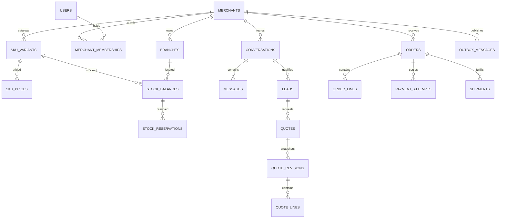
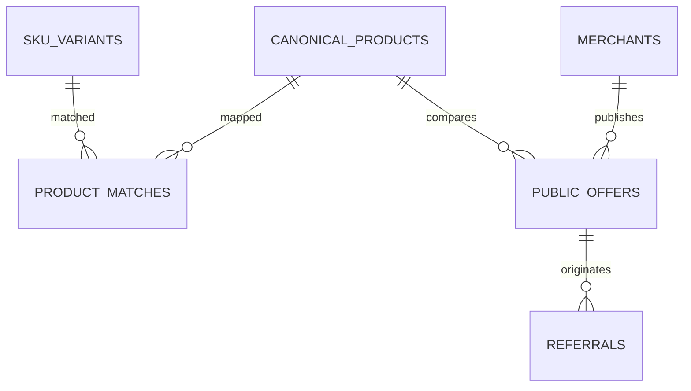

# TECH-06 — Database ERD, schema and lifecycle

**Status:** v1 design draft, NOT deployed DDL. **Primary:** PostgreSQL; SQLAlchemy2 async + Alembic. **Contexts:** C01–C19. **Phase:** normalized Stage 1 tables; Stage 2/3 future-schema *non-migrated* appendix. **Decision refs:** ADR-002/003/004/018, ADR-021/025/026/028. **Baseline (2026-10-22):** K-01 `merchant_id`, K-02 `UPPER_SNAKE` enum'lar, K-04 `on_hand/reserved/allocated`, K-05 rezerv statuslari; to'lov (DEC-100) va yetkazish (DEC-113) jadvallari Stage 1 da migratsiya qilinmaydi.

## 1. Data ownership and invariants
Every merchant-owned record has `merchant_id`, `created_at timestamptz`, and usually `version bigint`; FK should be composite `(merchant_id, parent_id)` where supported to prevent cross-merchant associations. Never reuse row IDs as public tokens. Never expose cost, supplier price, PII or margin in Stage 3.

| Domain | Aggregate / important tables | Owner | Critical invariant |
|---|---|---|---|
| Identity C01 | users, merchant_memberships, role_assignments, sessions | access | active membership for merchant context |
| Merchant C02 | merchants, branches, delivery_regions, policies | merchant | branch in merchant |
| Catalog C03 | merchant_products, sku_variants, product_media, sku_attributes | catalog | unique `(merchant_id,sku_code)` |
| Pricing C04 | price_lists, sku_prices, price_revisions, discount_rules, currencies, exchange_rates | pricing | amount nonnegative; approved revision; SKU narxi UZS yoki USD, kurs snapshot (DEC-121) |
| Inventory C05 | stock_balances, stock_ledger, stock_reservations, stock_receipts | inventory | `on_hand - reserved - allocated >= 0`; ledger reasons incl. `SALE`, `OFFLINE_SALE` (DEC-123), `ADJUSTMENT`, `RECEIPT`, `RETURNED_QUARANTINE` |
| Storefront C06 | storefront_settings, pages, published_sku_snapshots | storefront | only approved public merchant listing |
| PC C07 | reference_hardware_specs (platform, merchant_id yo'q), sku_spec_links, pc_rulesets, pc_builds, pc_build_items, compatibility_results | pc builder | critical rule `BLOCK` prevents quote; bog'lanmagan SKU → `REVIEW_REQUIRED` (DEC-011) |
| Messaging C08 | channel_accounts, provider_events, conversations, messages, handoff_tasks, conversation_summaries, conversation_pii_refs (shifrlangan, TECH-26 §7) | messaging | unique provider event + speaker lease |
| AI C09 | agent_profiles, prompt_versions, ai_tool_executions (TECH-26 §12), ai_usage | ai | no direct money/stock write |
| CRM C10 | leads, quotes, quote_revisions, quote_lines | crm | sent revision immutable |
| Orders C11 | orders (`status`, `fulfillment_method`, `delivery_address`, `paid_mark_*`, `assigned_user_id`), order_lines (price + FX snapshot, warranty snapshot), order_notes, order_status_history | orders | committed snapshots; unique order token; FSM-08 statuses |
| Payments C12 — `DEFERRED` (DEC-100) | payment_intents, payment_attempts, payment_evidence, verified_transactions | payments | proof != verification; Stage 1 da migratsiya yo'q |
| Fulfillment C13 | support_cases (S5, DEC-114); shipments/pickup_requests — `DEFERRED` (DEC-113) | fulfill | qaytgan mahsulot tekshiruvgacha sotuvga chiqmaydi |
| Engagement C14 | notification_intents, notifications, message_templates (TECH-24 §5.6) | notifications | idempotent intent |
| Reporting C15 | metric_definitions, daily_aggregates, report_jobs | reporting | approved definitions, source watermarks |
| Platform C16 | subscriptions, usage_ledgers, audit_entries, outbox_messages, jobs, consumer_receipts, idempotency_keys, merchant_policies | platform/infra | append-only audit, durable delivery; policy: quote TTL, discount limits, reminder hours (DEC-102…110) |
| Integrations C17 | connections, external_id_maps, sync_runs, sync_conflicts | integration | source precedence |
| Registry C18 (S2) | canonical_products, product_matches, public_offers, publish_versions | registry | opt-in and reversible matches |
| Discovery C19 (S3) | search_documents, referrals, saved_searches, ad_placements | discovery | public allowlist only |

## 2. Concept ERD (Stage 1)


## 3. Implementable DDL examples — Stage 1 subset
Schemas below illustrate **minimum** invariants, NOT complete migration. All production tables get audited Alembic migrations and proper tenant FKs.

```sql
CREATE TABLE stock_balances (
  merchant_id uuid NOT NULL,
  branch_id uuid NOT NULL,
  sku_id uuid NOT NULL,
  on_hand integer NOT NULL DEFAULT 0 CHECK (on_hand >= 0),
  reserved_qty integer NOT NULL DEFAULT 0 CHECK (reserved_qty >= 0),
  allocated_qty integer NOT NULL DEFAULT 0 CHECK (allocated_qty >= 0),
  version bigint NOT NULL DEFAULT 1,
  PRIMARY KEY (merchant_id, branch_id, sku_id),
  CHECK (on_hand >= reserved_qty + allocated_qty)
);
CREATE TABLE stock_reservations (
  id uuid PRIMARY KEY,
  merchant_id uuid NOT NULL,
  order_id uuid NOT NULL,
  branch_id uuid NOT NULL,
  sku_id uuid NOT NULL,
  qty integer NOT NULL CHECK(qty > 0),
  status text NOT NULL CHECK(status IN ('ACTIVE','ALLOCATED','CONSUMED','RELEASED','EXPIRED')),  -- K-05
  expires_at timestamptz NOT NULL,
  created_at timestamptz NOT NULL DEFAULT now(),
  UNIQUE (merchant_id, order_id, branch_id, sku_id)
);
CREATE TABLE outbox_messages (
  id uuid PRIMARY KEY,
  merchant_id uuid,
  event_type text NOT NULL,
  aggregate_type text NOT NULL,
  aggregate_id uuid NOT NULL,
  aggregate_version bigint NOT NULL,
  payload jsonb NOT NULL,
  traceparent text,
  created_at timestamptz NOT NULL DEFAULT now(),
  claimed_until timestamptz,
  published_at timestamptz,
  attempt_count integer NOT NULL DEFAULT 0
);
CREATE INDEX outbox_due_idx ON outbox_messages (created_at, id)
  WHERE published_at IS NULL;
CREATE TABLE consumer_receipts (
  consumer_name text NOT NULL,
  event_id uuid NOT NULL,
  applied_at timestamptz NOT NULL DEFAULT now(),
  PRIMARY KEY (consumer_name,event_id)
);
```
```sql
-- Baseline qo'shimchalari (2026-10-22)
CREATE TABLE currencies (
  code char(3) PRIMARY KEY,              -- 'UZS', 'USD'
  exponent smallint NOT NULL CHECK (exponent BETWEEN 0 AND 4)  -- UZS=2, USD=2 (ADR-025)
);
CREATE TABLE exchange_rates (
  id uuid PRIMARY KEY,
  merchant_id uuid NOT NULL,
  base_currency char(3) NOT NULL REFERENCES currencies(code),   -- USD
  quote_currency char(3) NOT NULL REFERENCES currencies(code),  -- UZS
  rate numeric(18,6) NOT NULL CHECK (rate > 0),
  source text NOT NULL CHECK (source IN ('MERCHANT','CBU')),
  effective_at timestamptz NOT NULL,
  created_by uuid NOT NULL
);
CREATE TABLE reference_hardware_specs (       -- platform-owned, merchant_id yo'q (ADR-028)
  id uuid PRIMARY KEY,
  category text NOT NULL,                     -- CPU, MOTHERBOARD, GPU, RAM, PSU, CASE, COOLER, STORAGE
  brand text NOT NULL,
  model text NOT NULL,
  mpn text,
  attributes jsonb NOT NULL,                  -- socket, ddr_generation, length_mm, wattage, connectors ...
  source_url text NOT NULL,                   -- ishlab chiqaruvchi hujjati
  version integer NOT NULL DEFAULT 1,
  UNIQUE (category, brand, model, version)
);
CREATE TABLE sku_spec_links (
  merchant_id uuid NOT NULL,
  sku_id uuid NOT NULL,
  spec_id uuid NOT NULL REFERENCES reference_hardware_specs(id),
  linked_by text NOT NULL CHECK (linked_by IN ('AUTO_MPN','AUTO_MODEL','MANUAL')),
  PRIMARY KEY (merchant_id, sku_id)
);
CREATE TABLE orders (
  id uuid PRIMARY KEY,
  merchant_id uuid NOT NULL,
  status text NOT NULL CHECK (status IN ('DRAFT','PENDING_CONFIRMATION','CONFIRMED','PROCESSING','COMPLETED','CANCELLED','EXCEPTION')),
  source text NOT NULL CHECK (source IN ('AI','STOREFRONT','STAFF')),
  conversation_id uuid,
  assigned_user_id uuid,
  fulfillment_method text NOT NULL CHECK (fulfillment_method IN ('PICKUP','DELIVERY')),
  delivery_address text,                      -- PII: encrypted at rest
  currency char(3) NOT NULL REFERENCES currencies(code),
  total_minor bigint NOT NULL CHECK (total_minor >= 0),
  ready_at timestamptz,                       -- PROCESSING ichida "olib ketishga tayyor" belgisi (TECH-31)
  paid_mark_at timestamptz,                   -- DEC-100a: merchant belgisi, tekshirilmagan
  paid_mark_by uuid,
  paid_mark_method text CHECK (paid_mark_method IN ('CASH','CARD','TRANSFER','OTHER')),
  version bigint NOT NULL DEFAULT 1,
  created_at timestamptz NOT NULL DEFAULT now()
);
```
**Gap requiring review:** `stock_balances` must reference tenant-scoped branch and SKU via composite FKs, and reservation references must be tenant-composite. Stock transfers require separate `stock_ledger` double-entry movement records rather than direct quantity edits.

## 4. Monetary model, pricing versioning
- `money_minor bigint`, `currency_code char(3)` and `currencies.exponent` (ADR-025: UZS = 2, ya'ni 10 000 000 so'm = `1000000000`); all calculations in integer/Decimal, no float. UI butun so'mga yaxlitlaydi. SKU narxi USD bo'lsa, xaridorga UZS da `exchange_rates` snapshot bilan (DEC-121). Snapshot unit price, discount, currency, tax treatment, optional FX version at quote approval.
- `price_revisions` immutable; `sku_prices` pointer/current. `quote_revisions` immutable once sent. Quote acceptance revalidates same/version/expiry or returns `PRICE_CHANGED` and requires explicit reconfirmation.
- (`DEFERRED`, DEC-100) Dedup external payment by `(provider, provider_merchant_id, external_transaction_id) UNIQUE` and merchant-scoped verified transaction link. Ledger separate from attempts.

## 5. Indexes, retention and query patterns
| Query | Index recommendation | Guard |
|---|---|---|
| Inbox newest | `(merchant_id,updated_at DESC,id DESC)` | cursor pagination |
| Orders by state | `(merchant_id,status,created_at DESC)` | tenant authorization |
| Provider webhook dedup | `(provider,channel_account_id,provider_event_id) UNIQUE` | canonical normalized IDs |
| Find active reservation due | partial `(expires_at)` WHERE status='ACTIVE' | SKIP LOCKED batch |
| SKU local lookup | `(merchant_id, sku_code) UNIQUE` | normalized SKU code |
| Public offers (Stage 2) | `(canonical_product_id, published, last_verified_at)` | opt-in and revocation overlay |
| Event rebuild | `(aggregate_type,aggregate_id,aggregate_version)` | version/ordering |

- Sensitive conversations/audio: explicit retention policy and deletion/export flow; design GDPR-like minimization without claiming particular law applies. Backups have expiry and documented deletion limitations.
- Outbox/consumed receipts: partition/TTL after sufficient replay horizon and consumer offset reconciliation. Archive audit separately with tamper checks.
- Migrations: expand → dual-read/write where needed → backfill (idempotent batches) → contract; rollback plan for each incompatible change.

## 6. Tenant scoping and public projection
`merchant_id` is extracted from authenticated membership and set on UoW context. RLS — ADR-026 / TECH-23 §6: S0 spike, o'tsa sezgir jadvallarga (`FORCE ROW LEVEL SECURITY`, `set_config('app.merchant_id', …, true)`). Public catalog is **separate projection**: merchant can opt-in, restrict SKUs, revoke instantly in read path even when search index lags. Do not JOIN private stock ledger in anonymous API.

## 7. Stage 2/3 evolution — do not migrate on day one

- Canonical product identity includes model, exact variant, capacity, condition, manufacturer evidence and `match_confidence/status`; false merge undo must be supported.
- Publication keeps `merchant_id, sku_id, branch/location, revision, allowed_fields, status, revoked_at`; price/stock timestamp prominent; public ranking cannot override truth.

## 8. Verification / hard edge cases
`TC-DB-01`: cross-tenant FK insert rejected; `TC-DB-02`: 2 simultaneous final-SKU reservations → exactly one success; `TC-DB-03`: duplicate payment callback → one verified transaction; `TC-DB-04`: old price revision cannot overwrite newer; `TC-DB-05`: rollback emits no outbox; `TC-DB-06`: create merchant then teardown leaves no leaked public row; `TC-DB-07`: migration rollback/backfill tested on snapshot.

## 9. Open questions
Hal qilingan (2026-10-22): rezerv muddati — avtomatik yo'q, 72 soatlik review (DEC-104); stok manbai — dashboard (DEC-107); to'lov — `DEFERRED` (DEC-100); PC spec — reference library (DEC-011). Ochiq: supplier stoki, retention muddatlari (huquqshunos), RLS spike natijasi (S0), reference spec atributlari sxemasi (`PC_COMPATIBILITY_ENGINE` hujjatida).
