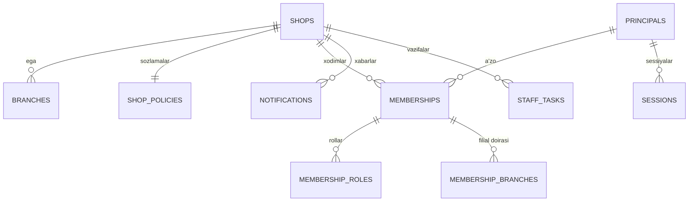
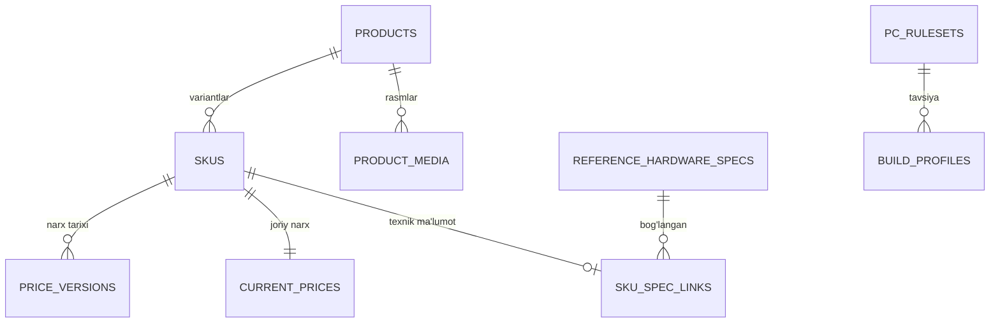
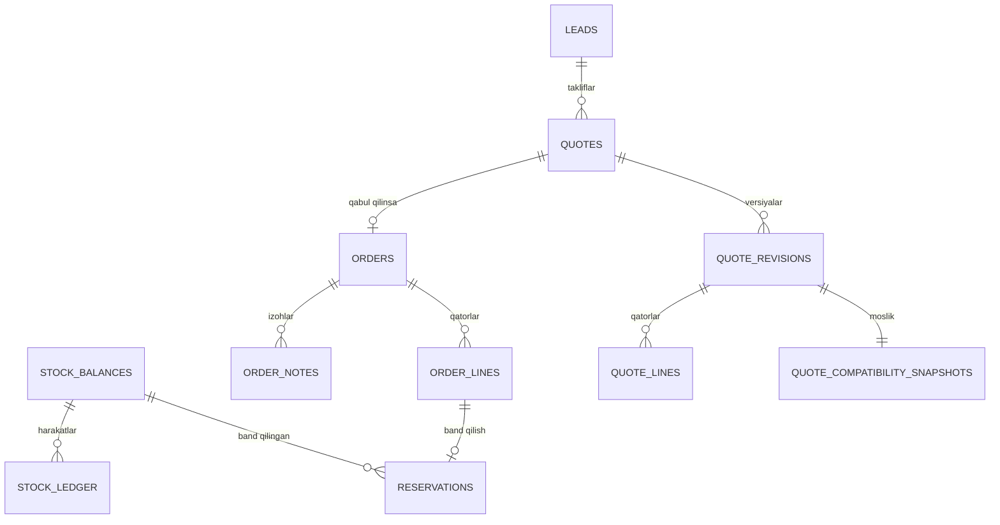
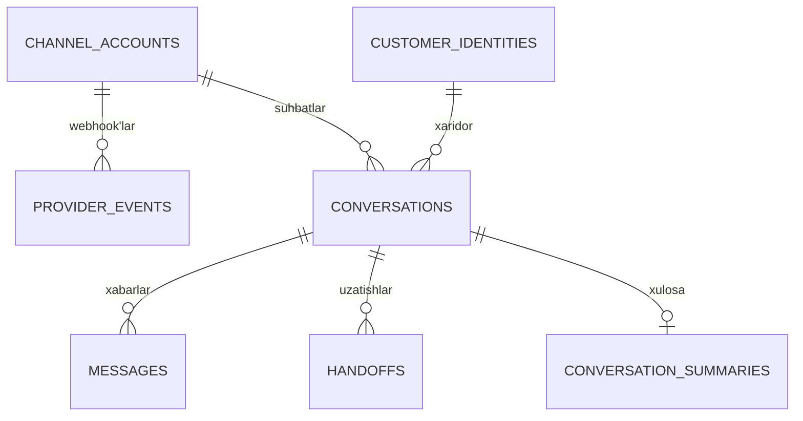

# 07 — Ma'lumotlar qatlami: schemalar, jadvallar, migratsiyalar

> **Versiya:** v2 (2026-10-22). Eski `06_DATABASE_ERD_AND_SCHEMA` va `34_DOMAIN_ENTITIES_AND_DATA_BOUNDARIES` o'rnini bosadi.
> **Bog'liq:** ADR-002, ADR-025, ADR-026, ADR-028, ADR-033, ADR-034, ADR-035; DEC-001, DEC-002, DEC-007, DEC-121, DEC-124; K-01, K-02, K-04, K-05.
> **Kim o'qiydi:** backend dasturchi.
> **Holat:** dizayn, deploy qilingan DDL emas. Aniq DDL Alembic migratsiyalarida yoziladi va shu hujjatga mos bo'lishi shart.

## 1. Muammo va yechim

**Muammo:** bitta PostgreSQL'da yuzlab shop va 7 ta domen. Agar jadvallar aralash tursa: (a) bir shop ma'lumoti boshqasiga sizib chiqishi mumkin, (b) bir domen boshqasining jadvaliga JOIN yoki FK qilib, chegarani buzadi, (c) domenni keyin ajratish imkonsiz bo'ladi.

**Yechim — ikki o'q bo'yicha ajratish:**
- **Vertikal (domen):** har domen — o'z PostgreSQL schemasi (ADR-035). Cross-schema FK va JOIN — TAQIQ.
- **Gorizontal (shop):** har shop jadvalida `shop_id UUID NOT NULL`, shop ichidagi bog'lanishlar composite FK, sezgir jadvallarda RLS (DEC-002, [10-security-tenancy-rbac.md](10-security-tenancy-rbac.md)).

---

## 2. Umumiy qoidalar (har jadval uchun)

| Mavzu | Qoida |
|---|---|
| ID | `id UUID` — **UUIDv7** (vaqt bo'yicha tartiblangan, indeks uchun qulay). Ilovada yaratiladi (`shared/db/mixins.IdMixin`). Ichki ID ommaviy token sifatida ishlatilmaydi |
| Shop | `shop_id UUID NOT NULL` (K-01, `ShopScopedMixin`). Indekslar `shop_id` dan boshlanadi. **Istisno — platformaning global ma'lumotnoma jadvallari** (`shop_id` yo'q, shoplar faqat o'qiydi): `catalog.reference_hardware_specs`, `catalog.pc_rulesets`, `catalog.build_profiles`, `catalog.currencies`; shuningdek `platform.shops`, `platform.principals`, `platform.platform_staff` |
| Vaqt | `created_at`, `updated_at` — `timestamptz`, UTC. Biznes sanalari (hisobot kuni) — shop timezone'ida (`Asia/Tashkent`) hisoblanadi |
| Versiya | O'zgaradigan aggregate'larda `version BIGINT NOT NULL DEFAULT 1` (optimistic lock, `If-Match`) |
| Enum | `TEXT` + `CHECK (status IN (...))`, qiymatlar `UPPER_SNAKE` (K-02). PostgreSQL `ENUM` turi ishlatilmaydi (migratsiyasi qiyin) |
| Pul | `<nom>_minor BIGINT` + `currency CHAR(3)` (ADR-025). Float — TAQIQ |
| Unikal | Shop doirasida: `UNIQUE (shop_id, sku_code)` |
| Shop ichidagi FK | Composite: `FOREIGN KEY (shop_id, product_id) REFERENCES catalog.products (shop_id, id)` — boshqa shop obyektiga bog'lab bo'lmaydi. Ota jadvalda `UNIQUE (shop_id, id)` |
| Boshqa domen obyekti | Faqat `UUID` ustun, FK'siz (masalan `commerce.orders.conversation_id`) |
| O'chirish | Biznes obyektlari jismonan o'chirilmaydi — holat (`ARCHIVED`, `DISABLED`). Jismoniy o'chirish faqat saqlash muddati tugaganda yoki shop yopilganda ([26-privacy-and-retention.md](26-privacy-and-retention.md)) |
| PII | Telefon, manzil — alohida ustunlarda, shifrlangan (`pgcrypto` yoki ilova darajasida, kalit secret manager'da). Logga va event payload'ga tushmaydi |
| `SELECT *` | Ishlatilmaydi |

```python
# app/shared/db/mixins.py — qisqacha
class IdMixin:            id: Mapped[UUID] = mapped_column(primary_key=True, default=uuid7)
class TimestampMixin:     created_at / updated_at: Mapped[datetime]   # server_default=now()
class ShopScopedMixin:    shop_id: Mapped[UUID] = mapped_column(nullable=False, index=True)
class VersionMixin:       version: Mapped[int] = mapped_column(default=1)   # __mapper_args__ version_id_col
```

---

## 3. Schemalar xaritasi

| Schema | Egasi | Nima saqlanadi | Stage |
|---|---|---|---|
| `platform` | `app/platform/*` | Shoplar, filiallar, xodimlar, rollar, sessiyalar, transition log, idempotency, xabar shablonlari, fayllar, AI xarajati, tarif | 1 |
| `audit` | `platform/audit` | Append-only o'zgarishlar tarixi (oyma-oy partition) | 1 |
| `catalog` | `domains/catalog` | Mahsulotlar, SKU, narx versiyalari, kurslar, texnik ma'lumotlar kutubxonasi, moslik natijalari, importlar | 1 |
| `commerce` | `domains/commerce` | Qoldiq, ledger, band qilish, tez sotuv, leadlar, takliflar, buyurtmalar | 1 |
| `messaging` | `domains/messaging` | Kanallar, provayder event'lari, suhbatlar, xabarlar, handoff | 1 |
| `sales_ai` | `domains/sales_ai` | Agent profili, bilim bazasi (FAQ, siyosatlar), tool chaqiruvlari jurnali | 1 |
| `storefront` | `domains/storefront` | Sayt sozlamalari, sahifalar, ommaviy katalog proyeksiyasi | 1 |
| `support` | `domains/support` | Kafolat murojaatlari | 1 (S5) |
| `reporting` | `domains/reporting` | Metrika registri, event'lardan proyeksiyalar (read model) | 1 (S5) |
| `payments`, `fulfillment` | — | **DEFERRED** (DEC-100, DEC-113) — Stage 1 da migratsiya yo'q | keyin |
| `network`, `marketplace` | — | Stage 2–3 ([28-network-and-global-search.md](28-network-and-global-search.md)) | 2–3 |

Har domen schemasida o'z `outbox_events` va `consumer_receipts` jadvali bor (§5).

---

## 4. Jadvallar (Stage 1)

Faqat asosiy ustunlar. To'liq DDL — migratsiyalarda.

### 4.1 `platform`

| Jadval | Asosiy ustunlar | Cheklovlar va izoh |
|---|---|---|
| `shops` | `id`, `slug`, `name`, `status` (FSM-01: `DRAFT, PENDING_VERIFICATION, ACTIVE, SUSPENDED, CLOSED`), `default_locale`, `timezone`, `deployment_mode` (`SHARED`/`DEDICATED`), `version` | `UNIQUE (slug)`. `shop_id` ustuni yo'q — `id` o'zi tenant |
| `branches` | `id`, `shop_id`, `name`, `address`, `geo`, `working_hours` (JSONB), `phone`, `status` (`ACTIVE`/`CLOSED`) | `UNIQUE (shop_id, id)`; FK `shop_id → shops(id)` |
| `shop_policies` | `shop_id` (PK), `quote_ttl_hours` (24), `discount_limit_sales_pct` (0), `discount_limit_manager_pct` (5), `reminder_hours` (`{24,72}`), `quote_approval_mode` (`ALL`/`RISKY_ONLY`), `exchange_rate_source` (`MANUAL`/`CBU`), `stock_display` (`EXACT`/`STATUS_ONLY`, default `STATUS_ONLY`), `low_stock_threshold` (default 2), `version` | DEC-102…110 |
| `principals` | `id`, `phone`, `email`, `password_hash` (Argon2id), `locale`, `status` | Global (shopdan tashqari), bir odam bir nechta shopda ishlashi mumkin |
| `memberships` | `id`, `shop_id`, `principal_id`, `status` (`INVITED, ACTIVE, DISABLED`), `branch_scope` (`ALL` yoki filiallar ro'yxati), `version` | `UNIQUE (shop_id, principal_id)` |
| `membership_roles` | `shop_id`, `membership_id`, `role` (`OWNER, MANAGER, SALES, WAREHOUSE, FINANCE, CATALOG_EDITOR, ANALYST, AI_POLICY_EDITOR`) | PK `(membership_id, role)`; bir xodimga bir nechta rol |
| `role_permissions` | `role`, `permission` | Seed ma'lumot; shop o'zgartira olmaydi (Stage 1) |
| `membership_branches` | `shop_id`, `membership_id`, `branch_id` | Composite FK branch'ga |
| `sessions` | `id`, `principal_id`, `shop_id`, `refresh_token_hash`, `family_id`, `expires_at`, `revoked_at`, `user_agent` | Refresh rotation (ADR-023) |
| `platform_staff` | `id`, `principal_id`, `role` (`PLATFORM_ADMIN, PLATFORM_SUPPORT, SPEC_EDITOR`), `status` | Platforma jamoasi ([10](10-security-tenancy-rbac.md) §6.7) |
| `support_grants` | `id`, `shop_id`, `platform_staff_id`, `reason`, `scope` (JSONB), `approved_by_membership_id`, `starts_at`, `expires_at` (maks 4 soat), `revoked_at` | Break-glass ([10](10-security-tenancy-rbac.md) §9) |
| `transition_log` | `id`, `shop_id`, `entity_type` (`commerce.order`), `entity_id`, `from_status`, `to_status`, `command`, `actor_type` (`STAFF/AI_AGENT/CUSTOMER/SYSTEM/PLATFORM`), `actor_id`, `reason`, `forced`, `trace_id`, `occurred_at` | Slim USE (ADR-034); oyma-oy partition, PK `(id, occurred_at)`; runtime rolida UPDATE/DELETE yo'q |
| `idempotency_keys` | `shop_id`, `operation`, `key`, `request_hash`, `response_status`, `response_body` (JSONB), `created_at`, `expires_at` | PK `(shop_id, operation, key)`; 24 soat; bir xil key + boshqa `request_hash` → `IDEMPOTENCY_KEY_REUSED` |
| `message_templates` | `id`, `shop_id` (NULL = platforma default), `key`, `locale` (`uz, uz-Cyrl, ru, en`), `body` (ICU), `version` | `UNIQUE (shop_id, key, locale, version)` |
| `notifications` | `id`, `shop_id`, `template_key`, `locale`, `template_version`, `recipient_type` (`CUSTOMER/STAFF`), `recipient_ref`, `channel`, `status` (FSM-12: `PENDING, SCHEDULED, SENT, FAILED, SUPPRESSED`), `attempts`, `dedup_key` | `UNIQUE (shop_id, dedup_key)` |
| `staff_tasks` | `id`, `shop_id`, `type`, `subject_type`, `subject_id`, `assignee_membership_id`, `status`, `due_at` | Operator vazifalari (M17) |
| `stored_files` | `id`, `shop_id`, `bucket_key` (`shops/{shop_id}/...`), `mime`, `size`, `purpose`, `retention_until` | Signed URL berishdan oldin egalik tekshiriladi |
| `ai_usage` | `id`, `shop_id`, `occurred_at`, `provider`, `model`, `tokens_in`, `tokens_out`, `cost_minor`, `currency`, `purpose` | `platform/llm`; hisobot va limitlar uchun |
| `llm_pii_refs` | `id`, `shop_id`, `conversation_id`, `token` (`[PHONE_1]`), `value_enc`, `expires_at` | `platform/llm` redaction xaritasi, shifrlangan ([14](14-ai-sales-agent-and-tools.md)) |
| `privacy_requests` | `id`, `shop_id`, `type` (`EXPORT, ERASURE, SHOP_EXPORT, SHOP_PURGE`), `subject_ref` (hash), `status`, `parts_done` (JSONB: domen → natija), `deadline_at`, `requested_by`, `created_at` | `platform/privacy` — [26](26-privacy-and-retention.md). Hamma domen qismi tugaganda `COMPLETED` |
| `retention_policies` | `data_type`, `shop_id` (NULL = platforma default), `retention_days` | Domenlar `privacy.get_policy()` orqali o'qiydi ([26](26-privacy-and-retention.md) §5) |
| `subscriptions`, `usage_counters` | `shop_id`, `plan`, `period_start/end`, limitlar; hisoblagichlar (suhbatlar, AI xabarlar, xodimlar, SKU) | `platform/billing`, DEC-119 |

### 4.2 `audit`

| Jadval | Asosiy ustunlar | Izoh |
|---|---|---|
| `audit_entries` | `id`, `shop_id` (platforma amallarida NULL), `occurred_at`, `actor_type`, `actor_id`, `action` (`commerce.order.confirmed`), `entity_type`, `entity_id`, `entity_version`, `reason`, `diff` (xavfsiz, PII'siz JSONB), `trace_id` | `PARTITION BY RANGE (occurred_at)` — oyma-oy; partitionlarni `scheduler` oldindan yaratadi (`scripts/create_audit_partitions.py`). Faqat INSERT; runtime rolida UPDATE/DELETE grant yo'q |

### 4.3 `catalog`

| Jadval | Asosiy ustunlar | Cheklovlar va izoh |
|---|---|---|
| `products` | `id`, `shop_id`, `title`, `category`, `brand`, `description`, `status` (FSM-02: `DRAFT, IN_REVIEW, PUBLISHED, HIDDEN, ARCHIVED`), `version` | `UNIQUE (shop_id, id)` |
| `skus` | `id`, `shop_id`, `product_id`, `sku_code`, `mpn`, `model`, `condition` (`NEW/USED/REFURBISHED`), `attributes` (JSONB), `warranty_months`, `status` | `UNIQUE (shop_id, sku_code)`; composite FK `(shop_id, product_id)` |
| `product_media` | `id`, `shop_id`, `product_id`, `file_id`, `position` | `file_id` — `platform.stored_files` (bir schemadan boshqasiga FK yo'q, UUID) |
| `currencies` | `code` (PK), `exponent` | Ma'lumotnoma: `UZS`=2, `USD`=2 (ADR-025). Shop ustuni yo'q |
| `price_versions` | `id`, `shop_id`, `sku_id`, `amount_minor`, `currency` (`UZS`/`USD`), `valid_from`, `valid_to`, `created_by`, `reason` | Immutable; yangi narx = yangi qator. `CHECK (amount_minor >= 0)` |
| `current_prices` | `shop_id`, `sku_id` (PK), `price_version_id`, `version` | Joriy narx ko'rsatkichi; CAS bilan yangilanadi |
| `exchange_rates` | `id`, `shop_id`, `base` (`USD`), `quote` (`UZS`), `rate NUMERIC(18,6)`, `source` (`MANUAL`/`CBU`), `effective_at`, `created_by` | DEC-121. Taklif va buyurtma qatorida snapshot saqlanadi |
| `discount_rules` | `id`, `shop_id`, `scope`, `percent`, `valid_from/to` | Chegirma limiti — `platform.shop_policies` |
| `reference_hardware_specs` | `id`, `category` (`CPU, MOTHERBOARD, GPU, RAM, PSU, CASE, COOLER, STORAGE`), `brand`, `model`, `mpn`, `attributes` (JSONB, sxema — [17](17-pc-compatibility-engine.md)), `source_url`, `version` | **Platforma egaligida — `shop_id` yo'q** (DEC-011, DEC-120). `UNIQUE (category, brand, model, version)`. Shoplar faqat o'qiydi |
| `sku_spec_links` | `shop_id`, `sku_id`, `spec_id`, `linked_by` (`AUTO_MPN, AUTO_MODEL, MANUAL`), `linked_at` | PK `(shop_id, sku_id)`; bog'lanmasa moslik `REVIEW_REQUIRED` |
| `pc_rulesets` | `version` (`pc-2026-10-v1`), `rules` (JSONB), `published_at` | **Platforma egaligida — `shop_id` yo'q** ([17](17-pc-compatibility-engine.md)) |
| `build_profiles` | `id`, `key` (masalan `GAMING_1080P`), `requirements` (JSONB), `version` | **Platforma egaligida — `shop_id` yo'q**; yig'ma tavsiyasi uchun |
| `catalog_imports`, `catalog_import_rows`, `import_stock_rows` | `id`, `shop_id`, `file_id`, `status`, `stats`; qator bo'yicha xatolar; `import_stock_rows` — qoldiq staging (commit'da `commerce` ga event orqali) | [18-catalog-import.md](18-catalog-import.md) |

### 4.4 `commerce`

| Jadval | Asosiy ustunlar | Cheklovlar va izoh |
|---|---|---|
| `stock_balances` | `shop_id`, `branch_id`, `sku_id`, `on_hand`, `reserved`, `allocated`, `quarantine_qty` (qaytgan, "tekshiruvda" — `on_hand` ga kirmaydi, sotilmaydi, BR-X11), `version` | PK `(shop_id, branch_id, sku_id)`. `CHECK (on_hand >= 0 AND reserved >= 0 AND allocated >= 0 AND reserved + allocated <= on_hand)` (K-04). `available = on_hand − reserved − allocated` — hisoblanadi, saqlanmaydi |
| `stock_ledger` | `id`, `shop_id`, `branch_id`, `sku_id`, `reason` (`RECEIPT, ADJUSTMENT, SALE, OFFLINE_SALE, RETURN_QUARANTINE, RETURN_RESTOCK, RESERVE, RELEASE, ALLOCATE, CONSUME`), `delta_on_hand`, `delta_reserved`, `delta_allocated`, `ref_type`, `ref_id`, `actor_id`, `idempotency_key`, `created_at` | Append-only. Tuzatish — yangi qator, eskisini o'zgartirish yo'q. `UNIQUE (shop_id, reason, ref_type, ref_id, sku_id)` — bir sabab ikki marta qo'llanmaydi |
| `stock_adjustment_requests` | `id`, `shop_id`, `branch_id`, `sku_id`, `delta`, `reason`, `evidence_file_id`, `status` (`PENDING, APPROVED, REJECTED`), `requested_by`, `approved_by` | Katta tuzatish tasdiqi (`../business/04` §3) |
| `reservations` | `id`, `shop_id`, `order_id`, `order_line_id`, `branch_id`, `sku_id`, `qty`, `status` (FSM-07, K-05: `ACTIVE, ALLOCATED, CONSUMED, RELEASED, EXPIRED`), `review_at`, `version` | `UNIQUE (shop_id, order_line_id)`; `CHECK (qty > 0)`. Partial indeks `(review_at) WHERE status='ACTIVE'` |
| `quick_sales` | `id`, `shop_id`, `branch_id`, `lines` (JSONB: sku, qty, narx snapshot), `total_minor`, `currency`, `sold_by`, `idempotency_key`, `created_at` | DEC-123; ledger'ga `OFFLINE_SALE` |
| `leads` | `id`, `shop_id`, `conversation_id` (UUID, FK'siz), `customer_ref`, `status` (FSM-05: `NEW, QUALIFIED, QUOTED, WON, LOST`), `budget_minor`, `currency`, `purpose`, `lost_reason`, `assignee_membership_id`, `version` | Shaxsiy ma'lumot minimal |
| `quotes` | `id`, `shop_id`, `lead_id`, `current_revision`, `status` (FSM-06: `DRAFT, REVIEW, APPROVED, SENT, ACCEPTED, EXPIRED, REJECTED`), `public_token_hash`, `expires_at`, `version` | Composite FK lead'ga |
| `quote_compatibility_snapshots` | `id`, `shop_id`, `quote_revision_id`, `ruleset_version`, `result` (K-09: `PASS, REVIEW_REQUIRED, BLOCK`), `findings` (JSONB), `spec_versions` (JSONB), `created_at` | Moslik natijasi taklif revision'i bilan muzlatiladi ([17](17-pc-compatibility-engine.md)) |
| `quote_revisions` | `id`, `shop_id`, `quote_id`, `revision`, `lines` → `quote_lines`, `compatibility_snapshot_id`, `ruleset_version`, `exchange_rate_id`, `rate_snapshot`, `total_minor`, `currency`, `created_by` (`STAFF`/`AI`), `approved_by`, `approved_at` | `UNIQUE (shop_id, quote_id, revision)`. Yuborilgan revision **o'zgarmaydi**; o'zgarish = yangi revision |
| `quote_lines` | `id`, `shop_id`, `quote_revision_id`, `sku_id`, `qty`, `unit_price_minor`, `currency`, `price_version_id`, `discount_pct` | Snapshot |
| `orders` | `id`, `shop_id`, `number` (shop ichida ketma-ket), `status` (FSM-08: `DRAFT, PENDING_CONFIRMATION, CONFIRMED, PROCESSING, COMPLETED, CANCELLED, EXCEPTION`), `source` (`AI, STOREFRONT, STAFF`), `conversation_id`, `quote_id`, `branch_id`, `assigned_membership_id`, `fulfillment_method` (`PICKUP, DELIVERY`), `delivery_address_enc`, `customer_ref`, `agreement_note`, `currency`, `total_minor`, `ready_at`, `paid_mark_at`, `paid_mark_by`, `paid_mark_method` (`CASH, CARD, TRANSFER, OTHER`), `cancel_reason`, `tracking_token_hash`, `version` | `UNIQUE (shop_id, number)`. Indeks `(shop_id, status, created_at DESC)`. `paid_mark_*` — tekshirilmagan belgi (DEC-100a). To'lov holati bu yerda yo'q (K-03) |
| `order_lines` | `id`, `shop_id`, `order_id`, `sku_id`, `qty`, `unit_price_minor`, `currency`, `price_version_id`, `exchange_rate_snapshot`, `discount_pct`, `warranty_snapshot` (JSONB) | Snapshot (narx, kurs, kafolat — DEC-114) |
| `order_notes` | `id`, `shop_id`, `order_id`, `author_membership_id`, `body`, `created_at` | |

### 4.5 `messaging`

| Jadval | Asosiy ustunlar | Cheklovlar va izoh |
|---|---|---|
| `channel_accounts` | `id`, `shop_id`, `provider` (`TELEGRAM, INSTAGRAM, WEBCHAT`), `account_ref` (webhook URL'dagi tasodifiy identifikator), `external_account_id`, `secret_ref` (secret manager), `status` (FSM-03: `PENDING, CONNECTED, DEGRADED, DISCONNECTED`), `capabilities` (JSONB), `version` | `UNIQUE (account_ref)`; `UNIQUE (provider, external_account_id)`. Webhook → shop xaritasi shu jadvaldan |
| `provider_events` | `id`, `shop_id`, `channel_account_id`, `provider_event_id`, `received_at`, `payload_ref`, `status` | `UNIQUE (channel_account_id, provider_event_id)` — takror webhook (TC-010) |
| `customer_identities` | `id`, `shop_id`, `provider`, `external_user_id`, `display_name`, `locale`, `consent_flags`, `notice_version` | `UNIQUE (shop_id, provider, external_user_id)`. Shoplararo birlashtirish yo'q |
| `conversations` | `id`, `shop_id`, `channel_account_id`, `customer_identity_id`, `status` (FSM-04: `NEW, AI_ACTIVE, WAITING_CUSTOMER, HUMAN_NEEDED, HUMAN_ACTIVE, RESOLVED, REOPENED`), `speaker_mode` (`AI`/`HUMAN`), `speaker_version`, `assignee_membership_id`, `last_message_at`, `locale`, `version` | Indeks `(shop_id, last_message_at DESC, id DESC)`. `speaker_version` — fencing |
| `messages` | `id`, `shop_id`, `conversation_id`, `direction` (`IN/OUT`), `author_type` (`CUSTOMER, AI, STAFF, SYSTEM`), `author_id`, `body_enc`, `attachments`, `provider_message_id`, `delivery_status`, `intent_id`, `speaker_version`, `created_at` | `UNIQUE (shop_id, intent_id)` chiquvchilar uchun — takror yuborish yo'q |
| `handoffs` | `id`, `shop_id`, `conversation_id`, `reason`, `requested_by` (`AI/STAFF`), `status`, `taken_by`, `created_at` | Bitta suhbatda bitta ochiq handoff |

### 4.6 `sales_ai`

| Jadval | Asosiy ustunlar | Izoh |
|---|---|---|
| `agent_profiles` | `shop_id` (PK), `tone`, `languages`, `mode` (`OFF, SUGGEST, AUTO`), `escalation_rules` (JSONB), `active_prompt_version_id`, `version` | |
| `prompt_versions` | `id`, `shop_id`, `version`, `content`, `status` (`DRAFT, APPROVED, ACTIVE, RETIRED`), `approved_by` | Ega tasdiqlaydi (`../business/04` §3) |
| `knowledge_items` | `id`, `shop_id`, `type` (`FAQ, POLICY`), `locale`, `title`, `body`, `status`, `version`, `embedding` (pgvector, ixtiyoriy) | Qidiruv har doim `shop_id` filtri bilan |
| `ai_sessions` | `shop_id`, `conversation_id` (PK), slot'lar (`budget`, `workloads`, `brand_preferences`, `selected_sku_ids`, `fulfillment_method`), `last_quote_ref`, `last_order_ref`, `updated_at` | [14](14-ai-sales-agent-and-tools.md) §6 |
| `conversation_summaries` | `shop_id`, `conversation_id`, `summary_redacted`, `updated_at` | AI konteksti uchun, PII'siz; egasi `sales_ai` |
| `ai_turns` | `id` (= event'dagi `reply_id`), `shop_id`, `conversation_id`, `message_id`, `speaker_version`, `mode`, `model_alias`, `prompt_version`, `reply_text_enc`, `outcome`, `tokens_in`, `tokens_out`, `cost_minor`, `latency_ms`, `created_at` | `SalesAiQueryPort.get_reply(reply_id)` shu jadvaldan o'qiydi; [14](14-ai-sales-agent-and-tools.md) §13 |
| `ai_tool_executions` | `id`, `shop_id`, `turn_id`, `tool` (`catalog.search` …), `args_redacted`, `result_hash`, `decision` (`ALLOWED/DENIED`), `error_code`, `latency_ms`, `trace_id`, `created_at` | [14](14-ai-sales-agent-and-tools.md). Partition yoki 90 kunlik saqlash |

### 4.7 `storefront`

| Jadval | Asosiy ustunlar | Izoh |
|---|---|---|
| `sites` | `shop_id` (PK), `subdomain`, `theme`, `logo_file_id`, `contacts`, `locales`, `status`, `version` | `UNIQUE (subdomain)` |
| `pages` | `id`, `shop_id`, `slug`, `locale`, `title`, `body`, `status` | `UNIQUE (shop_id, slug, locale)` |
| `public_products` | `shop_id`, `sku_id`, `product_slug`, `title`, `price_minor`, `currency`, `stock_status` (`IN_STOCK`, `LOW`, `OUT_OF_STOCK`), `available_qty` (faqat shop `stock_display = EXACT` bo'lsa, aks holda NULL), `media`, `source_version`, `updated_at` | **Proyeksiya** — `catalog`/`commerce` event'laridan quriladi. Faqat ommaviy maydonlar; tannarx, ichki izoh yo'q. Buyurtma tasdiqlashda bu jadval ishlatilmaydi |

### 4.8 `support`

| Jadval | Asosiy ustunlar | Izoh |
|---|---|---|
| `support_cases` | `id`, `shop_id`, `order_id`, `order_line_id`, `sku_id`, `type` (`WARRANTY, RETURN`), `status` (FSM-11: `NEW, IN_REVIEW, APPROVED, REJECTED, IN_SERVICE, RESOLVED, CLOSED`), `warranty_snapshot`, `resolution`, `reject_reason`, `version` | `order_id` — UUID (commerce'ga FK yo'q). Qaytgan mahsulot `commerce` da `support.case.status_changed` (→ `IN_SERVICE`) orqali `quarantine_qty +1`, ledger sababi `RETURN_QUARANTINE`; omborchi qarori bilan `RETURN_RESTOCK` (→ `on_hand`) |

### 4.9 `reporting`

| Jadval | Asosiy ustunlar | Izoh |
|---|---|---|
| `order_facts`, `order_line_facts`, `quick_sale_facts` | `shop_id`, `order_id`, `status`, `source`, `channel`, `branch_id`, `assigned_staff_id`, `total_minor`, `currency`, vaqtlar, `aggregate_version` | `commerce.*` event'laridan, idempotent upsert (`aggregate_version` kattasi yutadi) |
| `quote_facts`, `lead_facts`, `stock_facts` | [19](19-reporting-metrics.md) §3 | `commerce.*` event'laridan |
| `conversation_facts` | `shop_id`, `conversation_id`, `channel`, `first_meaningful_reply_at`, `handoff_count`, ... | `messaging.*` event'laridan |
| `support_case_facts` | `shop_id`, `case_id`, `status`, `opened_at`, `resolved_at`, `outcome` | `support.case.*` event'laridan |
| `product_dim` | `shop_id`, `sku_id`, `title`, `category`, `current_price_minor`, `currency` | `catalog.*` event'laridan |
| `projection_checkpoints` | `projection`, `shop_id`, `last_event_id`, `last_occurred_at` | `data_as_of` manbai; qayta qurish (rebuild) |

Metrika registri DB'da emas — kodda (`reporting/metrics/registry.py`, [19](19-reporting-metrics.md) §4). Ustunlar va manba event'lar — faqat [19](19-reporting-metrics.md) §3 da (yagona manba).

---

## 5. Infratuzilma jadvallari (har domen schemasida)

### 5.1 `outbox_events` (ADR-033)

```sql
CREATE TABLE commerce.outbox_events (
  id               uuid PRIMARY KEY,          -- = event_id
  shop_id          uuid,                      -- platforma event'larida NULL
  event_type       text NOT NULL,             -- 'commerce.order.confirmed'
  schema_version   int  NOT NULL,
  aggregate_type   text NOT NULL,
  aggregate_id     uuid NOT NULL,
  aggregate_version bigint NOT NULL,
  payload          jsonb NOT NULL,            -- minimal fakt, PII yo'q
  traceparent      text,
  correlation_id   uuid,
  causation_id     uuid,
  created_at       timestamptz NOT NULL DEFAULT now(),
  published_at     timestamptz,
  attempts         int NOT NULL DEFAULT 0,
  next_attempt_at  timestamptz NOT NULL DEFAULT now(),
  status           text NOT NULL DEFAULT 'PENDING' CHECK (status IN ('PENDING','PUBLISHED','DEAD')),
  last_error       text
);
CREATE INDEX outbox_due_idx ON commerce.outbox_events (next_attempt_at, id) WHERE status = 'PENDING';
```
Envelope maydonlari — K-08. Batafsil: [05-events-and-outbox.md](05-events-and-outbox.md).

### 5.2 `consumer_receipts`

```sql
CREATE TABLE commerce.consumer_receipts (
  consumer   text NOT NULL,          -- 'commerce.on_order_draft_requested'
  event_id   uuid NOT NULL,
  applied_at timestamptz NOT NULL DEFAULT now(),
  PRIMARY KEY (consumer, event_id)
);
```
Subscriber o'z tranzaksiyasida receipt yozadi — event ikki marta kelsa, ikkinchisi `ON CONFLICT DO NOTHING` bilan o'tkaziladi.

### 5.3 Saqlash muddati

| Jadval | Muddat | Qanday |
|---|---|---|
| `outbox_events` (`PUBLISHED`) | 14 kun | Scheduler kunlik o'chiradi (batch 1000) |
| `outbox_events` (`DEAD`) | Qo'lda hal qilinguncha | Runbook ([25](25-operations-runbooks.md)) |
| `consumer_receipts` (event consumer idempotency) | 7 kun | Kunlik. 7 kundan eski event'ni dead-letter'dan qayta yuborish faqat qo'lda tekshiruv bilan (`25`) |
| `idempotency_keys` (HTTP `Idempotency-Key`) | 24 soat | Soatlik |
| `transition_log`, `audit_entries` | Huquqshunos xulosasigacha — kamida 3 yil (taklif) | Oyma-oy partition, eski partition arxivga |
| `ai_tool_executions`, `ai_turns` | 90 kun (taklif) | Kunlik |

---

## 6. Domenlar bo'yicha ERD (Stage 1)

### 6.1 `platform`


### 6.2 `catalog`


### 6.3 `commerce`

`stock_balances.sku_id`, `order_lines.sku_id` — `catalog.skus` ga **FK'siz UUID** (boshqa schema). SKU mavjudligi `CatalogQueryPort` orqali yaratish paytida tekshiriladi.

### 6.4 `messaging`


### 6.5 `sales_ai`, `storefront`, `support`, `reporting`
Har biri 1–4 jadvaldan iborat va o'z ichida sodda (§4.6–4.9). Boshqa domenlarga faqat UUID orqali ishora qiladi.

---

## 7. Ma'lumot egaligi va ko'rinish

| Biznes obyekti | Egasi (domen) | Ko'rinish | Kim o'qiydi (qanday) |
|---|---|---|---|
| Shop, filial | `platform/shops` | Ichki; ommaviy qismi (nom, manzil, ish vaqti) saytda | Hamma domen — `ActorContext` va platform service orqali |
| Xodim, a'zolik, rol | `platform/staff` | Ichki | Platform service |
| Mahsulot, SKU, narx, kurs | `catalog` | Ichki; chiqarilgan qismi saytda | `sales_ai`, `storefront`, `commerce` — `CatalogQueryPort` |
| Texnik ma'lumotlar kutubxonasi | `catalog` (platforma) | Hamma shop o'qiydi | `CatalogQueryPort` |
| Qoldiq, band qilish, ledger | `commerce` | Ichki; saytda faqat "bor/yo'q" | `sales_ai` — `CommerceQueryPort.get_availability` |
| Lead, taklif, buyurtma | `commerce` | Ichki; xaridor o'z taklif/buyurtmasini token orqali | `messaging`, `reporting` — event'lar |
| Kanal, suhbat, xabar | `messaging` | Ichki, eng sezgir | `sales_ai` — event + `MessagingQueryPort` |
| AI profili, bilim bazasi | `sales_ai` | Ichki | Faqat `sales_ai` |
| Sayt sozlamalari, ommaviy katalog | `storefront` | Ommaviy | Anonim xaridor |
| Kafolat murojaati | `support` | Ichki | `reporting` — event |
| Hisobot proyeksiyalari | `reporting` | Ichki, rol bo'yicha | Faqat `reporting` |
| Audit, transition log | `platform` | Cheklangan (ega) | Platform service |

**Uchta farqli tushuncha (Stage 2 ga tayyorlik):** `catalog.skus` — shopning o'z mahsuloti (narx va qoldiq bilan); `reference_hardware_specs` — texnik ma'lumot (narx/qoldiqsiz); Stage 2 `network.canonical_products` — umumiy mahsulot. Narx va qoldiq **hech qachon** umumiy mahsulot xususiyati emas.

---

## 8. Indekslar va so'rov namunalari

| So'rov | Indeks | Izoh |
|---|---|---|
| Inbox — yangi suhbatlar | `messaging.conversations (shop_id, last_message_at DESC, id DESC)` | Cursor pagination |
| Operatorning suhbatlari | `(shop_id, assignee_membership_id, status)` | |
| Buyurtmalar holat bo'yicha | `commerce.orders (shop_id, status, created_at DESC)` | |
| Eslatma kerak buyurtmalar | `(status, created_at) WHERE status = 'PENDING_CONFIRMATION'` | Scheduler, shoplararo — `app_scheduler` roli (§10) |
| Ko'rib chiqiladigan band qilishlar | `commerce.reservations (review_at) WHERE status = 'ACTIVE'` | |
| SKU kodi bo'yicha | `catalog.skus UNIQUE (shop_id, sku_code)` | |
| Katalog qidiruvi | `catalog.products` — `pg_trgm` GIN (`title`), `tsvector` (ADR-013) | `shop_id` filtri birinchi |
| Webhook takrori | `messaging.provider_events UNIQUE (channel_account_id, provider_event_id)` | |
| Outbox | `outbox_events (next_attempt_at, id) WHERE status='PENDING'` | `FOR UPDATE SKIP LOCKED` |
| Event bo'yicha qayta qurish | `(aggregate_type, aggregate_id, aggregate_version)` | |

---

## 9. Ulanishlar: `get_db()` va `get_read_db()`

```python
# app/shared/db/session.py
async def get_db(actor: ActorContext = Depends(get_actor_context)) -> AsyncIterator[AsyncSession]:
    async with write_session_factory() as session:
        async with session.begin():
            await session.execute(text("SELECT set_config('app.shop_id', :sid, true)"), {"sid": str(actor.shop_id)})
            yield session

async def get_read_db(...) -> AsyncIterator[AsyncSession]:   # hozir write bilan bir xil DSN
    ...
```
- `set_config(..., true)` — faqat **tranzaksiya** davomida (RLS uchun, [10](10-security-tenancy-rbac.md) §4). Session darajasidagi `SET` — TAQIQ.
- **Pilot:** bitta PostgreSQL, `get_read_db()` ham shu DSN. Kod hozirdan ajratilgan yoziladi — keyin read replica qo'shish faqat konfiguratsiya (hisobotlar, ro'yxatlar, ommaviy katalog replica'dan).
- **PgBouncer** — hozir yo'q. Ulanishlar soni `pool_size × jarayonlar` ga yaqinlashsa (maqsad < 70%), transaction pooling rejimida qo'shiladi; `set_config(..., true)` bu rejimga mos (RLS spike'da tekshiriladi).
- Pool: API jarayoni uchun `pool_size=10, max_overflow=5`; worker'lar uchun alohida (taklif, yuklama testidan keyin aniqlanadi).
- Statement timeout: API — 5 s, worker — 60 s; `idle_in_transaction_session_timeout` — 10 s.

---

## 10. DB rollari

| Rol | Huquq | Kim ishlatadi |
|---|---|---|
| `app_migrator` | DDL, jadvallar egasi | Faqat Alembic (CI/deploy) |
| `app_runtime` | DML, `NOSUPERUSER NOBYPASSRLS`, jadval egasi emas | API, `task_worker` |
| `app_scheduler` | `app_runtime` + shoplararo o'qish uchun cheklangan view'lar (`BYPASSRLS` emas; maxsus `SECURITY DEFINER` funksiyalar orqali "qaysi shopda ish bor" ro'yxati) | `scheduler_worker`, `outbox_worker` |
| `app_readonly` | Faqat SELECT, ommaviy proyeksiyalar | Keyinroq storefront o'qish |

Batafsil va RLS siyosatlari: [10-security-tenancy-rbac.md](10-security-tenancy-rbac.md).

---

## 11. Migratsiyalar

### 11.1 Tuzilma
```
app/db/
├── schemas.sql                 # CREATE SCHEMA platform, audit, catalog, ...; rollar; GRANT'lar
└── migrations/
    ├── platform/ {env.py, versions/}
    ├── audit/  catalog/  commerce/  messaging/  sales_ai/  storefront/  support/  reporting/
alembic.ini                     # [platform], [catalog], ... — har biri o'z script_location va version_table_schema
```
Buyruq: `alembic -n commerce upgrade head`. Deploy skripti hammasini tartib bilan yuritadi: `platform` → `audit` → qolganlari alifbo bo'yicha (schemalar orasida FK yo'qligi uchun tartib muhim emas).

### 11.2 Qoidalar
1. Har migratsiya **o'z schemasiga** yozadi; boshqa schemaga DDL — TAQIQ (CI tekshiradi).
2. CI testi: `information_schema.referential_constraints` da cross-schema FK yo'q.
3. **Expand → migrate → contract:** ustun qo'shish va to'ldirish bir relizda, eski ustunni o'chirish keyingi relizda. Har buzuvchi o'zgarish uchun rollback rejasi.
4. Katta jadvalga indeks — `CREATE INDEX CONCURRENTLY` (alohida migratsiya, tranzaksiyasiz).
5. Data migratsiya — idempotent, batch'lar bilan (1000 qator), uzun lock yo'q.
6. Migratsiya shop ma'lumotiga bog'liq bo'lmaydi — har qanday DB'da (dedicated ham) ishlaydi (DEC-001).
7. RLS siyosati va `FORCE ROW LEVEL SECURITY` jadval bilan bitta migratsiyada.
8. Migratsiya sinovi: production snapshot'ining anonimlashtirilgan nusxasida (pilotdan keyin).

---

## 12. Backup va tiklash

- **To'liq:** kunlik `pg_dump --format=custom` + WAL arxivi (PITR). Shifrlangan, O'zbekistondagi alohida storage'da (DEC-013).
- **Domen bo'yicha:** `pg_dump --schema=commerce` — tekshirish va alohida servisga chiqarish uchun.
- **Shop bo'yicha eksport** (pilot tugaganda, `26`): har schemadan `WHERE shop_id = :id` — skript schemalar ro'yxatini `schemas.sql` dan oladi.
- **Tiklash mashqi:** har oy staging'da; TC-033 (ma'lumot izchil, kutib turgan vazifalar to'g'ri davom etadi). RPO/RTO — [22-infrastructure-and-deployment.md](22-infrastructure-and-deployment.md).
- Redis backup qilinmaydi: navbat outbox'dan tiklanadi (ADR-033).

---

## 13. Testlar

| ID | Sinov | Kutilgan natija |
|---|---|---|
| TC-DB-01 | A shop `order_line` ini B shop `sku_id`/`branch_id` bilan composite FK orqali yaratish | DB rad etadi |
| TC-DB-02 | Oxirgi SKU'ga 2 ta parallel band qilish | Faqat bittasi o'tadi (= TC-002) |
| TC-DB-03 | Eski narx versiyasi yangisining ustidan yozilmoqchi (`version` CAS) | `VERSION_CONFLICT` |
| TC-DB-04 | Tranzaksiya rollback bo'ldi | Outbox yozuvi ham yo'q |
| TC-DB-05 | Cross-schema FK qo'shadigan migratsiya | CI yiqiladi |
| TC-DB-06 | `stock_balances` da `reserved + allocated > on_hand` qilmoqchi | CHECK rad etadi |
| TC-DB-07 | Bir xil event subscriber'ga 2 marta | `consumer_receipts` tufayli bir marta qo'llanadi |
| TC-DB-08 | Shop eksporti va o'chirish skripti | Hamma schemada shu shop qatorlari 0, boshqa shoplar tegilmagan |

---

## 14. Ochiq savollar

1. RLS spike natijasi (S0): asyncpg + pool + `set_config(..., true)` — [10](10-security-tenancy-rbac.md) §4.
2. Telefon/manzil shifrlash: `pgcrypto` yoki ilova darajasida (AES-GCM, kalit secret manager'da) — S0 da tanlanadi.
3. Saqlash muddatlari — huquqshunos xulosasi ([26](26-privacy-and-retention.md)).
4. `pgvector` (FAQ semantik qidiruvi) — S3 da kerakmi yoki trigram yetadimi.

## Keyingi qadam

→ [08-cache-and-realtime.md](08-cache-and-realtime.md) — Redis kesh va WebSocket
→ [10-security-tenancy-rbac.md](10-security-tenancy-rbac.md) — RLS va ruxsatlar
