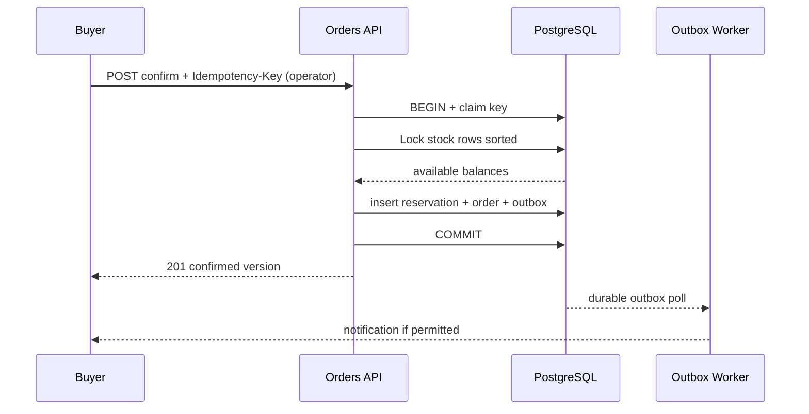

# TECH-07 — Domain transactions, concurrency, invariants

**Status:** engineering design; owner C05 Inventory, C10 Quote, C11 Orders (C12 Payment — `DEFERRED`, DEC-100). **Hard requirements:** G-02/G-03/G-05 and BL-001–BL-111. **Not performance certified.**
**Baseline (2026-10-22):** rezerv operator/menejer `confirm` qilganda yaratiladi (DEC-105, DEC-108); `PROCESSING` da allocated; `COMPLETED` da `on_hand` kamayadi; avtomatik expiry yo'q — 72 soatlik review vazifasi (DEC-104); offline "tez sotuv" xuddi shu stock lock tartibidan foydalanadi (DEC-123).

## 1. Transaction ownership
| Use case | TX writes | Lock / guard | After commit |
|---|---|---|---|
| `confirm_order` (workflow, ADR-021) | C11 order `PENDING_CONFIRMATION → CONFIRMED` + C05 reservations/balances + outbox | stock rows `FOR UPDATE` sorted `(branch_id,sku_id)`; order version CAS | xaridorga xabar; 72 soatlik review job |
| `start_processing` | order `PROCESSING` + reservations `ALLOCATED` (reserved→allocated) | stock rows sorted lock | status xabari |
| `complete_order` | order `COMPLETED` + reservations `CONSUMED` + `on_hand -= qty` + ledger `SALE` | stock rows sorted lock; idempotent | lead `WON`, hisobot |
| `offline_quick_sale` | `on_hand -= qty` (faqat `available` dan) + ledger `OFFLINE_SALE` + audit | stock row lock | available yangilanadi (DEC-123) |
| `quote_approve` | quote revision, approval log, event | revision CAS + policy permissions | send approved snapshot |
| `payment_verify` — `DEFERRED` (DEC-100) | attempt, verified_tx, order projection/outbox | unique external tx; lock order/attempt | notify/report; no retry-unsafe charge |
| `cancel_order` | order transition (Manager/Owner, DEC-108), release each active/allocated hold + outbox | ordered locks, idempotent state transitions | pul qaytarish tizimdan tashqarida (izoh/audit) |
| `receive_stock` | receipt, ledger, balance, outbox | stock row lock | cache/index invalidation |
| `transfer_stock` | source, destination ledger, balances in same merchant | lock sorted keys | reporting refresh |
| `handoff_chat` | conversation speaker/version, handoff task | CAS conversation version | invalidate pending AI output |
| `revoke_public_offer` S2 | opt-out flag + outbox/tombstone | version monotonic | public read denies immediately |

## 2. Stock reservation safe algorithm
```text
INPUT merchant, order lines [(branch, sku, qty)] + request idempotency key
1. Authenticate role/merchant (Sales — faqat o'ziga biriktirilgan buyurtma, yoki Manager), validate order `PENDING_CONFIRMATION` va line snapshots (PC bo'lsa quote revision).
2. BEGIN DB TX; insert idempotency operation claim unique(merchant,operation,key).
3. Lock stock_balances in stable branch/sku sort order FOR UPDATE.
4. For each line: verify available = on_hand - reserved - allocated >= qty (K-04).
5. Apply reserved += qty; create ACTIVE reservation (avtomatik expiry yo'q; `reservation_review_hours` vazifasi, DEC-104).
6. Persist order or transition in SAME TX, ledger/audit/outbox records.
7. COMMIT; response includes committed order/version; asynchronous notify.
On insufficient stock: ROLLBACK entire set and return typed 409; no partial holds.
```
**Important:** lock stock before order row only if global lock order documented; ALL writers must use same order. If lock contention grows, consider optimistic compare-and-swap or SKIP LOCKED for batch processing, but not for customer cart checkout unless semantics explicit.



## 3. Reservation expiration / conflict
- Review job (`reservation_review_hours`, default 72) muddati o'tgan `ACTIVE` rezerv uchun menejerga vazifa yaratadi; holatni o'zgartirmaydi. Menejer `expire` qilsa — tranzaksiya reservation+stock+order ni canonical tartibda qulflaydi, state va version'ni qayta tekshiradi; `CONSUMED`/`RELEASED` bo'lsa idempotent no-op.
- **Race (BR-X13):** online buyurtma tasdig'i va do'kondagi `offline_quick_sale` bir xil stock row'ni qulflaydi; faqat bittasi muvaffaqiyatli, ikkinchisi typed 409 oladi.
- **Crash:** successful COMMIT but HTTP timeout; client retry with same key returns stored final response; different key same natural order requires anti-dup quote/customer guard.
- **No negative stock:** CHECK only covers row-level invariants; ledger conservation verified via reconciliation.

## 4. Payment callbacks — `DEFERRED` (DEC-100; to'lov moduli qaytganda)
- Authenticate provider signature + request origin policy and independently retrieve settlement if required.
- Unique `(provider, external_txid, merchant_provider_account)`; callback `at-least-once`, may arrive out of order; transitions monotonic through status FSM.
- Don't mark `PAID` on screenshot, user-sent text, a pending capture, or provider timeout.
- **Partial refund / reversal:** separate amount ledger; paid totals cannot be derived by count of successful callbacks. Refund failures stay pending/manual actionable.
- Payment API outgoing `charge`/`refund` retries ONLY with provider-supported idempotency reference; otherwise operator reconciliation before repeat.

## 5. Quote/price/time
When generating quote: engine runs verified compatibility + current `price_version`; quote is DRAFT. Approval snapshots total, rates, rules, expiry, discount, user and revision hash. Accept checks `expires_at`, snapshot version policy and stock fresh; changed price yields new revision requiring buyer reconfirmation. Avoid silent quote mutation.

## 6. Human vs AI double reply race
Conversation records `speaker_mode` (`AI`,`HUMAN`,`PAUSED`) and `speaker_version`. AI worker reads version before tool call; outbound sender atomically rechecks it before enqueueing send. Upon operator handoff version increments; all stale AI intents canceled. External outbound races cannot guarantee unsend; show operator transcript and detect late provider confirmation.

## 7. Deadlocks, isolation, visibility
Default PG `READ COMMITTED` with explicit row locks; `SERIALIZABLE` not globally enabled. Retry SQLSTATE `40001`, `40P01` only for **whole transaction** with capped jitter, no external side effects inside TX. DB pool exhausted -> bounded 503, never infinite await. Lock timeout configurable; record `lock_wait_ms`, deadlock counts; no network calls while DB transaction open.

## 8. Idempotency policy
| Operation | Scope/key | Stored result | Replay semantics |
|---|---|---|---|
| API unsafe POST | `(merchant,actor,route,key)` | normalized body hash+status+response | same hash returns result; different hash 409 |
| webhook | `(provider,channel_account,provider_event_id)` | normalized provider payload ref | duplicate ACK, no duplicate work |
| event consumer | `(consumer,event_id)` | consumed timestamp | skip duplicate, ordering guarded |
| payment — `DEFERRED` | `(provider,provider_account,external_txid)` | verified ledger record | same tx no-op |
| notification | `(merchant,template,aggregate,version,channel)` | attempt/delivery status | avoid duplicate intention; delivery may repeat |

## 9. Adversarial scenarios required before release
- Two simultaneous purchases of final SKU: only one reserves; no partial basket hold.
- Two cancellation requests plus expiry job: inventory released once.
- Online confirm va offline "tez sotuv" bir vaqtda oxirgi dona uchun: faqat bittasi o'tadi, available manfiy emas (BR-X13, TC-027).
- Quote approved concurrently with price change: version mismatch human review.
- Duplicate webhook 100 times: one conversation event and one authoritative lead.
- Two AI workers + human takeover: no stale AI message after effective handoff gate.
- Retry job after DB commit/crash: one business transition; one outbox fact.
- Merchant A submits merchant B SKU/branch: 404/403 with no mutation.
- `complete_order` takroriy chaqiriladi: `on_hand` faqat bir marta kamayadi (TC-030). (To'lov tarmoq uzilishi stsenariysi — DEFERRED, DEC-100.)

## 10. Acceptance
`TC-CON-01..10` concurrency suite runs on actual PostgreSQL (not SQLite), with barriers rather than flaky sleeps; test must assert counts, ledger, order status, outbox and audit and includes failpoints just before/after commit.
