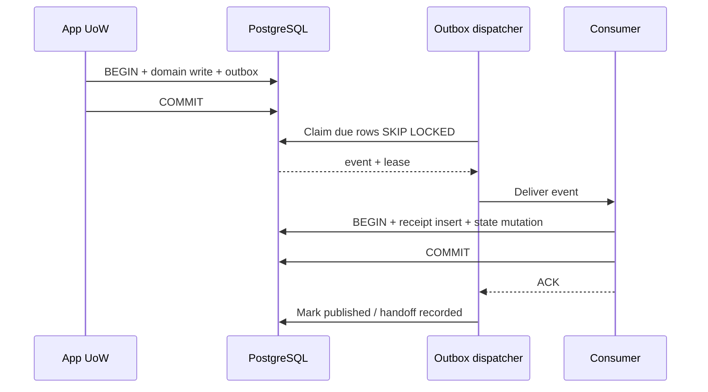

# TECH-09 — Event contracts, transactional outbox, durable jobs

**Status:** Proposed Stage 1 operational design, PostgreSQL queue candidate ADR-005. **References:** TECH-03 19 contexts, TECH-07 concurrency, TECH-12 telemetry, business 09 module relations. At-least-once, **not exactly-once external side effects**.

## 1. Three different entities — never confuse
1. **Domain event** = committed business fact (`order.created.v1`); immutable schema version.
2. **Outbox message** = transactionally persisted dispatch intent; can be replayed.
3. **Job** = scheduled/executing task with lease/retry/result; may be created by event consumer or transaction.
Webhook raw delivery is in an **inbox event** first with provider dedup, not a domain event until authenticated/normalized.

## Envelope schema
```json
{
 "event_id":"uuid","event_type":"inventory.stock_changed.v1",
 "merchant_id":"uuid","aggregate_type":"stock_balance","aggregate_id":"uuid",
 "aggregate_version":8,"occurred_at":"2026-10-21T09:00:00Z",
 "producer":"inventory","schema_version":1,"traceparent":"00-...-...-01",
 "actor":{"kind":"merchant_user","id":"uuid"},
 "payload":{"sku_id":"uuid","branch_id":"uuid","available_after":3}
}
```
No PII, bank/card number, conversation raw text or provider token in event payload; reference encrypted/private records by UUID.

## Event owner / consumers
| Event | Producer | Consumer(s) | Processing contract |
|---|---|---|---|
| `conversation.message_received.v1` | C08 | C09 AI router, C10 lead | dedup provider event; speaker guard |
| `conversation.handoff_requested.v1` | C08 | C14 notification | one active handoff per version |
| `catalog.sku_published.v1` | C03 | C06 web; C09 search view | index upsert revision |
| `pricing.price_changed.v1` | C04 | C06,C09; C18 Stage2 | latest version wins |
| `inventory.stock_changed.v1` | C05 | C06,C15; C18 Stage2 | fetch absolute state, not `+=` |
| `quote.approved.v1` | C10 | C14 send | immutable quote snapshot |
| `order.created.v1` | C11 | C14,C15,C12 intent | order+reservation already committed |
| `order.cancelled.v1` | C11 | C14,C15 | no second release |
| `payment.verified.v1` | C12 | C11,C14,C15 | settlement uniqueness |
| `shipment.delivered.v1` | C13 | C14,C15 | delivery proof check |
| `public_offer.withdrawn.v1` S2 | C18 | index/projection | immediate DB read-time revoke |
| `canonical_product.match_changed.v1` S2 | C18 | C19 search | reversible merge/split |

## Outbox dispatch flow

If consumer crashes after commit and before ACK, replay finds `(consumer_name,event_id)` receipt unique and no-ops. If outbox dispatcher itself crashes before mark, event may deliver again; no loss by design.

## Jobs (specific payload, retry, recovery)
| Job type | Queue | Attempt policy candidate | Failure handling |
|---|---|---|---|
| `inbound_normalize` | high | 3, quick jitter | invalid signed payload quarantined |
| `ai_draft_answer` | ai | 2, deadline bounded | handoff human; no spam |
| `channel_send` | external | provider-aware (up to 5) | store provider receipt, ambiguous delivery reconcile |
| `reservation_expire` | critical | 5 short + operator | monotonic FSM, audit |
| `payment_reconcile` | finance | periodic capped | manual finance alert for UNKNOWN |
| `catalog_import` | bulk | resume rows/chunks | error CSV, reject partial commit by policy |
| `report_export` | bulk | 3 | report job failed with retry button |
| `voice_transcription` | ai | 2, no endless replay | ask text clarification |
| `sync_partner` S2 | external | rate-limit guided | conflict queue, fail closed stock |
| `public_reindex` S2 | search | retry/backoff | tombstones visible immediately |

**Values are proposed defaults**, not universal: retry based on error classification. 4xx/invalid input generally permanent; 429 honors Retry-After; timeout ambiguous for outbound financial/notification and MUST reconcile rather than blindly repeat.

## Leasing, scheduling and DLQ
`job_id`, queue, priority, `payload_ref`, tenant, created_at, due_at, lease_owner, lease_until, heartbeat_at, attempts, max_attempts, status (`READY/RUNNING/SUCCEEDED/DEAD/CANCELLED`), failure_code, `traceparent`, last_result_ref. Poller uses `FOR UPDATE SKIP LOCKED` with small transaction; do not hold lock while calling external API. Lease expiry redispatch; high-cost AI checks job state and budget before retry. Dead jobs require UI showing safe retry controls; operator replay creates explicit audit log and preserves original causality.

## Ordering and replay
- Aggregate event carries `aggregate_version`; consumers maintain `last_applied_version`, hold or backfill gaps, ignore lower versions. Some projections can recalculate from source of truth instead of buffering history.
- Outbox backlog alarm, oldest job age, stuck lease, DLQ count, replay rate, duplicate provider events; dashboards per tenant with redacted identifiers.
- Full backfill rebuilds derived reports/search projections from authoritative DB; no business order/payment derived from event stream only.

## Proof tests
1. Crash after business COMMIT before dispatch → event eventually observed.
2. Crash consumer after DB COMMIT before ACK → no duplicate state mutation.
3. Same provider message 50x → 1 normalized business effect.
4. Worker restarts mid AI send → exactly-one *intent*, provider duplicates possible; tagged and remediated.
5. Out-of-order price versions 10,8 → final 10; opt-out immediately blocks public.
6. DB unavailable → webhook does NOT 2xx without durable inbox.
7. Publisher 429/rate-limit → backoff/jitter and operator sees backlog.
