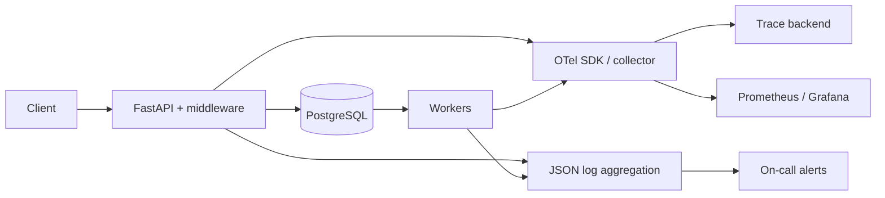

# TECH-12 — Observability, tracing, SLOs and incident diagnostics

**Status:** Instrumentation contract for API+workers+providers; **not an already deployed monitoring stack.** **ADR-017.** Trace context alone does not provide durable audit or idempotency.

## 1. Correlation data contract
- Inbound `traceparent` W3C parse (validate format), create server span and `request_id` UUID; response echoes `X-Request-ID`. Use `tracestate` only if allowed and sanitized.
- Every event/job persists `traceparent` and business `event_id`, `job_id`, aggregate ID/version, merchant **anonymized/hash or low-cardinality attribute**; do not attach unbounded customer IDs as metric labels.
- Async worker receives context, starts `process job` span with **span link** to producer context where appropriate. Never manually fake parent-child across broken traces; search by IDs in structured logs.
- End-to-end path: `webhook.receive → inbox.commit → outbox.dispatch → ai.tool.retrieve → quote.validate → channel.send`; order/payments path separate linked trace with idempotency.

## 2. Span specification
| Span | Attributes (safe only) | Error cases |
|---|---|---|
| `http.server` | route template, status, request_id | 429/5xx, malformed context |
| `db.transaction` | context, isolation, duration | lock timeout/deadlock |
| `inventory.reserve` | branch hash, lines count | insufficient stock/version conflict |
| `ai.generate` | provider, model alias, input/output token counts | timeout, tool rejection |
| `tools.catalog_search` | result_count, search mode | stale index, no match |
| `webhook.verify` | provider, verification boolean | forged/replay |
| `outbox.claim` / `job.process` | event_type, retries, queue lag | lease lost/DLQ |
| `channel.send` | provider, status class | ambiguous delivery |
| `payment.verify` | provider, verification method | mismatch/unknown |
| `voice.report` | language, audio duration, confidence bucket | low confidence/unauthorized metric |

Never emit raw message, address, receipt image, STT transcript, token, provider secret, prompt containing customer PII, or payment reference into telemetry.

## 3. Metrics and labels
- `http_requests_total{route,status_class}`; `http_duration_seconds{route}`.
- `job_queue_depth{queue}`, `oldest_job_age_seconds{queue}`, `job_retry_total{job_type,error_class}`, `outbox_unpublished_total`.
- `webhook_duplicates_total{provider}`, `webhook_ack_duration_seconds{provider}`.
- `inventory_reservation_conflict_total`, `stock_reconciliation_discrepancy_total`.
- `ai_requests_total{model_alias,outcome}`, `ai_tokens_total{model_alias,direction}`, `ai_cost_minor_total{tenant_plan_tier}` (not per tenant Prometheus label).
- `payment_mismatch_total`, `failed_provider_callbacks_total`, `public_revocation_latency_seconds` Stage2.
- `voice_transcript_corrections_total{language}`, `voice_unauthorized_attempt_total`.

## 4. Proposed alerts and operational response
| Signal | Candidate threshold | First action |
|---|---|---|
| API 5xx business routes | sustained >2% for 5m | compare last deploy, trace failures |
| Outbox oldest age | >120s for 10m | workers, DB contention, provider failure |
| Stock negative / ledger mismatch | **any** | pause affected SKU reservations; reconcile |
| Verified payment mismatch | **any** | hold order fulfilment; finance review |
| AI invented confirmed price | **any confirmed** | kill switch auto-send, audit prompt/tools |
| Tenant data leak | **any** | security incident, restrict access immediately |
| Public revoked offer visible S2 | **any** | serve revocation overlay, purge cache/index |
| Backup restore untested | periodic compliance gap | schedule restore dry-run |

All thresholds are candidates calibrated after controlled pilot, not current promises. Initial availability aim 99.5% pilot, RPO/RTO provisional; formal SLA only after deployment evidence.

## 5. Instrumentation diagram

## 6. Incident example: duplicate paid order
Look up `payment.provider_txid` by authorized finance UI → correlation to `request_id`, `event_id`, `job_id`, `order_version` → find duplicate callback receipt → verify amount in trusted provider + internal ledger; never alter stock based on log alone. Document incident timeline, root cause, corrective test, customer impact, sanitized evidence.

## 7. Acceptance and redaction
- Test trace continuity via API→outbox→worker and async span link.
- Log/trace snapshot scan for tokens, phone/email patterns, chat text, signed URLs; zero matches in fixture.
- Dashboard: API p95, queue age, provider failure, AI cost, stale price, payment mismatch. Alert route tested by staging synthetic event; no pretending configured until verified.
