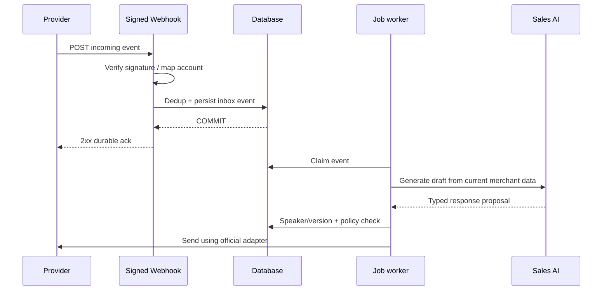

# TECH-13 — Channel, payment, POS/ERP and map integration architecture

**Status:** design+capability matrix, NOT actual provider approval. **Stage 1:** Telegram/web chat, authorized Meta where granted, manual payment reconciliation then gateway. **Stage 2:** POS/ERP/canonical sync. **Stage 3:** maps/geosearch. **ADR-015/016.**

## 1. Port/adapter contract
Every integration implements typed port independent of domain:
```python
class MessagingPort(Protocol):
    async def send_message(self, channel_account_id: UUID, recipient_ref: str,
                           idempotency_ref: str, payload: OutboundMessage) -> SendResult: ...
class PaymentVerificationPort(Protocol):
    async def verify_transaction(self, merchant_account_ref: str,
                                 external_tx_id: str) -> VerificationResult: ...
class CatalogSyncPort(Protocol):
    async def fetch_changes(self, cursor: str | None) -> ChangePage: ...
```
Domain never imports Telegram SDK/Meta API/PSP concrete adapter. Adapter returns stable error taxonomy: `AUTH_REVOKED`, `RATE_LIMITED`, `TIMEOUT_AMBIGUOUS`, `VALIDATION_ERROR`, `UNAVAILABLE`, `NOT_SUPPORTED`.

## 2. Capability matrix — not all social platforms work alike
| Channel | Trigger | Message response | Media/catalog | Restrictions / MVP |
|---|---|---|---|---|
| Merchant web chat | User opens store | platform authorized | links/cards/file | S1 P0 |
| Telegram Bot | user starts/writes bot | bot API as permitted | product cards/media | S1 P0; bot cannot proactively DM arbitrary users |
| Telegram Business | connected account/authorized chat | business connection | media; scope policy | feature gated per current Telegram API |
| Instagram professional | allowed user-initiated DM/comment events | official Meta messaging permissions | provider-specific templates/limits | S1 after review; no scraped accounts |
| Facebook Messenger | approved Page conversations | platform policy | approved templates | gated |
| WhatsApp Business | approved WABA/official provider | template/session rules | provider-constrained | research later, no promises |
| TikTok/other | only if official integration capability verified | maybe unavailable | unknown | no default integration claim |

Per connected account store `provider, account_ref, permissions/scopes, connection_status, token_secret_ref, webhook_secret_ref, subscribed_events, rate_policy, last_health_check`. Token never returned in frontend JSON.

## 3. Inbound webhook transaction
1. Verify signature using **raw body**+timestamp/secret where provider supports; limit payload size and deadline.
2. Resolve exact connected merchant/channel via server mapping, check connected status and allowed event type.
3. Insert unique provider inbox event with hash, payload pointer encrypted or sanitized, `received_at`, trace ID.
4. Commit before 2xx. Duplicate provider event returns success without second business effect. Invalid verification rejects and records security metric.
5. Asynchronous normalization→conversation→AI candidate/handoff. Outbound adapter enforces speaker version, channel messaging window and provider rate limits.



## 4. Payment contract — merchant of record
Merchant configures their payment merchant account. Backend produces payment intent with immutable order snapshot and expected amount; buyer follows provider checkout URL. Provider callback alone is untrusted until signature+remote verification according to provider specification. If only proof screenshot, `PROOF_SUBMITTED`→finance `UNDER_REVIEW`→`VERIFIED` only after matching bank/settlement evidence. Failure/unknown stays pending; dedup unique external tx. Refund a separate approved workflow and legal/fiscal compliance check, not merely negative order amount.

## 5. POS/ERP/Marketplace sync (Stage 2)
- Support explicit source priority per field (e.g. stock from POS, offer prices from commerce OS) and synchronizing direction; prevent ping-pong via `origin_id`, `external_revision`, `sync_cursor` and last-applied hash.
- Import products as staged drafts; map variants, currency, units, condition and branch. Conflicts require manual queue; incompatible SKU never silently merged.
- Initial full sync paginated + incremental pull/webhook; nightly/periodic reconciliation compares checksums/totals; provider 429 backoff.
- Source update cannot violate stock invariant; if stale/unknown, disable auto checkout or manager-confirm order.

## 6. Maps and geo
Merchant branch stores own verified coordinates; no unauthorized bulk Google Maps copying. Search radius computed by PostGIS stage 3 if justified; return location freshness and delivery service region. No exact user street address persisted unless needed with informed authorization. ETA is from authorized routing service and clearly labeled estimated, not fabricated.

## 7. Integration security + observability
Stored secrets in secret manager/KMS reference; OAuth state/PKCE where applicable; revoke callback + rotation runbook; egress allowlist for external URLs; per-provider circuit breaker and rate buckets. Trace external request by span and sanitized external correlation. Dashboard states `PENDING_AUTH → CONNECTED → DEGRADED → REVOKED → DISCONNECTED` with visible reauthorization UI.

## 8. Provider verification checklist
For each integration, maintain a capabilities evidence sheet with `official docs/version/date`, permission review outcome, sandbox account, data residency rules, quota cost, rate limits, outbound time windows, webhook verification, revoke procedure, tests. All unsupported features default off. Current provider behavior must be rechecked immediately before implementation.

## 9. Acceptance
- Invalid signature, replay, revoked account cannot create lead.
- Duplicate webhook → single normalized message/event.
- Provider down after business COMMIT → durable retry, alert and human inbox.
- Expired channel messaging window → task for human / approved template, not illicit message.
- Check screenshot never auto marks paid.
- Sync source conflict produces visible review, no stock overselling.
