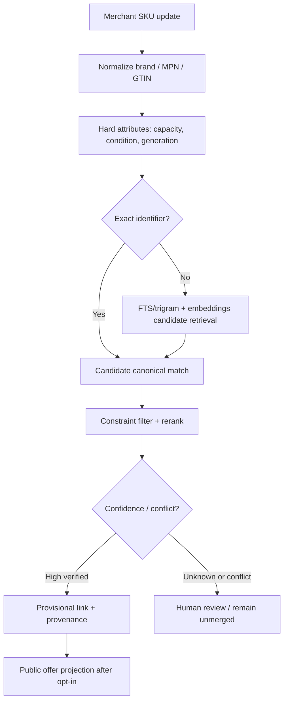
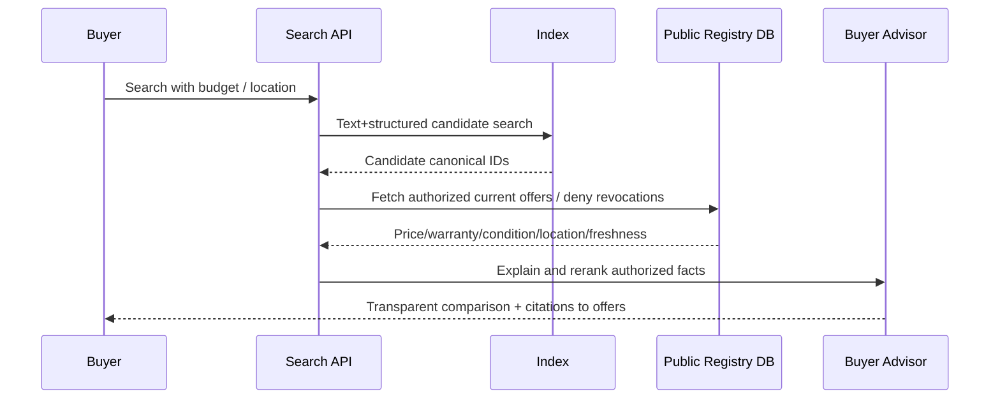

# TECH-14 — Network global catalog, offer publication and shopper search

**Status:** Stage 2/3 architecture plan, deliberately NOT Stage 1 code. **DDD:** C18 Registry/PublicOffers, C19 Discovery; C03 MerchantCatalog remains private source.

## 1. Three separate identities
- `MerchantSKU`: unique merchant variant; owner decides details, price, inventory and privacy.
- `CanonicalProduct`: platform verified manufacturer/model/variant identity, no merchant price/stock.
- `PublicOffer`: merchant's **explicit opt-in** published SKU at a store/location, with public price, condition, warranty, timestamp, availability label and revocable status.
One canonical product ↔ many public offers; one merchant product may be under review or unmatched. Two similar names do not imply identical capacity/condition/part number.

## 2. Matching pipeline

Matching hard blocks: different model suffix/Ti, 8GB vs 16GB, used/refurbished vs new, bundle vs standalone, kit quantity vs single, warranty terms distinct even if hardware identical. Golden-set false-merge risk prioritized over recall. Human review decision includes evidence and reversible history.

## 3. Public projection security
Merchant controls per-SKU public flag and fields; opt-out commits `status=REVOKED` in canonical DB and public search read path denies immediately, independent of eventual index lag. Published snapshot includes `merchant_id, sku_id, canonical_id, approved_price_version, branch_id, last_verified_at, listing_version, permitted_fields`; no cost, margin, customer conversation, PII or unapproved stock quantity. Projection consumers compare monotonic `listing_version`.

## 4. Query flow (Stage 3)

## 5. Search ranking and disclosure
Organic rank based on text+attribute fit, exact identity confidence, availability freshness, distance (if permitted), warranty and merchant reliability signals with published explanation. Sponsored listings separate explicit label and cannot covertly alter AI's claimed quality. Never call an offer cheapest without total comparable cost (delivery, service fees, taxes/conditions); currency/units normalized.

## 6. Catalog source, indexing, freshness
Start Stage 1 PostgreSQL FTS/trigram for each merchant. Stage 2 canonical matching evaluation may add pgvector only if retrieval benchmark improves quality; Stage 3 dedicated search service only after latency/size benchmarks. Search read model rebuildable; changes via outbox. Index may lag, so before buyer request/checkout merchant source is revalidated. Stale/unknown stock marked as such and may be excluded per policy.

## 7. Maps, SEO and global Telegram
Branch's merchant-authorized lat/lon and contact displayed. Map query uses PostGIS or approved geo service; no scraped proprietary locations. SEO: canonical product pages with structured product/offer data, fresh prices/availability, canonical URLs and duplicate store offer management, merchant opt-out respected in sitemaps. Global Telegram bot is distinct security principal from merchant bot and may only call public search tools.

## 8. Monitoring and quality benchmark
Gold data: 500–1000 reviewed identical/nonidentical SKU pairs from active merchants, edge cases: Ti vs non-Ti, RAM kit capacity, NVMe generation, condition. Track false merge precision (set strict acceptance threshold after baseline), eligible coverage, offer freshness, merchant opt-out leakage (target ZERO), search result p95, buyer comparison CTR and wrong price incidence. Run sample split/merge rollback workflow before launch.

## 9. Stage gate
Do not publicly announce Stage 3 until minimum adequate merchant coverage, verified same-item comparisons, publication consent, freshness compliance, fair sponsored disclosure and referral audit. Stage 1 does not need these tables migrated.
