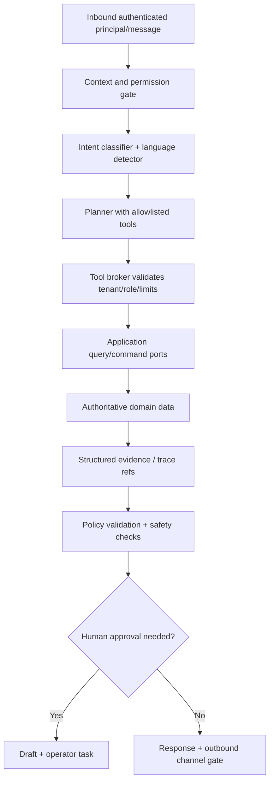

# TECH-15 — AI agent architecture and tool authorization

**Status:** Baseline Stage 1 (2026-10-22: DEC-009, DEC-016, DEC-100c, K-10, TECH-23); Stage 3 separated. **Batafsil kontraktlar:** tool sxemalari, prompt, xotira, PII redaction, javob tekshiruvi — `26_AI_TOOL_CONTRACTS.md`. **Agent = merchant profili + prompt versiyasi + RAG scope + tool ruxsatlari + har job uchun yangi ActorContext** — alohida model yoki process emas (TECH-23 §4). **AI is advisory+language orchestration, never authoritative for inventory, pricing, payments or PC hardware compatibility.** **References:** TECH-03/07/10, BL business rules, ADR-011/012.

## 1. Agent identities and trust boundaries
| Agent | User | Data access | Allowed actions | Never do |
|---|---|---|---|---|
| Merchant Sales Agent S1 | merchant customer | merchant's published SKU/policies, current quote | search catalog, clarify intent, create lead/draft quote, request handoff | alter actual price, confirm payment, update stock |
| Merchant Business Copilot S1 | owner/authorized staff | role-filtered approved metrics | read summary/export job, TTS response | unapproved margin access or silent mutation |
| PC Advisor S1 | merchant customer/sales | merchant PC SKU+curated compatibility rules | suggest tested builds, mark UNKNOWN review | claim undocumented socket/BIOS or benchmark |
| Global Shopping Advisor S3 | public shopper | authorized public offers only | compare/ explain/referral intent | read merchant private reports, charge buyer |

## 2. Runtime orchestration

## 3. Tool catalogue and examples
| Tool name | Inputs (typed) | Output evidence | Authority |
|---|---|---|---|
| `catalog.search` | query, constraints, locale, merchant context server side | sku_id, title, variant, price_version, stock_confidence | read public-to-merchant data |
| `pricing.get_price_stock` | sku_id, branch | amount_minor, currency (UZS/USD + kurs snapshot), available, freshness | read |
| `pc.compatibility_check` | proposed SKU IDs, ruleset version | `PASS / REVIEW_REQUIRED / BLOCK` (K-09), findings; spec manbai — reference library (DEC-011) | deterministic only |
| `quotes.prepare_draft` | SKU/version/qty, verified customer requirements (faqat PC yig'ma, DEC-100e) | draft_id, source_refs | write draft, no approval |
| `quotes.request_approval` | quote_id, reason | approval task id | request only (tasdiq — Manager/Owner, DEC-109) |
| `orders.create_draft` | SKU(lar), qty, contact ref, `fulfillment_method`, address ref, conversation | order_id (`DRAFT`), operator task | write `DRAFT` only — stok band qilmaydi, tasdiqlamaydi (DEC-100c, BL-110) |
| `orders.lookup_status` | scoped order token / authenticated buyer | FSM-08 status | read |
| `leads.capture` | consented contact, channel reference | lead_id, status | scoped write with idempotency |
| `chat.request_handoff` | reason, conversation/version | handoff_task_id | permissible workflow transition |
| `reports.query_metric` | approved metric IDs, date range, dimension filters | result, currency, data_as_of, quality flags | role-filtered read |
| `notifications.preview` | recipient opt-in, template | intended message | never bypass channel policy |
| `public_offers.compare` S3 | canonical_id, authorized filters | offers with source/updated_at | public only |
| `orders.confirm`, `orders.cancel`, `pricing.write`, `discount.apply`, `inventory.write`, `payments.*` | — | — | **mavjud emas** — AI'ga hech qachon berilmaydi |

## 4. Tool input/output and execution contract
All tool calls strictly Pydantic validated: no arbitrary SQL, no arbitrary URL fetch, no browser actions. Tool broker obtains tenant scope from server session, not LLM arguments. Mutation requires `idempotency_key`, actor, policy and possible human approval. Tool output includes `source_id`, `observed_at`, `revision` and `scope`. Rate/budget per merchant: max steps per request, token/time/cost budget. Secrets always server-side. Tool failing must produce typed unavailable/handoff, not hallucinated success.

## 5. Knowledge/RAG
Retrieval source: SKU, merchant policy, warranty, delivery regions, accepted FAQs with approval status+last revision. Hybrid exact SKU/attribute search and semantic retrieval; structured validators enforce prices/stock separately. Prompts are versioned per merchant with restricted customer override, injected message text quoted as untrusted. Documents ingestion strips instructions and disallowed PII; no cross-tenant vector namespace leakage.

## 6. Handoff and outbound guard
Async agent worker receives conversation `speaker_version`; it may take seconds. Before outbound send, compare version; if agent paused or human assigned, cancel send. Tool context must be reauthorized before any write. Every reply has `model_alias`, prompt version, approved evidence refs, failure class and cost, but no raw secret in audit. AI can run in degraded mode: FAQ → request human.

## 7. Model routing
**ADR-027 (DEC-009):** provayderdan mustaqil `LLMPort`; S3 dan oldin 1 haftalik bake-off — 200 ta uz/ru/en dialog (tool-calling aniqligi, narx, latency), default nomzod Claude Sonnet (eng so'nggi). **DEC-016:** provayderga PII redaction'dan keyingi matn, zero-retention/no-training shartiga ega provayderlar. Small classifier/structured extraction model when possible; higher-quality hosted LLM for complex PC recommendations, fallback to alternate provider only if data transfer agreements permit. Model alias and evaluation version pinned at deployment; no speculative retrain from raw merchant conversations. Choose per empirical Uzbek/Russian/English accuracy and unit economics.

## 8. Evaluation golden suites
- 200+ initial mixed-language user intent cases (UZ Latin/Cyrillic/RU/EN), expanding with consented anonymized conversations.
- 150 PC compatibility edge cases (socket mismatch, PSU, BIOS unknown, 5060 vs 5060 Ti), strict deterministic rule exactness.
- 100 red-team adversarial prompts: cross-merchant prompt injection, fake admin approval, fabricate discount, payment, stock, force secret reveal.
- Metrics: tool selection, exact price fidelity, unsafe action rate **zero tolerated**, rate of human handoff on unknown, merchant-converted lead precision, p95 latency/cost. Evaluation passing threshold established before production sign-off; no pretense tests already run.

## 9. Cost controls and rollout
Merchant quota per plan, shadow-mode before auto response, 5% authorized pilot rollout, comparison to human baseline, feedback corrections queue, one-click per-merchant AI OFF switch and global kill switch. Capture verified order attribution carefully; cannot claim AI-generated revenue from raw chat count.
