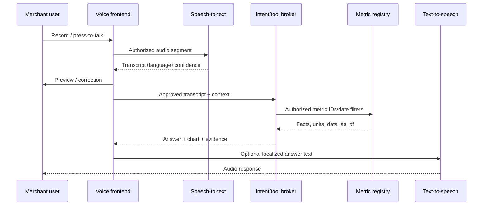

# TECH-16 — Business Voice Copilot in Uzbek, Russian and English

**Status:** proposed product/tech design; model/provider quality unverified. **Stage 1:** READ-ONLY reports first. **Not voice identity biometrics** or unconstrained voice-driven money transfer.

## 1. Experience requirements
Owner opens Voice Copilot in merchant dashboard (staff auth already established), selects or auto-detects `uz/ru/en`, speaks: “Oxirgi 7 kunda qaysi GPU eng ko‘p sotildi?” → sees editable transcript → approved metric resolution → result table/chart + optional spoken answer. If the speaker asks for money/stock mutation, only show a *draft* request for an authorized human confirmation flow, initially disabled.

## 2. Pipeline

## 3. Language and numbers
UZ Latin+mixed Cyrillic, Russian, English; code-switch terms GPU/RTX/SSD, spoken currency sum/dollar, decimals, quantities, date expressions ('shu oy', 'прошлая неделя', 'last Friday'). Normalize timezone with merchant `Asia/Tashkent` default configurable, distinguish paid revenue vs created-order amount. Human transcript correction mandatory on low confidence, metric ambiguity or large sum.

## 4. Metric allowlist
| Approved metric | Definition | Visibility |
|---|---|---|
| `orders_paid_count` | distinct orders with verified settlement in period | owner, manager, approved sales |
| `sales_paid_gross_minor` | verified gross amount by currency | owner, manager, finance |
| `sales_refunded_minor` | settled refunded amount | owner, finance |
| `profit_gross_minor` | paid net less captured COGS (explicit missing-data flags) | owner, authorized finance |
| `top_products_by_units` | unit count on paid/fulfilled policy version | owner, manager, authorized sales |
| `conversation_first_response_p50` | median first response latency on eligible conversations | owner, manager |
| `stock_low_count` | SKU-by-branch below merchant threshold | owner, warehouse |

Natural language planner maps to these metric IDs. It cannot generate raw SQL from voice. Every response states time range, timezone, currency and data freshness; never mix UZS/USD totals silently.

## 5. API and privacy
`POST /voice/query-jobs` accepts secure audio upload reference + locale preference; async job -> text transcript (if permitted), normalized intent, metric IDs, result JSON, optional voice asset TTL. Encrypt audio at rest; default short retention until policy approved, consent UX and deletion controls. No cross-tenant audio used for global training without explicit agreement. If voice input contains customer PII, filter before model provider where feasible.

## 6. Speaker authorization
Voice does not prove identity; current logged-in principal and role decide metric access. Margin/PII sensitive query requires verified session, optionally step-up MFA for exports. Do not interpret someone else's audible command as merchant approval. No always-listening microphone by default; user-initiated press-to-talk, explicit recording indicator.

## 7. Reliability and evaluation
Golden set minimum 300 recordings split across UZ/RU/EN accents and code-switching, plus 100 numeric/date/currency cases; licenses/consent documented. Measure word/character error, `intent_accuracy`, numeric `slot_exact_match`, metric ID selection, p95 latency, TTS pronunciation, hallucinated number count. *Gate*: no user-facing incorrect financial claim on reviewed critical set; unreadable transcript → clarification UI rather than guessing.

## 8. Future write-enabled voice (separate release)
Workflow: parse action → policy validate → preview exact diff (`SKU`,`old/new`, scope) → step-up human confirmation in UI → domain service and audit → result readback. Never allow “pulni yubor”, “hamma narxni pasaytir” to auto-run, even if model confident.

## 9. Failure UX
STT unavailable → text input; language uncertain → choose language; ambiguous request → 2 explicit options; metric unavailable → say unavailable and what data is missing; TTS failure → display correct text/chart; long job → progress and safe cancel. All audio links expiring and tenant scoped.
