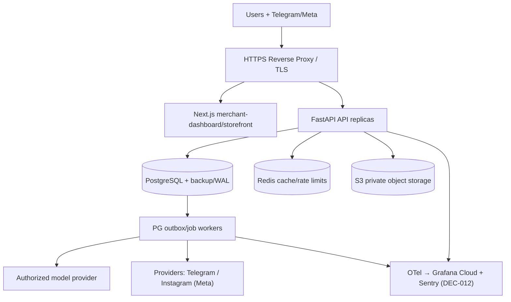

# TECH-19 — Infrastructure, environments, CI/CD, backup and recovery

**Status:** pilot deployment baseline (2026-10-22), not provisioned. **Repo:** `ai-commerce-backend/infra` until independent infra release requirements. **ADR-009/020/026/029/030.** **Baseline:** production PII DB va storage — O'zbekistondagi data center (DEC-013, huquqshunos xulosasidan keyin real PII); monitoring — Grafana Cloud + Sentry, self-hosted monitoring yo'q (DEC-012); deployment — shared-first, `deployment_mode` konfiguratsiyasi bilan dedicated-ready (DEC-001, TECH-23 §3). Must meet privacy/hosting legal requirements before real data.

## 1. Deployment profile

Docker Compose on secured VM(s) in an Uzbekistan data center (DEC-013) is the **baseline** for paid pilot. Production topology and HA are gated by RPO/RTO decisions and proven load. K8s not assumed. Dev/staging — sintetik ma'lumot bilan istalgan joyda.

## 2. Environments and config
| Environment | Data | Providers | Purpose |
|---|---|---|---|
| dev | synthetic | sandbox/emulators | local coding |
| staging | sanitized representative | vendor sandbox; no real unsolicited messages | integration/load/rehearsal |
| production | consented merchant data | approved accounts | real business |

Immutable image tags with Git SHA, protected env, no production secrets in `.env` committed. Environment schema validates DB, object store, public base URLs, allowed origins, signing refs, channel feature flags and job pool settings at startup. Fail fast if critical missing.

## 3. CI/CD gates
1. PR formatting, typecheck (mypy/pyright as configured), import boundary rule, dependency audit, secret scan.
2. Unit+domain property tests, lint/migration diff, OpenAPI generated artifact diff, frontend SDK typecheck.
3. PG integration/concurrency, fake provider callbacks, webhook signature, AI tool red-team, frontend E2E.
4. Build, SBOM/image scan, staging deploy, smoke, run migration dry-run and performance budget.
5. Manual production approval for DB/payment-impacting changes; blue/green or rolling deploy with health checks and feature flags, rollback tested.

## 4. Networking/secret hardening
Only edge public; DB, Redis, workers, telemetry private network. TLS to edge/protected service, firewall/security groups restricted, SSH key+MFA/jumpbox, backups encrypted. DB non-superuser role for app. Provider API credentials secret manager. Block public MinIO console and postgres/redis ports. Rotate keys with dual-key window, audit rotation.

## 5. Migration/change safety
Alembic supports expand/backfill/contract, old+new app simultaneous compatibility where rolling updates. Before prod destructive migration take restore point and evaluate retention. Reversible migrations preferred but rollback cannot blindly reverse payment transactions or irreversible data transformations. Separate data correction job with audit.

## 6. Backup / disaster recovery
- Proposed: daily full PG backups + WAL/archive where available, object-store versioning/replication as budget allows. Concrete RPO/RTO depends on agreed merchant requirements; provisional pilot design goal RPO ≤1h, RTO ≤4h subject to testing, never promise until proven.
- Periodic automated backup integrity check AND restoration into isolated staging. Verify tenant data isolation and matching object storage references. Document exact restore commands in environment-specific runbook, secrets rotation, DNS switch and reconciliation after restore.
- Durable jobs/outbox replay after restore; old external payment events require reconciliation, not re-charge; duplicate webhook dedup horizon policy aligns backup horizon.

## 7. Failure/incident playbooks
| Incident | Mitigation | Recovery verification |
|---|---|---|
| PostgreSQL unreachable | reject writes, no fake webhook ACK; keep provider retries | restore DB, pending outbox, compare stock ledger |
| Redis outage | disable noncritical cache/real-time, maintain authoritative DB writes with conservative throttling | refill cache, measure impact |
| AI provider down | human inbox and FAQ fallback, job timeout, notify merchant | staged AI resume, sample responses |
| PSP callback mismatch | hold order, finance manual review | provider reconciliation, audit |
| Worker backlog | prioritize critical queues, pause bulk import | oldest job age returns under target |
| Wrong AI price | disable automatic sending flag, refresh catalog/rules | regression golden set passes |
| Expired/public revoked offer visible | immediate DB deny overlay, clear CDN and index | anonymous opt-out test |
| Storage leak | revoke signed URLs, rotate credentials, assess scope | security incident signoff |

## 8. Production checklist
DNS/TLS, cert auto-renew, CSP/CORS, secrets, backup restore evidence, metrics/alerts delivered to owner, incident contact, tenant isolation pass, clock/NTP, recurring reconciliation, privacy handling and approved official API access. Missing items are release blockers where data/funds are at risk.

## 9. Capacity and spend
Collect CPU/RAM, swap, disk IOPS, PG QPS/pool, job age, AI cost per conversation, bandwidth and S3 spend. Pilot budget decided from measured traffic and LLM usage, not invented fixed infrastructure price. Vertical scaling first; service split when measured load or team boundaries demand it.
