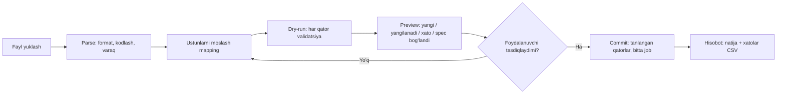

# TECH-28 — Katalog importi (CSV/XLSX) spetsifikatsiyasi

**Status:** Baseline (2026-10-22). M04, M05, M06, BL-011…015, BL-022, DEC-011 (spec bog'lash), DEC-107 (dashboard — stok manbai), DEC-121 (UZS/USD) asosida.
**Kim uchun:** backend (import worker), frontend (Import Wizard), onboarding jamoasi (business/13).

Import — pilotdagi birinchi va eng ko'p vaqt oladigan qadam: do'konning Excel ro'yxati tizimga to'g'ri tushmasa, AI ham, sayt ham noto'g'ri ma'lumot ko'rsatadi.

---

## 1. Oqim

- Import — fon job'i (`catalog_import`, 202 + `status_url`, TECH-09). Katta fayl xotiraga to'liq yuklanmaydi (stream).
- **Dry-run hech narsani yozmaydi.** Commit faqat foydalanuvchi tasdig'idan keyin va faqat xatosiz (yoki tanlangan) qatorlar uchun (BL-013).
- Har commit `import_batches` yozuvi bilan; har o'zgargan SKU audit'da `import_batch_id` bilan.

## 2. Fayl talablari

| Parametr | Qiymat |
|---|---|
| Formatlar | `.xlsx` (birinchi varaq yoki tanlangan varaq), `.csv` (UTF-8; `;` yoki `,` avtomatik aniqlanadi; Windows-1251 aniqlansa ogohlantirish va konvertatsiya) |
| Hajm | ≤ 10 MB, ≤ 20 000 qator (pilot limiti, sozlanadi) |
| Sarlavha | Birinchi qator — ustun nomlari |
| Formulalar | XLSX'da formula natijasi o'qiladi; `=`, `+`, `-`, `@` bilan boshlanadigan matn qiymatlari xavfsiz deb belgilanadi (CSV injection) |

## 3. Ustunlar

Ustun nomlari erkin — mapping bosqichida foydalanuvchi moslaydi. Tizim keng tarqalgan nomlarni avtomatik taklif qiladi (`Наименование`, `Nomi`, `Name` → `title`; `Цена`, `Narx` → `price` va h.k.). Mapping shabloni merchant uchun saqlanadi va keyingi importda qayta ishlatiladi.

| Maydon | Majburiy | Turi / format | Validatsiya |
|---|---|---|---|
| `sku_code` | ✅ | matn, ≤ 64 | do'kon ichida noyob (BL-011); bo'sh joy kesiladi; registr saqlanadi, solishtirish registrsiz |
| `title` | ✅ | matn, ≤ 200 | bo'sh emas |
| `category` | ✅ | enum: `CPU`, `MOTHERBOARD`, `RAM`, `GPU`, `PSU`, `CASE`, `CPU_COOLER`, `STORAGE`, `MONITOR`, `PERIPHERAL`, `LAPTOP`, `ASSEMBLED_PC`, `OTHER` | sinonimlar lug'ati (`Видеокарта`, `Videokarta` → `GPU`) |
| `brand` | ✅ (PC komponentlari uchun) | matn | — |
| `model` | tavsiya | matn | spec bog'lash uchun |
| `mpn` | tavsiya | matn | ishlab chiqaruvchi part number; spec bog'lashning eng ishonchli yo'li |
| `condition` | ❌ (default `NEW`) | `NEW`, `USED`, `REFURBISHED`, `OPEN_BOX` | — |
| `price` | ✅ (publish uchun) | son; `1 250 000`, `1250000`, `1,250,000`, `1 250 000.50` | > 0; minor units'ga aylantiriladi (ADR-025) |
| `currency` | ❌ (default merchant valyutasi) | `UZS`, `USD` | USD bo'lsa kurs mavjudligi tekshiriladi (DEC-121) |
| `quantity` | ❌ | butun son ≥ 0 | §5 |
| `branch` | ❌ (default asosiy filial) | filial nomi yoki kodi | mavjud filial |
| `warranty_months` | ❌ | butun son ≥ 0 | buyurtma qatoriga snapshot (DEC-114) |
| `description` | ❌ | matn, ≤ 5000 | HTML tozalanadi |
| `image_urls` | ❌ | URL'lar, `;` bilan | §6 |
| `barcode` | ❌ | EAN/UPC | check digit |
| `is_published` | ❌ (default `false`) | `ha/yo'q`, `1/0`, `true/false`, `да/нет` | publish talablari (BL-012) |

**Narx parsing:** mingliklar ajratgichi (bo'sh joy, vergul, nuqta) aniqlanadi; o'nlik qism faqat USD uchun saqlanadi; `so'm`, `сум`, `$` belgilar olib tashlanadi. Noaniq qiymat (`1.250` — 1250 yoki 1.25?) — xato, foydalanuvchi tuzatadi.

## 4. Mavjud SKU bilan to'qnashuv

Mapping bosqichida tanlanadi (`conflict_policy`):

| Siyosat | Xatti-harakat |
|---|---|
| `CREATE_ONLY` | Faqat yangi `sku_code`; mavjudlari "o'tkazib yuborildi" |
| `UPDATE_EXISTING` (default) | Mavjud SKU yangilanadi: narx — yangi `price_version` (eski quote'larga ta'sir qilmaydi, BL-016); atributlar — versiya bilan |
| `UPDATE_PRICE_ONLY` | Faqat narx va valyuta |

Importda yo'q, lekin tizimda bor SKU'lar **o'chirilmaydi va arxivlanmaydi** (xavfsiz default). Arxivlash — alohida aniq amal.

## 5. Stok miqdori

`quantity` ustuni bo'lsa:

- **Yangi SKU:** `RECEIPT` ledger yozuvi (`reason = IMPORT_INITIAL`).
- **Mavjud SKU:** farq hisoblanadi va `ADJUSTMENT` ledger yozuvi (`reason = IMPORT_SYNC`) yaratiladi; to'g'ridan-to'g'ri ustiga yozish yo'q (BL-022).
- Yangi `on_hand` qiymati `reserved + allocated` dan kam bo'lsa — qator xato (`STOCK_BELOW_COMMITTED`), chunki tasdiqlangan buyurtmalar bor.
- Katta tuzatishlar (merchant policy chegarasi) — AP-02 tasdig'iga tushadi.

## 6. Rasmlar

- URL bo'yicha yuklab olish — fon job'ida, SSRF himoyasi bilan: faqat `https`, ichki IP manzillar taqiqlangan, ≤ 5 MB, faqat `image/jpeg|png|webp` (content sniff).
- Yuklab bo'lmasa — SKU import qilinadi, rasm xatosi hisobotda.
- ZIP arxiv bilan rasm yuklash — keyinroq (taklif).

## 7. Spec'ga avtomatik bog'lash (DEC-011)

PC komponent kategoriyalari uchun har qator dry-run'da `reference_hardware_specs` bilan solishtiriladi (TECH-25 §4):

| Natija | Preview'da | Commit'dan keyin |
|---|---|---|
| MPN aniq mos | ✅ "Bog'landi (MPN)" | `sku_spec_links` (`AUTO_MPN`) |
| Model nomi aniq mos | ✅ "Bog'landi (model)" | `AUTO_MODEL` |
| Bir nechta nomzod | ⚠️ "Tanlang" — ro'yxat | foydalanuvchi tanlasa `MANUAL`, aks holda bog'lanmagan |
| Topilmadi | ⚠️ "Spec yo'q" | bog'lanmagan; "yangi model so'rovi" tugmasi |

Bog'lanmagan SKU sotilishi mumkin, lekin PC yig'mada `UNLINKED_PART` → `REVIEW_REQUIRED` (TECH-25).

## 8. Xato hisoboti

Har qator uchun natija: `CREATED`, `UPDATED`, `SKIPPED`, `ERROR`. Xatolar CSV fayli (asl ustunlar + `row_number`, `error_code`, `error_message` — foydalanuvchi tilida) yuklab olinadi, tuzatib qayta yuklash mumkin.

| `error_code` | Ma'nosi |
|---|---|
| `REQUIRED` | majburiy maydon bo'sh |
| `INVALID_NUMBER` | narx yoki miqdor son emas / noaniq |
| `INVALID_CHOICE` | kategoriya, valyuta, holat tanilmadi |
| `DUPLICATE_IN_FILE` | faylda bir xil `sku_code` ikki marta |
| `UNKNOWN_BRANCH` | filial topilmadi |
| `NO_EXCHANGE_RATE` | USD narx, lekin kurs kiritilmagan |
| `STOCK_BELOW_COMMITTED` | yangi qoldiq band qilinganidan kam |
| `PUBLISH_REQUIREMENTS` | publish uchun narx yoki majburiy atribut yetishmaydi |
| `UNSAFE_VALUE` | formula injection belgisi |

## 9. API

| Endpoint | Vazifasi |
|---|---|
| `POST /api/v1/merchant/catalog/imports` (multipart) | fayl yuklash → `import_id`, aniqlangan ustunlar, mapping taklifi |
| `PUT /api/v1/merchant/catalog/imports/{id}/mapping` | mapping va `conflict_policy` |
| `POST /api/v1/merchant/catalog/imports/{id}/dry-run` | 202 → natija: qator statistikasi, xatolar, spec bog'lash |
| `GET /api/v1/merchant/catalog/imports/{id}` | holat va preview (sahifalangan) |
| `POST /api/v1/merchant/catalog/imports/{id}/commit` | `Idempotency-Key`; tanlangan qatorlar; 202 |
| `GET /api/v1/merchant/catalog/imports/{id}/errors.csv` | xato hisoboti |

Holatlar: `UPLOADED → MAPPED → VALIDATING → VALIDATED → COMMITTING → COMPLETED / FAILED`. Faqat bitta faol import bir merchant uchun (parallel import — `409 CONFLICT`).

## 10. Testlar

| ID | Sinov | Natija |
|---|---|---|
| TC-IMP-01 | 5000 qatorli XLSX | xotira chegarasida, dry-run ≤ 60 s (pilot maqsad) |
| TC-IMP-02 | Bir xil faylni ikki marta commit (bir xil `Idempotency-Key`) | bitta natija |
| TC-IMP-03 | `quantity` reserved'dan kam | qator xato, boshqalari import qilinadi |
| TC-IMP-04 | Narx `1.250` / `1,250` | noaniq — xato; `1 250 000` — to'g'ri |
| TC-IMP-05 | `=HYPERLINK(...)` nomli mahsulot | `UNSAFE_VALUE`, eksportda ham xavfsiz |
| TC-IMP-06 | Rasm URL `http://169.254.169.254/` | yuklanmaydi (SSRF) |
| TC-IMP-07 | `RTX 5060 Ti 16GB` MPN bilan | to'g'ri spec'ga bog'lanadi, `RTX 5060` ga emas |
| TC-IMP-08 | A do'kon importi B do'kon SKU'siga tegmaydi | tenant izolyatsiyasi |
